# 2026_超音波_JASA

# Visualization of surface wave generation and tail wave formation in acoustic Wood anomalies

Kotaro Fujii, ${ }^{1}$ Hiroyuki Nakamoto, ${ }^{1, a)}$ (D) Philippe Guy, ${ }^{2}$ (D) and Tetsuya Uchimoto ${ }^{3,4}$ (D)

${ }^{1}$ Graduate School of System Informatics, Kobe University, Kobe 6578501, Japan

${ }^{2}$ Laboratory of Vibration and Acoustics, INSA Lyon, Lyon 69621, France

${ }^{3}$ Institute of Fluid Science, Tohoku University, Sendai 9808577, Japan

${ }^{4}$ ELyTMaX IRL3757, CNRS, Univ Lyon, INSA Lyon, Centrale Lyon, Université Claude Bernard Lyon 1, Tohoku University, Sendai 9808577, Japan

### Abstract

: Acoustic Wood anomalies are phenomena characterized by sharp amplitude peaks and dips at specific frequencies in the spectra of the waves reflected from periodic surfaces. Theoretical studies proposed the double mode conversion theory, suggesting bulk waves convert to surface waves at periodic rough surfaces and reconvert to bulk waves, which then interfere with specular reflections (main waves) as delayed reflected components (tail waves). However, experimental validation remains incomplete. This study clarifies the relationship between surface waves and tail waves through visualization of wave propagation processes and identifies causes of changes in tail wave formation due to periodic surface geometry. Pulse-echo experiments were conducted using carbon steel specimens with rectangular periodic profiles of varying pitch and depth. Finite-difference time-domain simulations visualized ultrasonic wave propagation under identical experimental conditions. Simulation data showed good agreement with experimental data, validating the simulation approach. Amplitude spectral analysis revealed that the surface waves and tail waves had common frequency characteristics, confirming the double mode conversion assumption. The simulations successfully visualized surface waves generation, propagation, and reconversion to bulk waves, demonstrating tail wave formation from surface waves in detail. © 2026 Acoustical Society of America. https://doi.org/10.1121/10.0042999

(Received 26 October 2025; revised 26 January 2026; accepted 23 February 2026; published online 16 March 2026)
[Editor: Dan Zhao]
Pages: 2477-2486

## I. INTRODUCTION

Acoustic Wood anomalies are phenomena characterized by sharp tips and dips at specific frequencies in the amplitude spectra of waves reflected from periodic surfaces. Liu et al. showed that comb filtering effects contribute to these anomalies. ${ }^{1}$ The phenomenon occurs when a signal is combined with a delayed version of itself. In our case, the pulse wave reflected specularly (hereafter referred to as the “main wave”) and the reflected waves delayed relative to the main wave (hereafter referred to as the “tail waves”). ${ }^{1-4}$ It has also been clarified that tail waves are components diffracted by periodic roughness. Jungman et al. and Claeys et al. conducted both experimental and theoretical analyses on surfaces with triangular periodic profiles. ${ }^{5,6}$ They proposed a theoretical opinion that acoustic Wood anomalies occur when a bulk wave is mode-converted into a surface wave at periodic surfaces, and then the components reconverted into bulk waves interfere with specular reflection components (hereafter referred to as the “double mode conversion” assumption). Furthermore, they predicted that spectral dips occur at specific frequencies based on the double mode conversion assumption, and these predictions were consistent

[1](about:blank#fn1)with experimental values. As previously mentioned, various assumptions have been discussed regarding the theory of acoustic Wood anomalies, based on the concept of diffraction proposed by Lord Rayleigh in response to the observation of the optical Wood anomaly. ${ }^{7,8}$ However, due to the experimental difficulty of measuring and visualizing surface waves, experimental verification of the generation, propagation, and reconversion processes predicted by the double mode conversion assumption has been limited, particularly regarding the detailed relationship with tail wave formation and acoustic Wood anomalies.

Some research has focused on analyzing acoustic Wood anomalies and surface waves converted by periodic roughness for potential applications in non-destructive testing (NDT), surface acoustic wave (SAW) devices, and metamaterials. ${ }^{9-13}$ In the field of NDT for pipes, wall thinning with periodic flaws caused by flow-accelerated corrosion (FAC) needs to be detected for the health monitoring of pipes. ${ }^{14}$ Several studies have investigated ultrasonic wave methods to measure this wall thinning with periodic flaws. Nakamoto et al. analyzed reflected waves from surfaces with periodic rectangular profiles. They reported that Wood anomalies caused changes in the amplitude spectra of the reflected waves, depending on the pitch and depth of the periodic roughness. ${ }^{15-17}$ Nguyen et al. developed a method for
predicting the pitch and depth of triangular periodic roughness from reflected waves obtained at multiple angles. ${ }^{18}$ However, this method does not utilize Wood anomalies. When measuring pipe thickness using the pulse-echo method, ultrasonic waves are mainly incident vertically, and the time difference between the reflected waves is used. If acoustic Wood anomalies occur in the reflected waves, the same wave data used for thickness measurement can also be used to predict the shape of the periodic rough surfaces, without measurements at multiple angles. To predict profiles of periodic rough surfaces, it is essential to understand how surface waves contribute to tail wave formation and the resulting spectral anomalies. This study focuses on rectangular periodic profiles as a representative case and analyzes the relationship between surface waves and profile parameters.

The purpose of this paper is to clarify the relationship between surface waves and tail waves and to identify the causes of changes in tail wave formation due to the shape of periodic rough surfaces. To clarify, in this study, surface waves are defined as wave components that are mode-converted from incident bulk waves at the rough surface and propagate along the surface. The tail wave is defined as time-delayed signal components observed at the probe, resulting from surface waves being reconverted to bulk waves through mode conversion at the periodic surface, based on the double mode conversion assumption. Specifically, experiments were conducted using carbon steel block specimens with rectangular periodic rough surfaces of different pitches and depths, employing the pulse-echo method commonly used in NDT. Finite-difference time-domain (FDTD) ultrasonic simulations were also performed under the same conditions as the experiments. After validating the simulation accuracy through comparison of reflected pulse waves between experiments and simulations, we visualized ultrasonic pulse wave reflection near the periodic rough surfaces and surface waves’ generation using the simulations. This approach enables detailed clarification of surface waves’ generation, propagation, and reconversion to bulk waves, which are processes that remain difficult to observe experimentally, and provides numerical validation of the double mode conversion assumption for acoustic Wood anomalies. Furthermore, simulation-based analysis was performed to examine the effects of periodic surface geometry on the amplitude and frequency characteristics of the tail waves.

## II. METHODS

## A. Specimens

The specimens consisted of 17 carbon steel blocks with a size of $40 \times 40 \mathrm{~mm}^{2}$ and a thickness of 20 mm . One side of each specimen had rectangular periodic profiles arranged in a linear pattern, while the other sides were all smooth. Figure 1 shows an overview of profile parameters. Let the width of the flaw be “width” and the spacing between flaws be “pitch.” For clarity, the flaw and its surrounding areas are defined as follows: the recessed area is the “groove,” the non-recessed area is the “ridge,” and the area between them is the “wall.” Each specimen had a different combination of the pitch $(1.25-2.00 \mathrm{~mm})$

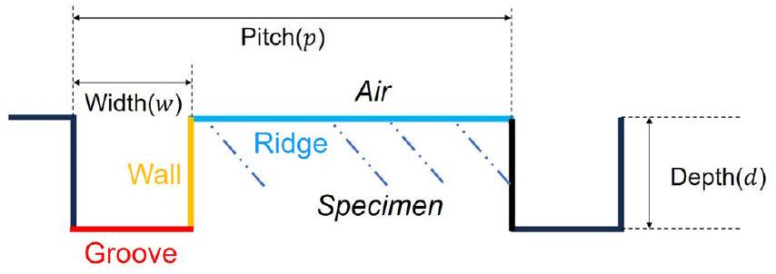

FIG. 1. Parameters of flaws.

and depth ( $0.04-0.21 \mathrm{~mm}$ ). Table I shows a list of parameters of profiles on the specimen. These ranges were set to imitate actual FAC thinning. ${ }^{19}$ Figure 2 shows typical specimens. The specimen on the left is a reference specimen without any flaws, while the specimens in the middle and on the right side have the narrowest and broadest flaw pitches, respectively.

## B. Experimental setup

Figure 3 shows the experimental setup. Figure 3(a) shows an overview of the measurement system, and Fig. 3 (b) shows a close-up view of the probe-specimen contact. The experimental equipment is listed below.
(1) Pulser-receiver: JPR-600C (Japan Probe Co., Yokohama, Japan).
(2) Probe: B5C5N (Japan Probe Co., Yokohama, Japan).
(3) Oscilloscope: MSOX 2014A (Agilent Technologies, Inc., Santa Clara, CA).
(4) Laptop personal computer (PC): Dynabook RX3W (Toshiba, Kawasaki, Japan).

The contact transducer, B5C5N, is a broadband longitudinal wave probe with a 5 mm diameter piezoelectric element, designed for normal incidence. The transducer emits one period, short sinusoidal bursts with an amplitude of 150 V , a gain of 0.9 dB , and a nominal central frequency of 5.0 MHz . The measured central frequency was 4.7 MHz with a full width at half maximum of 3.6 MHz . The reflected ultrasonic waves were sampled at 2.0 GHz by the oscilloscope. Based on the specimen thickness and pulse-echo reflection time, the longitudinal wave velocity was $5865 \mathrm{~m} / \mathrm{s}$.

Ultrasonic waves were incident from the probe placed on the smooth surface toward the rough surface. A total of ten measurements were conducted for each specimen, and the mean values were calculated to obtain the reflected waveform. In addition to the specimens shown in Table I, measurements were also conducted for the reference specimen with smooth surfaces.

TABLE I. Parameters of flaws on specimen. ${ }^{\text {a }}$
| Pitch $(p)(\mathrm{mm})$ | Depth $(d)(\mathrm{mm})$ |
| :—: | :—: |
| 1.25 | $0.05,0.10,0.14,0.20$ |
| 1.50 | $0.04,0.10,0.15,0.20$ |
| 1.75 | $0.04,0.10,0.15,0.21$ |
| 2.00 | $0.04,0.10,0.17,0.20$ |

[2](about:blank#fn2)

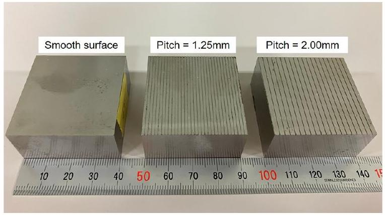

FIG. 2. Typical specimens.

## C. Simulation

In this study, we analyzed the propagation of ultrasonic waves under conditions similar to those in the experiment through simulation. We treated the carbon steel block shown in Fig. 2 as a two-dimensional isotropic elastic body and calculated the numerical solution to the elastic wave equation. The periodic grooves are linear features extending uniformly in one direction, and the simulation plane was set perpendicular to the groove direction, where the interaction between ultrasonic waves and the grooves predominantly occurs. The ultrasonic simulation was conducted using the FDTD method, where particle velocities and stresses are calculated alternately at grid points in the computational mesh. ${ }^{20,21}$ Equations (1) and (2) show the spatial and temporal derivatives of stress and particle velocity. In practice, Eqs. (1) and (2) were calculated using the central difference method,

$$
\left.\begin{array}{rl}
\frac{\partial}{\partial t}\left[\begin{array}{l}
-T_{1} \\
-T_{3} \\
-T_{5}
\end{array}\right] & =-\left[\begin{array}{ccc}
c_{11} & c_{13} & 0 \\
c_{31} & c_{11} & 0 \\
0 & 0 & c_{55}
\end{array}\right] \cdot\left[\begin{array}{c}
\frac{\partial \dot{u}}{\partial x} \\
\frac{\partial \dot{w}}{\partial z} \\
\frac{\partial \dot{u}}{\partial z}+\frac{\partial \dot{w}}{\partial x}
\end{array}\right], \\
\rho \frac{\partial}{\partial t}\left[\begin{array}{c}
\dot{u} \\
\dot{w}
\end{array}\right] & =-\left[\frac{\partial\left(-T_{1}\right)}{\partial x}+\frac{\partial\left(-T_{5}\right)}{\partial z}\right. \\
\frac{\partial\left(-T_{3}\right)}{\partial z}+\frac{\partial\left(-T_{5}\right)}{\partial x}
\end{array}\right],
$$

where $T_{1}$ and $T_{3}$ are the normal stresses in the $x$ and $z$ directions, $T_{5}$ is the shear stress, and $\dot{u}$ and $\dot{w}$ are the particle

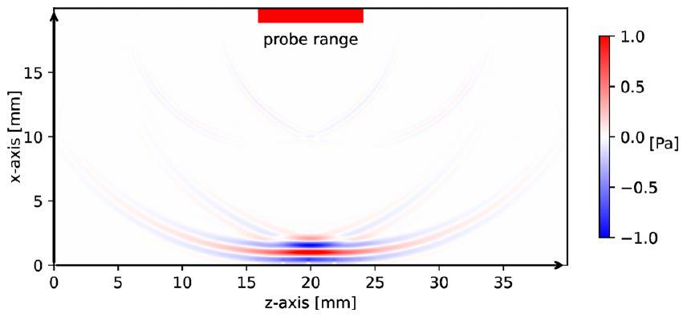

FIG. 4. FDTD simulation example of wave propagation (

$T_{1}$

).

velocity derivatives in the $x$ and $z$ directions. $c_{11}, c_{13}, c_{31}$, and $c_{55}$ are the stiffness tensor components. These stiffness tensor components can be expressed using the Lamé constants $\lambda, \mu$ as $c_{11}=\lambda+2 \mu, c_{13}=c_{31}=\lambda, c_{55}=\mu$. In order to match the experimental conditions (solid-air interface), the free boundary condition was set. The free boundary condition can be set by setting the stress nodes at the boundary surface to zero. The incident wave was modeled as a uniformly distributed $x$-direction normal stress $\left(T_{1}\right)$ over a 5 mm region corresponding to the probe contact area on the smooth surface. The waveform used was a longitudinal wave with a Hann window applied to a 4.7 MHz sine wave. Here, the wave number of the Hann window was set to 2.5. These parameters were set to reproduce the waveform used in the experiment. The reflected wave was recorded as the average value of the normal stress ( $T_{1}$ ) at the probe position. Figure 4 shows the propagation of the ultrasonic wave toward the center of the specimen.

Next, the physical parameters for the simulation are shown in Table II. The time step and mesh size were set to satisfy the Courant-Friedrichs-Lewy condition.

## D. Analysis

## 1. Input waveforms for the simulation

For clarity, we assigned names to the peaks and valleys of the waveform used in the simulation. Figure 5 shows the naming convention for these waveform features. The key waveform components were defined and named as “first valley,” “first peak,” “second valley,” and “second peak,” respectively. These names were used to identify which part

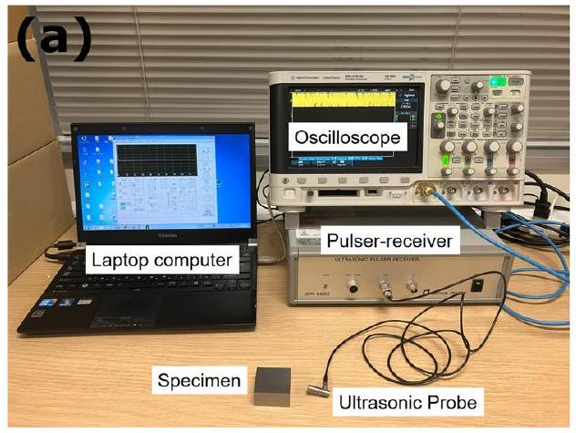

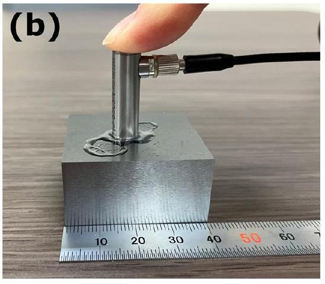

FIG. 3. Experimental setup. (a) Overview of the measurement system. (b) Close-up view of the probespecimen contact.

TABLE II. FDTD simulation parameters.
| Parameter | Value |
| :— | :— |
| $x$-direction length (mm) | 20 |
| $z$-direction length (mm) | 40 |
| Mesh size (mm) | 0.01 |
| Time step (ns) | 0.71 |
| Lamé’s constant ( $\lambda$ ) (GPa) | 95.2 |
| Lamé’s constant ( $\mu$ ) (GPa) | 81.1 |
| L-wave velocity (m/s) | 5730 |
| S-wave velocity (m/s) | 3194 |

of the incident waveform was responsible for generating a specific surface wave.

## 2. Fast Fourier transform (FFT)

This section explains the rectangular window function and FFT settings used to obtain the amplitude spectrum of waveforms from experiments and simulations. FFT was conducted by first applying the rectangular window function with a width of $2.05 \times 10^{-6} \mathrm{~s}$ to the whole waveform and then zero-padding the data until the data length reached $2^{14}$. The duration of the rectangular window function was set to cover the main waves and the tail waves that follows. In addition, when performing FFT, the time steps of the data obtained from simulations were matched to experimental data using third-order spline interpolation. In this study, tail waves were defined as wave components that occur after the amplitude of the waveform passes through zero for the first time after the “second peak.” When performing FFT on the tail waves only, the end of the rectangular window function was set to coincide with the end of the tail waves.

## III. RESULTS

## A. The validity of the simulation

Before analyzing the propagation process of ultrasonic waves in the simulation, the validity of the simulation is evaluated by comparing the data obtained from the experiment with the data obtained from the simulation. First, the

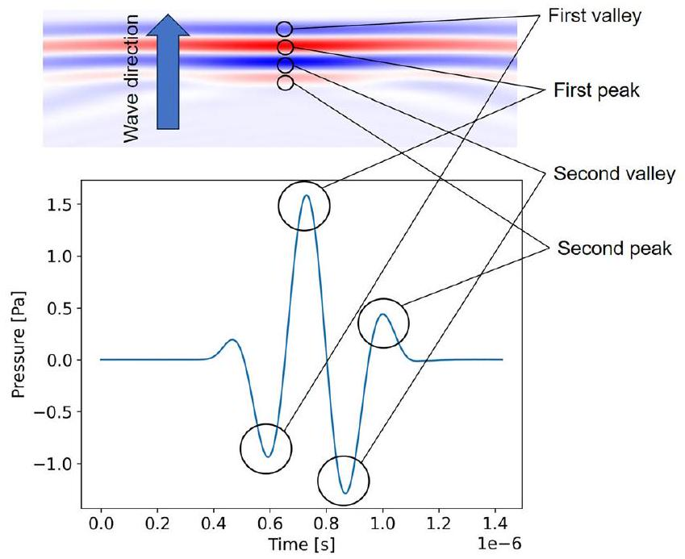

FIG. 5. The key waveform components name. (Top) The stress field visualization. (Bottom) The corresponding waveform in time domain.

reflected waves obtained from experiments and simulations are shown in Fig. 6 for both smooth and rough surfaces (pitch 1.25 mm , depth 0.20 mm ). In the case of periodic rough surfaces, in addition to amplitude attenuation, the pulsed wave if followed by small amplitude waves, tail waves.

Figure 7 shows amplitude spectra of reflected waves shown in Fig. 6. Wood anomalies were observed in these spectra of reflected wave containing tail waves for both the experimental and simulation results.

Figure 8 shows amplitude spectra of reflected waves from periodic surfaces listed in Table I. Here, these amplitude spectra were normalized by the amplitude spectrum from the smooth surface.

It can be observed in Fig. 8 that the simulated and experimental spectra are in good agreement in shape and amplitudes for all the pitches and all the depths. For each pitch, it is seen that the deeper narrow amplitude drop is observed at a frequency that decreases with the pitch, respectively about $5.0,4.0,3.5$, and 3.0 MHz . This seems to confirm the link between the pitch of the roughness and the

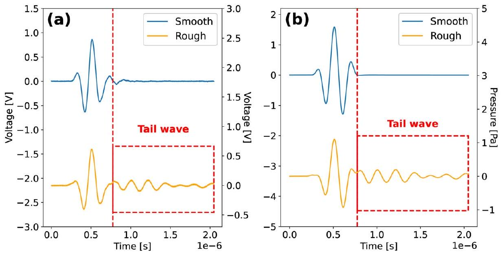

FIG. 6. Reflected waveform. (a) Experiment. (b) Simulation.

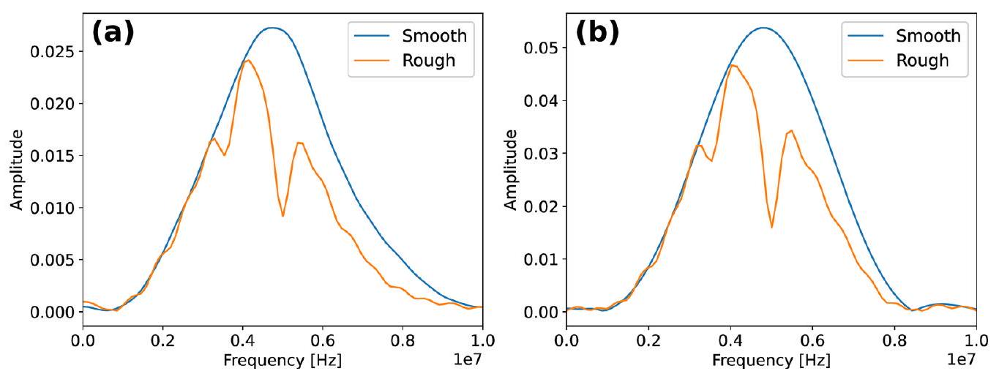

Fig. 7. Amplitude spectra. (a) Experiment. (b) Simulation.

wavelength of the generated surface waves. Also, for each pitch, it is seen that the larger the depth, the smaller the amplitude at a given frequency.

The quite good agreement between experiment and simulation shown in Fig. 8 seems to validate the numerical approach. So, we will use it to visualize the surface waves’ generation and propagation processes, which cannot be observed directly in the experiments. Figure 9 illustrates the positional relationship between the probe and flaws used for obtaining the longitudinal wave and the surface waves’ visualization shown in Fig. 10. The center of the probe was aligned with the center of the ridge. Since the specimen has periodic flaws, multiple ridges exist on its surface, but a ridge located near the center of the specimen was selected for recording the surface waves. Figures 10(a) and 10(b) show the longitudinal wave and surface waves along the $x$ axis and the $z$ axis, respectively, where the horizontal axis represents time and the vertical axis represents spatial coordinate. Since the boundary conditions require that stresses at the free surface be set to zero, the $x$ axis and $z$ axis were defined as shown in Fig. 9 and the surface waves were actually recorded at one grid edge inward from the boundary.

Figure 10(a) shows that the pulse wave was incident on the edge at $z=0$ at time $=3.5 \mu \mathrm{~s}$, which matches the
expected time of $3.49 \mu \mathrm{~s}$ ( 20 mm divided by $5730 \mathrm{~m} / \mathrm{s}$ ). Figure 10(b) shows that surface waves were generated at time $=3.5 \mu \mathrm{~s}$, propagating in both directions. The $T_{3}$ component along the surface of the $z$ axis represents the longitudinal wave component of the surface waves. The calculated velocity of the surface waves from Fig. 10(b) is $2916 \mathrm{~m} / \mathrm{s}$ : The surface waves traveled 1.75 mm in $0.6 \mu \mathrm{~s}$, which is consistent with the approximation of the Rayleigh wave being about $90 \%$ of the bulk shear wave’s velocity. Since the center of the probe and the center of the ridge coincide, it can be confirmed that surface waves propagate symmetrically along the ridge from both the left and right walls. In addition, Fig. 10(a) shows that the longitudinal wave component ( $T_{1}$ ) occurred on the ridge at $z=0$ when the surface waves reached the wall.

Figure 11 shows the particle velocity distribution in the depth direction at the center of the ridge when the $w$ component ( $z$-direction particle velocity) reaches its maximum amplitude. The amplitude is highest at the surface, exhibiting oscillation with a period of $\sim 0.6 \mathrm{~mm}$, corresponding to the surface wave wavelength.

Figure 12 shows the amplitude spectra of the tail waves and surface waves in the simulation. These spectra were normalized by the maximum value of each amplitude. The

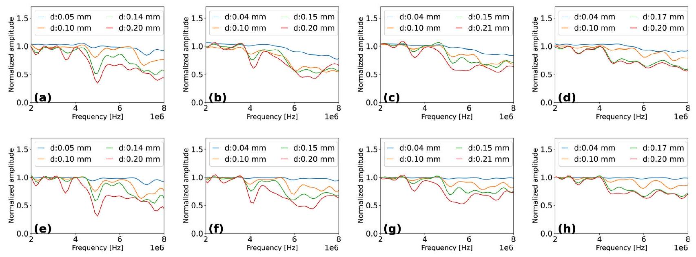

FIG. 8. Normalized amplitude spectra. (a) Experiment

$p 1.25 \mathrm{~mm}$

. (b) Experiment

$p 1.50 \mathrm{~mm}$

. (c) Experiment

$p 1.75 \mathrm{~mm}$

. (d) Experiment

$p 2.00 \mathrm{~mm}$

. (e) Simulation

$p 1.25 \mathrm{~mm}$

. (f) Simulation

$p 1.50 \mathrm{~mm}$

. (g) Simulation

$p 1.75 \mathrm{~mm}$

. (h) Simulation

$p 2.00 \mathrm{~mm}$

.

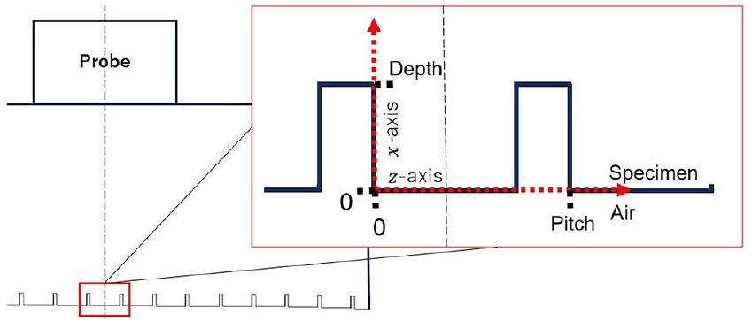

FIG. 9. Positional relationship between probe and flaw. The dashed line indicates that the center of the probe coincides with the center of the ridge.

surface waves were recorded directly below the probe, corresponding to the $T_{3}$ component on the $z$ axis at the middle of the ridge. Figure 12(a) shows that the peak of the amplitude occurs at 5.0 MHz for both tail waves and surface waves. As can be seen in Fig. 12(b), although there are differences in amplitude, there are frequency peaks at around 4.2 and 5.7 MHz , with a dip at around 5.8 MHz , which are common to both surface and tail waves.

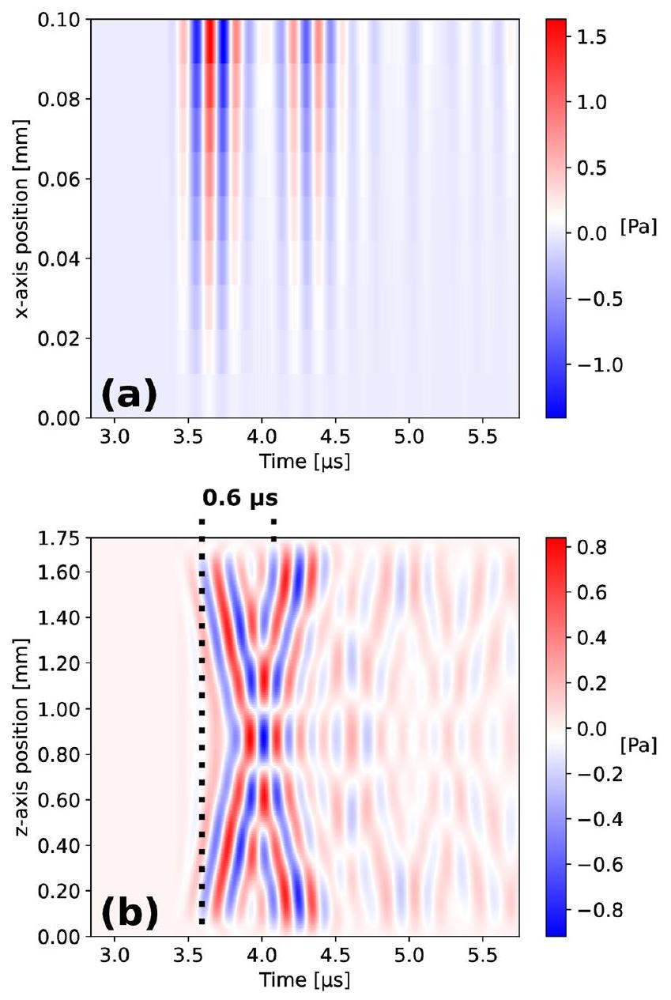

FIG. 10. Surface waves excited by pulse wave reflection on periodic rough surfaces (pitch 2.00 mm , depth 0.10 mm , ridge length 1.75 mm ). (a) The

$T_{1}$

component that occurred on the wall (

$z=0$

in Fig. 9). (b) The

$T_{3}$

component that occurred on the ridge (

$x=0$

in Fig. 9).

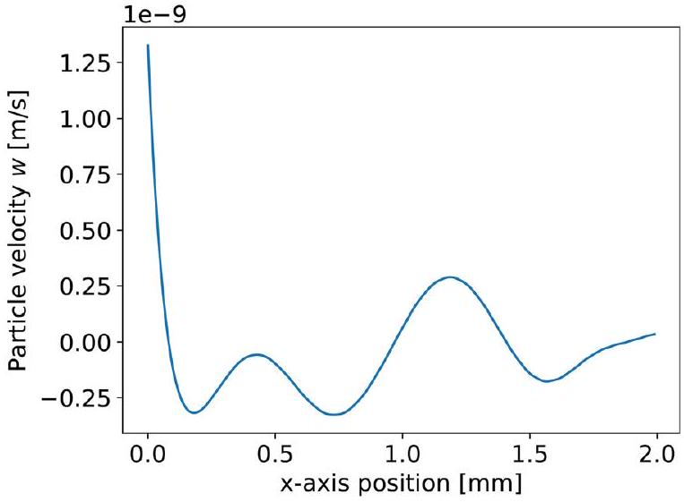

FIG. 11. Particle velocity distribution in the depth direction (

$x$

direction) at the center of the ridge when the particle velocity amplitude (

$w$

) reaches its maximum (pitch 2.00 mm , depth 0.10 mm ).

Figure 8 shows that the severe attenuation of the amplitude spectra due to the Wood anomaly increased with increasing depth. This is because the amplitude of the tail waves increases with depth. Figure 13 shows how the amplitude of tail waves and surface waves in simulation change with depth. Both graphs in Fig. 13 show that the amplitudes tend to increase with the flaws’ depth.

The validity of this simulation was confirmed by comparing the experimental and simulation results shown in Fig. 8 and by comparing amplitude spectra of the surface waves and tail waves shown in Fig. 12. These results are consistent with the double mode conversion assumption. ${ }^{5,6}$

## B. Surface wave propagation and tail wave formation

In this section, the excitation, propagation, and reconversion of surface waves into the bulk waves under the same conditions as in the experiment are analyzed by observing the $T_{1}$ and $T_{3}$ components near the rough surface. Figure 14 shows stress field visualization when a pulse wave is incident on the periodic rough surface. $T_{1}$, the normal stress in the $x$ axis, is shown on the left side. $T_{3}$, the normal stress in the $z$ axis, is shown on the right side. In Figs. 14(a)-14(d), white strips are visible in both $T_{1}$ and $T_{3}$ components, representing interference patterns between the incident and reflected waves. Figure 15 shows the comparison between rough and smooth surfaces at $t=3.64 \mu \mathrm{~s}$ [intermediate time between Figs. 14(a) and 14(b)], when interference occurs between the incident and reflected waves at the boundary. Similar white strips are observed in both cases, which confirms that these interference patterns are the result of the reflection process rather than the surface roughness itself. The red dotted line indicates the center of the probe, which is aligned with the center of the ridge. The origin of the $z$ axis is located at the left wall, as shown in Fig. 10. Figures 14(b)-14(e) show the excitation of surface waves that have the same amplitude corresponding to each peak or valley. The surface waves in Figs. 14(b)-14(e) were excited by the wave component shown in each preceding figure. From Figs. 14(f)-14(h), we can see the propagation of surface

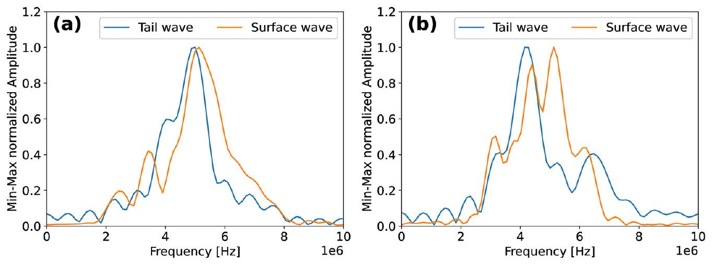

FIG. 12. Comparison of amplitude spectra of tail waves and surface waves in simulation. (a) Pitch 1.25 mm , depth 0.20 mm . (b) Pitch 2.00 mm , depth 0.20 mm .

waves excited by the second peak. In particular, Figs. 14(g) and 14(h) show the reconversion of surface waves into the bulk waves.

Surface waves are excited at discontinuity points, such as the junctions between the groove and the wall, along the rough surface and propagate across the surface. The simulation demonstrated that multiple surface waves interact, resulting in amplitude variations at different locations on the surface, similar to standing wave behavior. Figure 14(g) shows that mode conversion from the $T_{3}$ component to the $T_{1}$ component, i.e., reconversion from surface waves to bulk waves, occurs when surface waves amplify each other and the amplitude becomes large. Figure 14(h) shows that surface waves reach the wall, and bulk wave radiation can be
observed when surface waves propagate from the wall to the groove.

This reconversion of surface waves into bulk waves continues to occur as surface waves propagate along periodic rough surfaces and some wave components are reflected at the wall.

## IV. DISCUSSION

## A. Validation of the double mode conversion assumption through simulation

By comparing the reflected waveforms and their amplitude spectra from the experiments and simulations shown in Figs. 6-8, we found that the characteristic spectrum

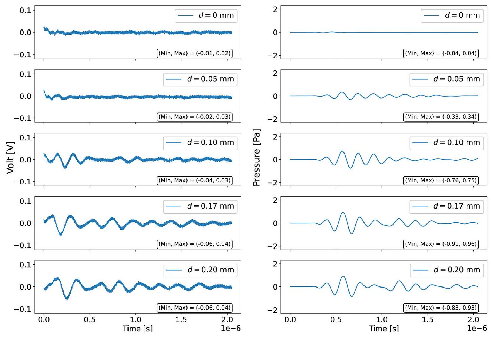

FIG. 13. Comparison of amplitude changes with flaw depth. (Left) Tail waves measured at the probe position in experiments. (Right) Surface waves measured at the surface (directly under the probe) in simulations.

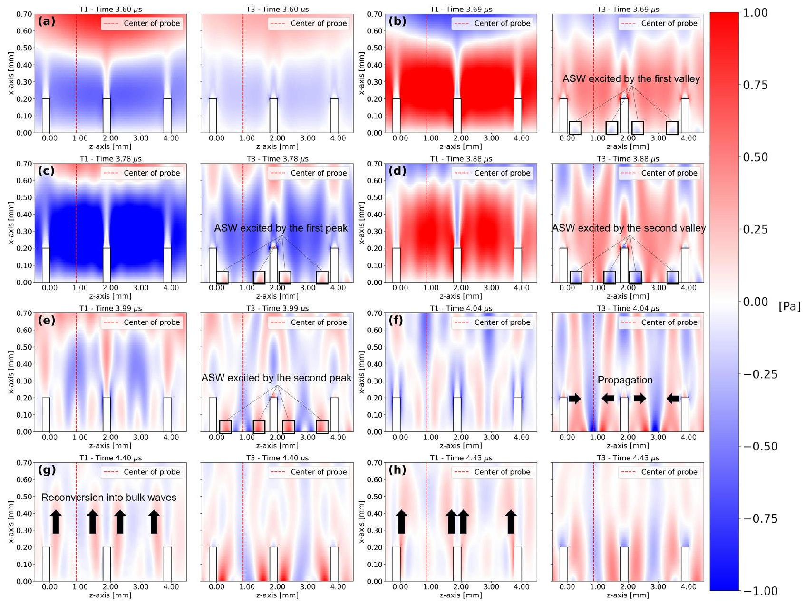

FIG. 14. The excitation, propagation, and reconversion of surface waves into bulk waves. (a) First valley arrival. (b) First peak arrival. (c) Second valley arrival. (d) Second peak arrival. (e) After second peak arrival and reflection. (f) Propagation of surface waves excited by second peak. (g) Reconversion of surface waves into bulk waves caused by surface waves’ amplification. (h) Reconversion of surface waves into bulk waves at the wall.

waveforms caused by the Wood anomalies were consistent between experimental and simulation results, thereby confirming the validity of the simulation approach.

Figure 12 showed a comparison of the amplitude spectra of surface waves and tail waves, revealing that the peaks and dips in amplitude were common to both waves. This result supports the double mode conversion assumption, ${ }^{5,6}$ based on amplitude spectral analysis, confirming that the surface waves visualized in Fig. 10 are the source of the tail waves.

Furthermore, visualizing the ultrasonic wave propagation process near the rough surface in Fig. 14 enabled detailed observation of surface waves’ generation, propagation, and reconversion to bulk waves, which had been difficult to observe experimentally. Figures 14(b)-14(e) show surface waves’ excitation corresponding to each valley and peak at discontinuity points of the periodic rough surfaces. Figures 14(g) and 14(h) confirm the reconversion process from surface waves to bulk waves, providing a more detailed visualization of the conversion process shown in

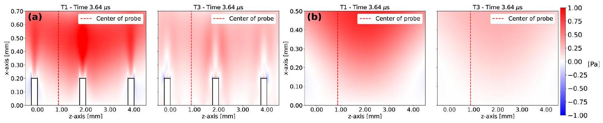

FIG. 15. Comparison of stress field visualization between rough and smooth surfaces at

$t=3.64 \mu \mathrm{~s}$

, showing interference patterns at the boundary during the reflection process. (a) Rough surface (pitch 1.25 mm , depth 0.20 mm ). (b) Smooth surface. White strips representing interference between incident and reflected waves are visible at the boundary in both cases, confirming these patterns result from the reflection process rather than surface roughness.

Fig. 9. Notably, Fig. 14(g) showed that reconversion to bulk waves occurs not only at discontinuities but also at points where surface waves amplitude increases.

## B. Effect of geometry of periodic roughness on Wood anomaly

Based on the experimental and simulation results in Fig. 8, pitch determines the frequency bands’ occurring attenuation, and depth determines the degree of the attenuation. This can be explained by the following mechanism: As shown in Fig. 14, surface waves propagate along periodic rough surfaces and are progressively reconverted into bulk waves at multiple locations. The propagation distance of surface waves and the positions where constructive interference occurs are determined by the pitch. Consequently, the time difference between the tail waves and the main waves, as well as the frequency components of the tail waves, depends on the pitch, which in turn determines the frequency position of the deeps in the spectra resulting from interferences between the tail waves’ components and the main reflected longitudinal wave.

The effect of depth can be explained by referring to Fig. 13. As the depth increases, the amplitude of both surface and tail waves tends to increase. Ultrasonic waves are incident parallel to the wall, where surface waves are expected to be excited. As the depth increases and the wall becomes taller, larger amplitude surface waves are excited. Consequently, larger amplitude tail waves are formed and attenuation due to the wood anomaly becomes more pronounced. Based on these findings, the factors and processes leading to the generation of tail waves that cause Wood anomalies have therefore been clarified through experiments and simulations.

## V. CONCLUSION

In this study, we conducted detailed analysis of ultrasonic wave reflection behavior on periodic rough surfaces, particularly focusing on tail waves’ generation that causes acoustic Wood anomalies, through both experimental and simulation approaches. As a result, we demonstrated the double mode conversion assumption, which had been theoretically predicted, through actual visualization of ultrasonic wave propagation processes. First, to validate the simulation, we calculated ultrasonic reflected waves under the same conditions as the experiments and obtained good agreement with experimental results. Additionally, we compared the spectra of surface waves and tail waves obtained from simulations, which also showed good agreement. Furthermore, by visualizing the reflection process near the rough surface in simulations, we provided detailed visualization of surface waves generation, propagation, and reconversion to bulk waves, which are difficult to observe experimentally. It was also revealed that reconversion to bulk waves occurs not only at discontinuity points but also through surface waves’ amplitude amplification due to interference.

The acoustic Wood anomalies investigated in this study show potential applications for improving ultrasonic inspection techniques in the NDT field, particularly for detecting wall thinning with periodic flaws in pipes caused by FAC. By detecting the change patterns in amplitude spectra due to acoustic Wood anomalies, more effective defect evaluation methods are expected to be developed. Furthermore, this research provides a theoretical foundation for surface waves’ control technologies in SAW devices and metamaterial design. Future challenges include verification and analysis of more complex cases, such as imperfect periodic rough surfaces like actual corrosion damage, and other shapes of periodic rough surfaces. The simulation method used in this study is expected to serve as an effective tool for these advanced research developments.

## ACKNOWLEDGMENTS

Part of the work was carried out under the Collaborative Research Project of the Institute of Fluid Science, Tohoku University (J25Ly03).

## AUTHOR DECLARATIONS Conflict of Interest

The authors have no conflicts to disclose.

## DATA AVAILABILITY

The data that support the findings of this study are available from the corresponding author upon reasonable request.
${ }^{1}$ J. Liu and N. F. Declercq, “Pulsed ultrasonic comb filtering effect and its applications in the measurement of sound velocity and thickness of thin plates,” Ultrasonics 75, 199-208 (2017).
${ }^{2}$ J. Liu and N. F. Declercq, “Investigation of the origin of acoustic Wood anomaly,” J. Acoust. Soc. Am. 138(2), 1168-1179 (2015).
${ }^{3}$ J. Liu and N. F. Declercq, “Acoustic Wood anomaly in transmitted diffraction field,” J. Appl. Phys. 121(11), 114902 (2017).
${ }^{4}$ J. Liu, K. Wang, and N. F. Declercq, “New perspectives on the physical origin of acoustic wood anomalies,” Acta Acust. united Acust. 105, 265272 (2019).
${ }^{5}$ A. Jungman, L. Adler, and G. Quentin, “Ultrasonic anomalies in the spectrum of acoustic waves diffracted by periodic interfaces,” J. Appl. Phys. 53(7), 4673-4680 (1982).
${ }^{6}$ J. M. Claeys, O. Leroy, A. Jungman, and L. Adler, “Diffraction of ultrasonic waves from periodically rough liquid-solid surface,” J. Appl. Phys. 54(10), 5657-5662 (1983).
${ }^{7}$ R. W. Wood, “On a remarkable case of uneven distribution of light in a diffraction grating spectrum,” Proc. Phys. Soc. London 18(1), 269-275 (1902).
${ }^{8}$ L. Rayleigh, “III. Note on the remarkable case of diffraction spectra described by Prof. Wood,” London, Edinburgh Dublin Philos. Mag. J. Sci. 14(79), 60-65 (1907).
${ }^{9}$ Y. Gulyaev and V. Plessky, “Propagation of acoustic surface waves in periodic structures,” Usp. Fiz. Nauk 157, 85-127 (1989).
${ }^{10}$ H. Estrada, V. Gómez-Lozano, A. Uris, P. Candelas, F. Belmar, and F. Meseguer, “Sound transmission through plates perforated with two periodic subwavelength hole arrays,” J. Phys.: Condens. Matter 23(13), 135401 (2011).
${ }^{11}$ N. Saffari and L. J. Bond, “Body to Rayleigh wave mode-conversion at steps and slots,” J. Nondestruct. Eval. 6(1), 1-22 (1987).
${ }^{12}$ C. Yi, Y. J. Yoo, Y. J. Kim, K. W. Kim, Y. Lee, and J. Y. Rhee, “Role of Wood’s anomaly in the performance of metamaterial absorbers with
periodicity comparable to wavelength,” J. Phys. D: Appl. Phys. 49(19), 195103 (2016).
${ }^{13}$ S. Herbison, J. Weide, and N. Declercq, “Observation of ultrasonic backward beam displacement in transmission through a solid having superimposed periodicity,” Appl. Phys. Lett. 97, 041908 (2010).
${ }^{14}$ C. Nash, P. Karve, and D. Adams, “Diagnosing nuclear power plant pipe wall thinning due to flow accelerated corrosion using a passive, thermal non-destructive evaluation method: Feasibility assessment via numerical experiments,” Nucl. Eng. Des. 386, 111542 (2022).
${ }^{15}$ H. Nakamoto, K. Fujii, P. Guy, and T. Uchimoto, “Effect of periodic rough surface on ultrasonic pulse-echo signal,” in 2024 IEEE Sensors, Kobe, Japan (IEEE, New York, 2024), pp. 1-4.
${ }^{16}$ H. Nakamoto, K. Terada, P. Guy, and T. Uchimoto, “Effects of rough reflection surface frequency spectrum ultrasonic wave,” in Selected Papers from the International Symposium on Applied Electromagnetics and Mechanics (IOS Press, Amsterdam, the Netherlands, 2025), Vol. 48, pp. 132-139.
${ }^{17}$ H. Nakamoto, K. Terada, P. Guy, and T. Uchimoto, “Comparison of random and periodic rough surfaces by ultrasonic attenuation and frequency distribution,” Int. J. Appl. Electromagnet. Mech. 71(1_suppl), S429-S436 (2023).
${ }^{18}$ C. N. Nguyen, Y. Kurokawa, and H. Inoue, “Evaluation of the height of internal periodic triangular surfaces by ultrasonic backscatter,” Mech. Eng. J. 5(2), 17-00585 (2018).
${ }^{19}$ J. M. Pietralik, “The role of flow in flow accelerated corrosion under nuclear power plant conditions,” J. Adv. Maint. 4, 63-78 (2012).
${ }^{20}$ M. Sato, FDTD-hō ni Yoru Dansei Shindō Hadō no Kaiseki Nyūmon (Basic Analysis of Elastic Vibrations and Waves by FDTD Method) (Morikita Publishing, Tokyo, Japan, 2003), pp. 34-62.
${ }^{21}$ M. Sato, “Application of the finite-difference time-domain method and total-field/scattered field formulation to scattering phenomena in solids,” Acoust. Sci. Technol. 28(4), 260-270 (2007).

---

1. ${ }^{\text {a) }}$ Email: nakamoto@panda.kobe-u.ac.jp[↩︎](about:blank#fnref1)
2. ${ }^{\mathrm{a}}$ Note: The width $(w)$ is common, 0.25 mm .[↩︎](about:blank#fnref2)