# 2026_超音波_JASA（和訳版）

# 音響ウッド異常における表面波の発生とテイル波形成の可視化

Kotaro Fujii, ${ }^{1}$ Hiroyuki Nakamoto, ${ }^{1, a)}$ (D) Philippe Guy, ${ }^{2}$ (D) and Tetsuya Uchimoto ${ }^{3,4}$ (D)

${ }^{1}$ 神戸大学大学院 システム情報学研究科、神戸市 657-8501、日本
${2}$ リヨン国立応用科学院（INSA Lyon）、振動・音響研究所、リヨン 69621、フランス
${3}$ 東北大学 流体科学研究所、仙台市 980-8577、日本
${4}$ ELyTMaX IRL3757（CNRS、リヨン大学、INSA Lyon、リヨン中央理工科学校、クロード・ベルナール・リヨン第1大学、東北大学）、仙台市 980-8577、日本

### 要約（Abstract）

音響ウッド異常（Acoustic Wood anomalies）は、周期的な表面から反射された波のスペクトルにおいて、特定の周波数で急峻な振幅のピークやディップが生じる現象である。理論的研究では「二重モード変換理論（double mode conversion theory）」が提案されており、周期的な粗面においてバルク波が表面波に変換され、再びバルク波に再変換された成分（テイル波：tail waves）が、鏡面反射（メイン波）と遅れて干渉することで生じると示唆されている。しかし、実験的な検証は依然として不十分である。本研究では、波動伝搬プロセスの可視化を通じて表面波とテイル波の関係を明らかにするとともに、周期的な表面形状によるテイル波形成の変化の原因を特定する。
ピッチと深さを変化させた矩形の周期プロファイルを持つ炭素鋼試験片を用い、パルス反射法による実験を行った。また、実験と同一条件下での超音波伝搬を有限差分時間領域（FDTD）シミュレーションにより可視化した。シミュレーションデータは実験データと良好な一致を示し、シミュレーション手法の妥当性が確認された。振幅スペクトル解析により、表面波とテイル波が共通の周波数特性を持つことが明らかになり、二重モード変換の仮定が裏付けられた。シミュレーションにより、表面波の発生、伝搬、およびバルク波への再変換の可視化に成功し、表面波からのテイル波形成の詳細が実証された。

© 2026 Acoustical Society of America. https://doi.org/10.1121/10.0042999

（2025年10月26日受領、2026年1月26日改訂、2026年2月23日受理、2026年3月16日オンライン公開）
[Editor: Dan Zhao]
Pages: 2477-2486

## I. はじめに（INTRODUCTION）

音響ウッド異常（Acoustic Wood anomalies）は、周期的な表面から反射された波の振幅スペクトルにおいて、特定の周波数で急峻なピークやディップが生じる現象である。Liuらは、コムフィルタリング効果がこれらの異常に寄与していることを示した[1]。この現象は、信号がそれ自体の遅延バージョンと組み合わされたときに発生する。本研究の場合では、鏡面反射されたパルス波（以下「メイン波」）と、メイン波に対して遅れて反射された波（以下「テイル波」）の組み合わせである[1-4]。また、テイル波は周期的な粗面によって回折された成分であることも明らかにされている。JungmanらおよびClaeysらは、三角形の周期プロファイルを持つ表面について実験的および理論的な解析を行った[5,6]。彼らは、周期的な表面でバルク波が表面波にモード変換され、その後に再びバルク波に再変換された成分が鏡面反射成分と干渉するという理論的見解（以下「二重モード変換」の仮定）を提案した。さらに、二重モード変換の仮定に基づいて特定の周波数でスペクトルのディップが発生することを予測し、これらの予測は実験値と一致した。

前述のように、光学的なウッド異常の観察[7,8]に応答してLord Rayleighによって提案された回折の概念に基づき、音響ウッド異常の理論に関して様々な仮定が議論されてきた。しかし、表面波の測定や可視化が実験的に困難であるため、二重モード変換の仮定によって予測される発生、伝搬、および再変換プロセスの実験的検証は限られており、特にテイル波形成や音響ウッド異常との詳細な関係については不十分であった。

一部の研究では、非破壊検査（NDT）、弾性表面波（SAW）デバイス、およびメタマテリアルへの応用の可能性を求めて、音響ウッド異常と周期的な粗面によって変換された表面波の解析に焦点を当てている[9-13]。配管のNDTの分野では、配管の健全性監視のために、流れ加速型腐食（FAC）によって引き起こされる周期的なきずを伴う減肉を検出する必要がある[14]。いくつかの研究では、この周期的なきずを伴う減肉を測定するための超音波手法が調査されている。中本らは、周期的な矩形プロファイルを持つ表面からの反射波を解析した。彼らは、ウッド異常が周期的な粗面のピッチと深さに応じて、反射波の振幅スペクトルに変化をもたらすことを報告した[15-17]。Nguyenらは、複数の角度で得られた反射波から三角形の周期的な粗面のピッチと深さを予測する手法を開発した[18]。しかし、この手法はウッド異常を利用していない。パルス反射法を用いて配管の厚さを測定する場合、超音波は主に垂直に入射し、反射波間の時間差が利用される。もし反射波に音響ウッド異常が発生すれば、厚さ測定に使用されるのと同じ波形データを使用して、複数の角度での測定を行うことなく、周期的な粗面の形状を予測することも可能になる。周期的な粗面のプロファイルを予測するためには、表面波がテイル波形成にどのように寄与し、その結果としてどのようなスペクトル異常が生じるかを理解することが不可欠である。本研究では、代表的なケースとして矩形の周期プロファイルに焦点を当て、表面波とプロファイルパラメータの関係を解析する。

本論文の目的は、表面波とテイル波の関係を明らかにし、周期的な粗面の形状によるテイル波形成の変化の原因を特定することである。明確化のために、本研究では、表面波を「粗面における入射バルク波からモード変換され、表面に沿って伝搬する波動成分」と定義する。テイル波は、二重モード変換の仮定に基づき、「表面波が周期的な表面でのモード変換を通じてバルク波に再変換される結果として探触子で観察される、時間遅延した信号成分」と定義する。具体的には、NDTで一般的に使用されるパルス反射法を用いて、異なるピッチと深さの矩形周期粗面を持つ炭素鋼ブロック試験片を使用して実験を行った。また、実験と同じ条件下で有限差分時間領域（FDTD）超音波シミュレーションも実施した。実験とシミュレーションの間で反射パルス波を比較してシミュレーション精度を検証した後、シミュレーションを用いて周期的な粗面近傍での超音波パルス波の反射と表面波の発生を可視化した。このアプローチにより、実験的に観察することが困難であった表面波の発生、伝搬、およびバルク波への再変換プロセスの詳細な解明が可能になり、音響ウッド異常に関する二重モード変換の仮定の数値的な検証が提供される。さらに、シミュレーションベースの解析を実施し、周期的な表面形状がテイル波の振幅および周波数特性に与える影響を調査した。

## II. 手法（METHODS）

## A. 試験片（Specimens）

試験片は、サイズ $40 \times 40 \mathrm{~mm}^2$、厚さ $20 \mathrm{~mm}$ の17個の炭素鋼ブロックで構成されている。各試験片の一方の面には、直線パターンで配置された矩形の周期プロファイルがあり、他の面はすべて滑らかである。図1にプロファイルパラメータの概要を示す。きずの幅を「width」、きずの間隔を「pitch」とする。明確化のために、きずとその周辺領域を次のように定義する：凹んだ領域を「溝（groove）」、凹んでいない領域を「山（ridge）」、それらの間の領域を「壁（wall）」とする。各試験片は、ピッチ（$1.25 \sim 2.00 \mathrm{~mm}$）と深さ（$0.04 \sim 0.21 \mathrm{~mm}$）の異なる組み合わせを持っている。表Iに試験片のプロファイルパラメータの一覧を示す。これらの範囲は、実際の流動加速型腐食（FAC）による減肉を模倣するように設定されている[19]。図2に代表的な試験片を示す。

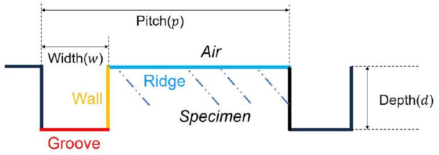
図1. きずのパラメータ。

左側の試験片はきずのない参照試験片であり、中央と右側の試験片はそれぞれ最も狭いピッチと最も広いピッチのきずを持っている。

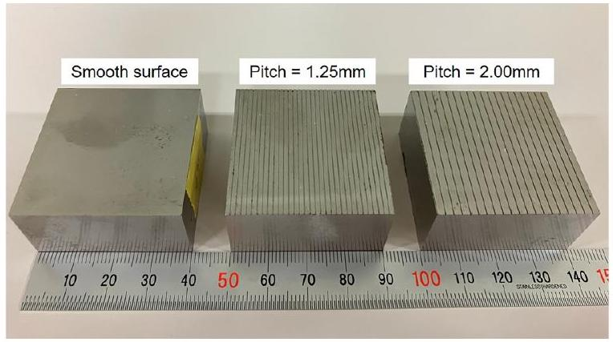
図2. 代表的な試験片。

## B. 実験装置（Experimental setup）

図3に実験装置を示す。図3(a)は測定システムの概要、図3(b)は探触子と試験片の接触部の拡大図である。実験機器を以下に列挙する。
(1) パルサ・レシーバ：JPR-600C（ジャパンプレーブ株式会社、横浜、日本）。
(2) 探触子：B5C5N（ジャパンプレーブ株式会社、横浜、日本）。
(3) オシロスコープ：MSOX 2014A（アジレント・テクノロジー株式会社、サンタクララ、カリフォルニア）。
(4) ノートパソコン（PC）：Dynabook RX3W（東芝、川崎、日本）。

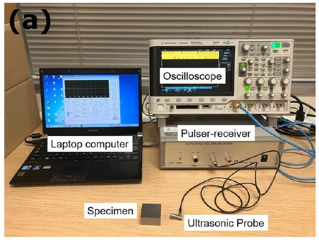
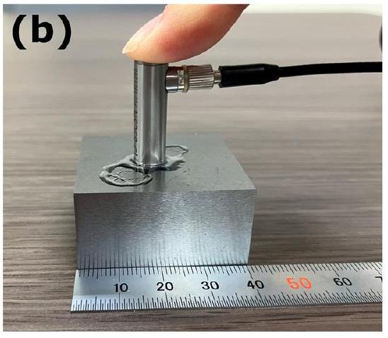
図3. 実験装置。(a) 測定システムの概要。(b) 探触子と試験片の接触部の拡大図。

接触型振動子 B5C5N は、直径 $5 \mathrm{~mm}$ の圧電素子を備えた広帯域縦波探触子であり、垂直入射用に設計されている。この振動子は、振幅 $150 \mathrm{~V}$、ゲイン $0.9 \mathrm{~dB}$、公称中心周波数 $5.0 \mathrm{~MHz}$ の1周期の短い正弦波バーストを放出する。測定された中心周波数は $4.7 \mathrm{~MHz}$ であり、半値全幅は $3.6 \mathrm{~MHz}$ であった。反射された超音波は、オシロスコープによって $2.0 \mathrm{GHz}$ でサンプリングされた。試験片の厚さとパルス反射の時間に基づき、縦波速度は $5865 \mathrm{~m} / \mathrm{~s}$ であった。

超音波は、滑らかな面上に配置された探触子から粗面に向かって入射された。各試験片について合計10回の測定が行われ、反射波形を得るために平均値が計算された。表Iに示された試験片に加えて、滑らかな表面を持つ参照試験片についても測定が行われた。

表I. 試験片上のきずのパラメータ。
| ピッチ $(p)(\mathrm{mm})$ | 深さ $(d)(\mathrm{mm})$ |
| :—: | :—: |
| 1.25 | $0.05, 0.10, 0.14, 0.20$ |
| 1.50 | $0.04, 0.10, 0.15, 0.20$ |
| 1.75 | $0.04, 0.10, 0.15, 0.21$ |
| 2.00 | $0.04, 0.10, 0.17, 0.20$ |

## C. シミュレーション（Simulation）

本研究では、シミュレーションを通じて、実験と同様の条件下での超音波の伝搬を解析した。図2に示す炭素鋼ブロックを二次元等方性弾性体として扱い、弾性波動方程式の数値解を計算した。周期的な溝は一方向に均一に伸びる直線的な特徴であり、シミュレーション平面は、超音波と溝の間の相互作用が主に発生する溝の方向に対して垂直に設定された。超音波シミュレーションはFDTD法を使用して行われ、計算メッシュ内の格子点で粒子速度と応力が交互に計算される[20, 21]。式(1)および(2)は、応力と粒子速度の空間および時間微分を示している。実際には、式(1)および(2)は中心差分法を使用して計算された。

$$
\left.\begin{array}{rl}
\frac{\partial}{\partial t}\left[\begin{array}{l}
-T_{1} \\
-T_{3} \\
-T_{5}
\end{array}\right] & =-\left[\begin{array}{ccc}
c_{11} & c_{13} & 0 \\
c_{31} & c_{11} & 0 \\
0 & 0 & c_{55}
\end{array}\right] \cdot\left[\begin{array}{c}
\frac{\partial \dot{u}}{\partial x} \\
\frac{\partial \dot{w}}{\partial z} \\
\frac{\partial \dot{u}}{\partial z}+\frac{\partial \dot{w}}{\partial x}
\end{array}\right], \\
\rho \frac{\partial}{\partial t}\left[\begin{array}{c}
\dot{u} \\
\dot{w}
\end{array}\right] & =-\left[\begin{array}{c}
\frac{\partial\left(-T_{1}\right)}{\partial x}+\frac{\partial\left(-T_{5}\right)}{\partial z} \\
\frac{\partial\left(-T_{3}\right)}{\partial z}+\frac{\partial\left(-T_{5}\right)}{\partial x}
\end{array}\right],
\end{array}\right\} \quad (1), (2)
$$

ここで、$T_1$ と $T_3$ は $x$ および $z$ 方向の垂直応力、$T_5$ はせん断応力であり、$\dot{u}$ と $\dot{w}$ は $x$ および $z$ 方向の粒子速度微分である。 $c_{11}, c_{13}, c_{31}, c_{55}$ は剛性テンソル成分である。これらの剛性テンソル成分は、ラメの定数 $\lambda, \mu$ を用いて $c_{11}=\lambda+2\mu, c_{13}=c_{31}=\lambda, c_{55}=\mu$ と表すことができる。実験条件（固体-空気界面）に合わせるために、自由境界条件が設定された。自由境界条件は、境界面の応力ノードをゼロに設定することで設定できる。入射波は、滑らかな面上の探触子接触領域に対応する $5 \mathrm{~mm}$ の領域にわたって均一に分布した $x$ 方向垂直応力（$T_1$）としてモデル化された。使用された波形は、$4.7 \mathrm{~MHz}$ の正弦波にハニング窓を適用した縦波である。ここで、ハニング窓の波数は 2.5 に設定された。これらのパラメータは、実験で使用された波形を再現するように設定された。反射波は、探触子位置における垂直応力（$T_1$）の平均値として記録された。図4に、試験片の中心に向かう超音波の伝搬を示す。

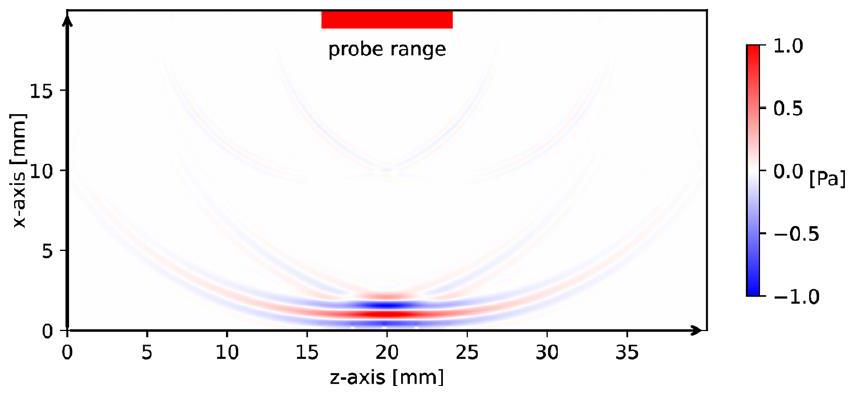
図4. 波動伝搬のFDTDシミュレーション例（$T_1$）。

次に、シミュレーションの物理パラメータを表IIに示す。時間ステップとメッシュサイズは、クーラン・フリードリヒス・レーヴィ（CFL）条件を満たすように設定された。

表II. FDTDシミュレーションパラメータ。
| パラメータ | 値 |
| :— | :— |
| $x$ 方向の長さ (mm) | 20 |
| $z$ 方向の長さ (mm) | 40 |
| メッシュサイズ (mm) | 0.01 |
| 時間ステップ (ns) | 0.71 |
| ラメの定数 ($\lambda$) (GPa) | 95.2 |
| ラメの定数 ($\mu$) (GPa) | 81.1 |
| 縦波速度 (m/s) | 5730 |
| 横波速度 (m/s) | 3194 |

## D. 解析（Analysis）

## 1. シミュレーション用の入力波形

明確化のために、シミュレーションで使用される波形のピークと谷に名称を割り当てた。図5に、これらの波形の特徴の命名規則を示す。主要な波形成分は、それぞれ「第1の谷（first valley）」、「第1のピーク（first peak）」、「第2の谷（second valley）」、および「第2のピーク（second peak）」と定義され、命名された。これらの名称は、入射波形のどの部分が特定の表面波の発生に関与しているかを識別するために使用された。

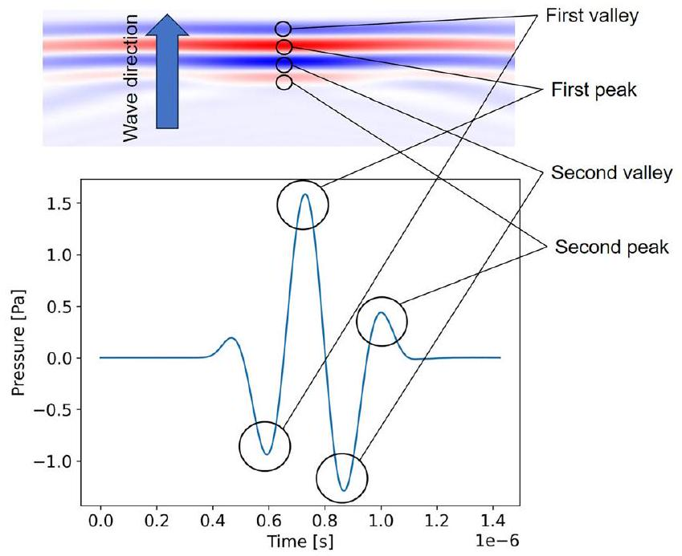
図5. 主要な波形成分の名称。（上）応力場の可視化。（下）時間領域における対応する波形。

## 2. 高速フーリエ変換（FFT）

本セクションでは、実験およびシミュレーションからの波形の振幅スペクトルを得るために使用される矩形窓関数とFFTの設定について説明する。FFTは、まず波形全体に幅 $2.05 \times 10^{-6} \mathrm{~s}$ の矩形窓関数を適用し、次にデータ長が $2^{14}$ に達するまでデータをゼロパディングすることによって行われた。矩形窓関数の持続時間は、メイン波とその後に続くテイル波をカバーするように設定された。さらに、FFTを実行する際、シミュレーションから得られたデータの時間ステップは、三次スプライン補間を使用して実験データと一致させられた。本研究では、テイル波は「第2のピーク」の後に波形の振幅が初めてゼロを通過した後に発生する波動成分として定義された。テイル波のみに対してFFTを実行する場合、矩形窓関数の終端はテイル波の終端と一致するように設定された。

## III. 結果（RESULTS）

## A. シミュレーションの妥当性（The validity of the simulation）

シミュレーションにおける超音波の伝搬プロセスを分析する前に、実験から得られたデータとシミュレーションから得られたデータを比較することで、シミュレーションの妥当性を評価する。まず、平滑面と粗面（ピッチ $1.25 \mathrm{~mm}$、深さ $0.20 \mathrm{~mm}$）の両方について、実験とシミュレーションから得られた反射波を図6に示す。周期的な粗面の場合、振幅の減衰に加えて、パルス波の後に小さな振幅の波であるテイル波が続いている。

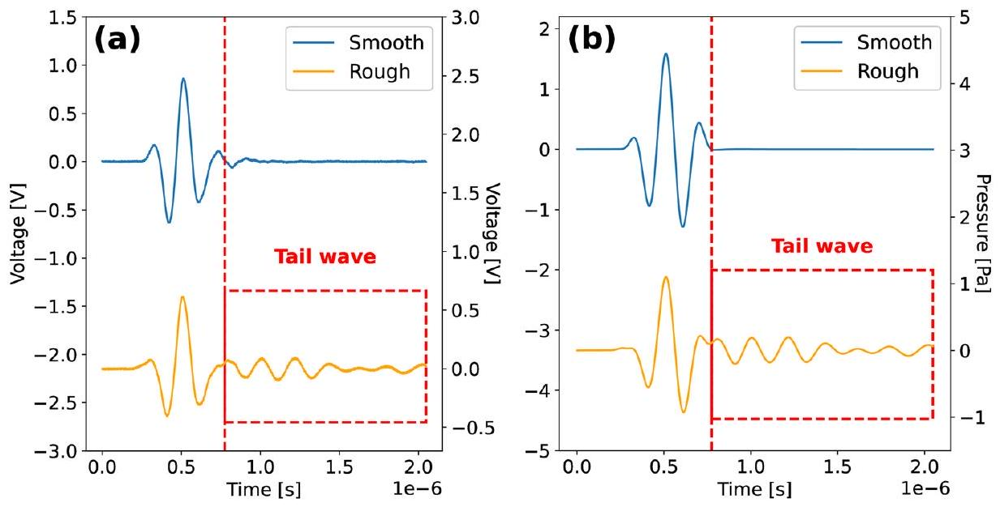
図6. 反射波形。(a) 実験。(b) シミュレーション。

図7は、図6に示した反射波の振幅スペクトルである。実験結果とシミュレーション結果の両方において、テイル波を含む反射波のスペクトルにウッド異常が観察された。

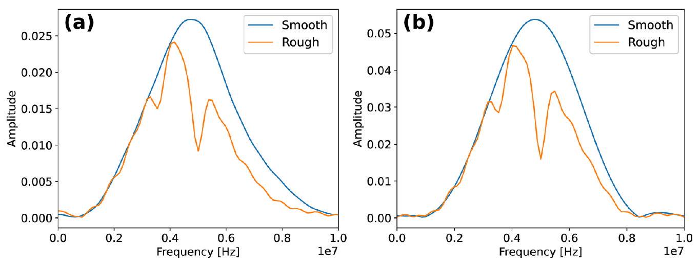
図7. 振幅スペクトル。(a) 実験。(b) シミュレーション。

図8は、表Iにリストされた周期的な表面からの反射波の振幅スペクトルを示している。ここで、これらの振幅スペクトルは、平滑面からの振幅スペクトルによって正規化されている。

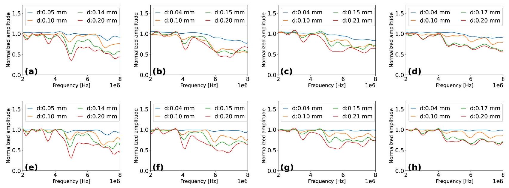
図8. 正規化された振幅スペクトル。(a)〜(d) 実験 (ピッチ 1.25, 1.50, 1.75, 2.00 mm)。(e)〜(h) シミュレーション (ピッチ 1.25, 1.50, 1.75, 2.00 mm)。

図8から、シミュレートされたスペクトルと実験スペクトルは、すべてのピッチとすべての深さにおいて、形状と振幅が良好に一致していることが観察できる。各ピッチについて、より深い狭い振幅のドロップが、ピッチとともに減少する周波数（それぞれ約 5.0、4.0、3.5、および 3.0 MHz）で観察されることがわかる。これは、粗面のピッチと生成された表面波の波長との間のリンクを裏付けているように思われる。また、各ピッチについて、深さが大きくなるほど、特定の周波数での振幅が小さくなることがわかる。

図8に示された実験とシミュレーションの非常に良好な一致は、数値的アプローチの妥当性を裏付けているように思われる。そこで、実験では直接観察できない表面波の発生および伝搬プロセスを可視化するために、これを使用する。図9は、図10に示す縦波および表面波の可視化を得るために使用された、探触子ときずの位置関係を示している。探触子の中心は山の中心に合わせられた。

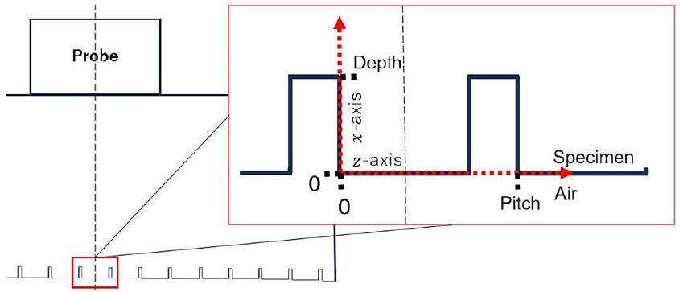
図9. 探触子ときずの位置関係。破線は、探触子の中心が山の中心と一致していることを示す。

試験片は周期的なきずを持っているため、その表面には複数の山が存在するが、表面波を記録するために試験片の中心近くに位置する山が選択された。図10(a)および10(b)は、それぞれ $x$ 軸および $z$ 軸に沿った縦波および表面波を示しており、横軸は時間、縦軸は空間座標を表している。境界条件により、自由表面での応力をゼロに設定する必要があるため、$x$ 軸と $z$ 軸は図9に示すように定義され、表面波は実際には境界から1グリッド内側で記録された。

図10(a)は、パルス波が時刻 $=3.5 \mu \mathrm{~s}$ に $z=0$ のエッジに入射したことを示しており、これは期待される時刻 $3.49 \mu \mathrm{~s}$（$20 \mathrm{~mm}$ を $5730 \mathrm{~m} / \mathrm{~s}$ で割った値）と一致している。図10(b)は、時刻 $=3.5 \mu \mathrm{~s}$ に表面波が発生し、両方向に伝搬していることを示している。 $z$ 軸の表面に沿った $T_3$ 成分は、表面波の縦波成分を表している。図10(b)から計算された表面波の速度は $2916 \mathrm{~m} / \mathrm{~s}$ である。表面波は $0.6 \mu \mathrm{~s}$ で $1.75 \mathrm{~mm}$ 移動しており、これはレイリー波がバルクせん断波の速度の約 $90 \%$ であるという近似と一致している。探触子の中心と山の中心が一致しているため、表面波が左右両方の壁から山に沿って対称に伝搬することが確認できる。さらに、図10(a)は、表面波が壁に到達したときに、山上の $z=0$ において縦波成分（$T_1$）が発生したことを示している。

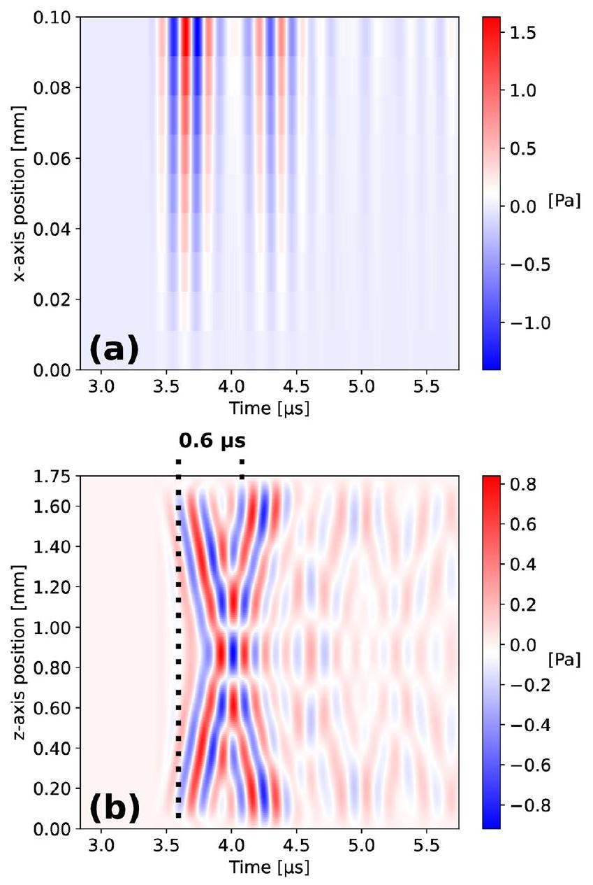
図10. 周期的な粗面上のパルス波反射によって励起された表面波（ピッチ 2.00 mm, 深さ 0.10 mm, 山の長さ 1.75 mm）。(a) 壁（図9の $z=0$）で発生した $T_1$ 成分。(b) 山（図9の $x=0$）で発生した $T_3$ 成分。

図11は、$w$ 成分（$z$ 方向粒子速度）が最大振幅に達したときの、山の中心における深さ方向の粒子速度分布を示している。振幅は表面で最も高く、表面波の波長に対応する $\sim 0.6 \mathrm{~mm}$ の周期で振動している。

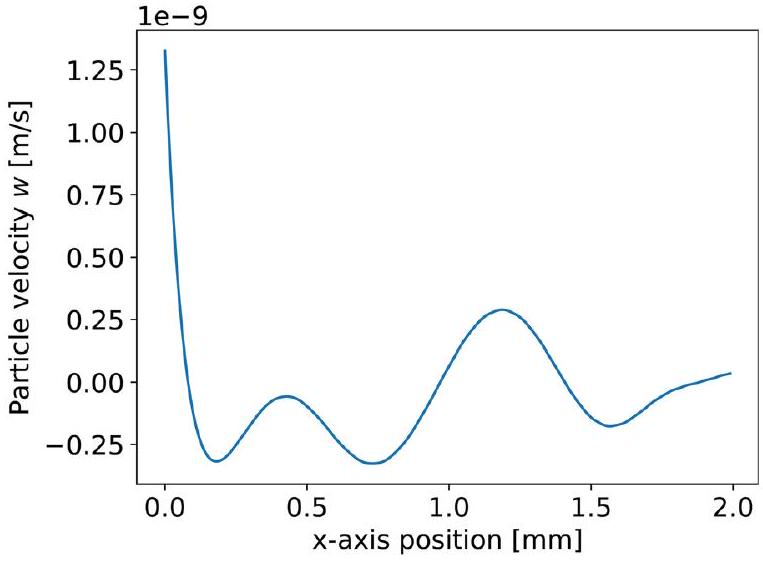
図11. 粒子速度振幅 ($w$) が最大に達したときの、山の中心における深さ方向 ($x$ 方向) の粒子速度分布 (ピッチ 2.00 mm, 深さ 0.10 mm)。

図12は、シミュレーションにおけるテイル波と表面波の振幅スペクトルを示している。これらのスペクトルは、各振幅の最大値によって正規化されている。表面波は、山の中心における $z$ 軸上の $T_3$ 成分に対応する、探触子の直下で記録された。図12(a)は、テイル波と表面波の両方について、振幅のピークが 5.0 MHz で発生することを示している。図12(b)で見られるように、振幅に違いはあるものの、4.2 MHz と 5.7 MHz 付近に周波数のピークがあり、5.8 MHz 付近にディップがあり、これらは表面波とテイル波の両方に共通している。

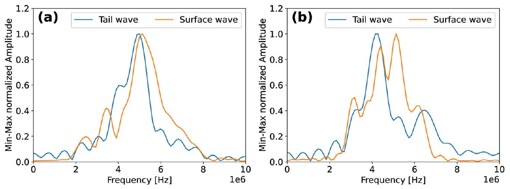
図12. シミュレーションにおけるテイル波と表面波の振幅スペクトルの比較。(a) ピッチ 1.25 mm, 深さ 0.20 mm。(b) ピッチ 2.00 mm, 深さ 0.20 mm。

図8は、ウッド異常による振幅スペクトルの激しい減衰が、深さの増加とともに増大したことを示している。これは、テイル波の振幅が深さとともに増加するためである。図13は、シミュレーションにおけるテイル波と表面波の振幅が深さとともにどのように変化するかを示している。図13の両方のグラフは、振幅がきずの深さとともに増加する傾向があることを示している。

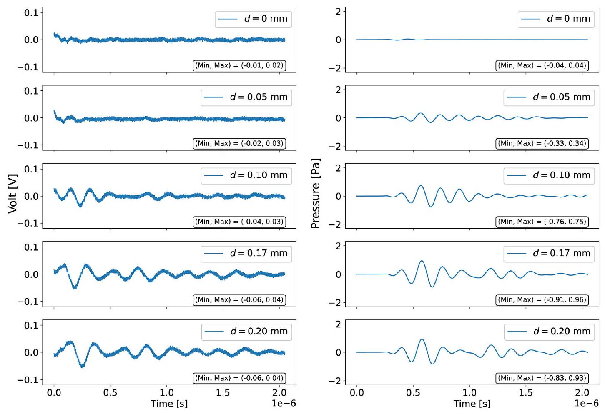
図13. きずの深さによる振幅変化の比較。（左）実験における探触子位置でのテイル波。（右）シミュレーションにおける表面（探触子の直下）での表面波。

このシミュレーションの妥当性は、図8に示す実験結果とシミュレーション結果の比較、および図12に示す表面波とテイル波の振幅スペクトルの比較によって確認された。これらの結果は、二重モード変換の仮定と一致している[5, 6]。

## B. 表面波の伝搬とテイル波の形成（Surface wave propagation and tail wave formation）

本セクションでは、粗面近傍の $T_1$ および $T_3$ 成分を観察することにより、実験と同じ条件下での表面波の励起、伝搬、およびバルク波への再変換を解析する。図14は、超音波パルス波が周期的な粗面に入射したときの応力場の可視化を示している。左側には $x$ 軸の垂直応力である $T_1$ が示されている。右側には $z$ 軸の垂直応力である $T_3$ が示されている。図14(a)〜(d)では、 $T_1$ および $T_3$ 成分の両方に白い筋が見え、入射波と反射波の間の干渉パターンを表している。

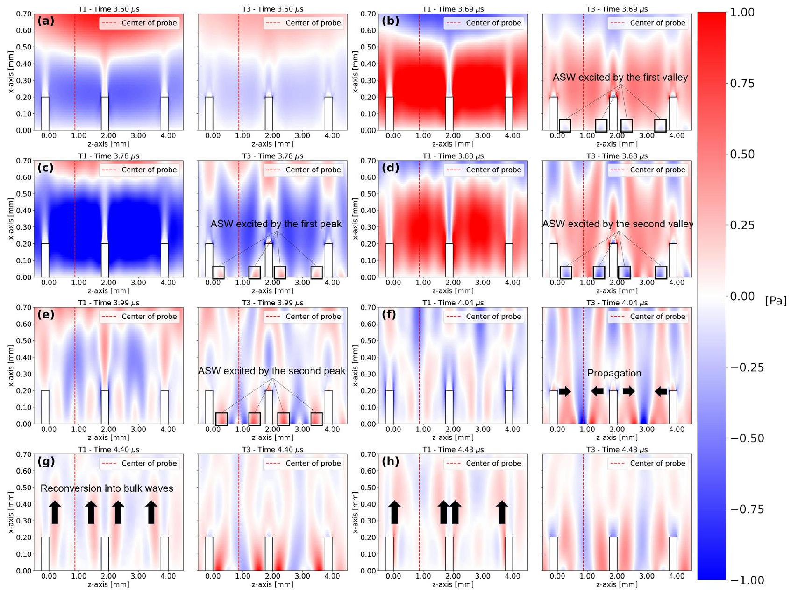
図14. 表面波の励起、伝搬、およびバルク波への再変換。(a) 第1の谷の到達。(b) 第1のピークの到達。(c) 第2の谷の到達。(d) 第2のピークの到達。(e) 第2のピークの到達と反射の後。(f) 第2のピークによって励起された表面波の伝搬。(g) 表面波の増幅によるバルク波への再変換。(h) 壁における表面波からバルク波への再変換。

図15は、境界面で入射波と反射波の間に干渉が発生する $t = 3.64 \mu \mathrm{~s}$ [図14(a)と14(b)の中間時刻]における、粗面と平滑面の比較を示している。

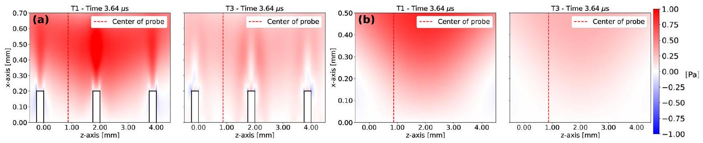
図15. 反射プロセス中の境界面における干渉パターンを示す、粗面と平滑面の間の応力場可視化の比較 ($t=3.64 \mu \mathrm{~s}$)。(a) 粗面 (ピッチ 1.25 mm, 深さ 0.20 mm)。(b) 平滑面。

両方のケースで同様の白い筋が観察され、これらの干渉パターンは表面の粗さ自体ではなく反射プロセスの結果であることを裏付けている。赤い点線は探触子の中心を示しており、これは山の中心と一致している。 $z$ 軸の原点は、図10に示すように左側の壁に位置している。図14(b)〜(e)は、各ピークまたは谷に対応する同じ振幅を持つ表面波の励起を示している。図14(b)〜(e)の表面波は、それぞれの直前の図に示されている波動成分によって励起された。図14(f)〜(h)からは、第2のピークによって励起された表面波の伝搬を見ることができる。特に、図14(g)と14(h)は、表面波からバルク波への再変換を示している。

表面波は、粗面に沿った溝と壁の接合部などの不連続点で励起され、表面を横切って伝搬する。シミュレーションは、複数の表面波が相互作用し、定在波の挙動と同様に、表面上の異なる場所で振幅の変化をもたらすことを示した。図14(g)は、$T_3$ 成分から $T_1$ 成分へのモード変換、すなわち表面波からバルク波への再変換が、表面波が互いに増幅し合い、振幅が大きくなったときに発生することを示している。図14(h)は、表面波が壁に到達し、表面波が壁から溝へと伝搬するときにバルク波の放射が観察できることを示している。

表面波からバルク波へのこの再変換は、表面波が周期的な粗面に沿って伝搬し、一部の波動成分が壁で反射されるにつれて発生し続ける。

## IV. 考察（DISCUSSION）

## A. シミュレーションによる二重モード変換仮定の検証（Validation of the double mode conversion assumption through simulation）

図6〜8に示した実験とシミュレーションの反射波形とその振幅スペクトルを比較することにより、ウッド異常によって引き起こされる特徴的なスペクトル波形が実験結果とシミュレーション結果の間で一致していることが分かり、シミュレーションアプローチの妥当性が確認された。

図12は、表面波とテイル波の振幅スペクトルの比較を示しており、振幅のピークとディップが両方の波に共通していることを明らかにした。この結果は、振幅スペクトル解析に基づいて二重モード変換の仮定[5, 6]を裏付けており、図10で可視化された表面波がテイル波の波源であることを裏付けている。

さらに、図14で粗面近傍の超音波伝搬プロセスを可視化したことにより、実験的に観察することが困難であった表面波の発生、伝搬、およびバルク波への再変換プロセスの詳細な観察が可能になった。図14(b)〜(e)は、周期的な粗面の不連続点における各谷とピークに対応する表面波の励起を示している。図14(g)および14(h)は、表面波からバルク波への再変換プロセスを裏付けており、図9に示された変換プロセスのより詳細な可視化を提供している。特に、図14(g)は、バルク波への再変換が不連続点だけでなく、表面波の振幅が増大する点でも発生することを示した。

## B. 周期的な粗面の形状がウッド異常に与える影響（Effect of geometry of periodic roughness on Wood anomaly）

図8の実験およびシミュレーション結果に基づくと、ピッチは減衰が発生する周波数帯域を決定し、深さは減衰の程度を決定する。これは次のメカニズムによって説明できる。図14に示すように、表面波は周期的な粗面に沿って伝搬し、複数の場所で段階的にバルク波へと再変換される。表面波の伝搬距離と強め合う干渉が発生する位置は、ピッチによって決定される。その結果、テイル波とメイン波の時間差、およびテイル波の周波数成分はピッチに依存し、これがテイル波の成分とメインの反射縦波との間の干渉から生じるスペクトルのディップの周波数位置を決定する。

深さの影響は、図13を参照することで説明できる。深さが増すにつれて、表面波とテイル波の両方の振幅が増加する傾向がある。超音波は壁に平行に入射し、そこで表面波が励起されることが期待される。深さが増して壁が高くなるにつれて、より大きな振幅の表面波が励起される。その結果、より大きな振幅のテイル波が形成され、ウッド異常による減衰がより顕著になる。これらの知見に基づき、ウッド異常を引き起こすテイル波の発生に至る要因とプロセスが、実験とシミュレーションを通じて解明された。

## V. 結論（CONCLUSION）

本研究では、実験とシミュレーションの両方のアプローチを通じて、周期的な粗面における超音波の反射挙動、特に音響ウッド異常を引き起こすテイル波の発生について詳細な解析を行った。その結果、理論的に予測されていた二重モード変換の仮定を、超音波伝搬プロセスの実際の可視化を通じて実証した。まず、シミュレーションを検証するために、実験と同じ条件下で超音波反射波を計算し、実験結果と良好な一致を得た。さらに、シミュレーションから得られた表面波とテイル波のスペクトルを比較し、これらも良好な一致を示した。さらに、シミュレーションにおいて粗面近傍の反射プロセスを可視化することにより、実験的に観察することが困難な、表面波の発生、伝搬、およびバルク波への再変換プロセスの詳細な可視化を提供した。また、バルク波への再変換は不連続点だけでなく、干渉による表面波の振幅増幅を通じても発生することが明らかになった。

本研究で調査された音響ウッド異常は、NDT分野における超音波検査技術の向上、特にFACによって引き起こされる配管の周期的なきずを伴う減肉の検出に対して、応用の可能性を示している。音響ウッド異常による振幅スペクトルの変化パターンを検出することで、より効果的な欠陥評価手法が開発されることが期待される。さらに、本研究は、SAWデバイスやメタマテリアル設計における表面波制御技術の理論的基礎を提供する。今後の課題には、実際の腐食損傷のような不完全な周期的粗面や、他の形状の周期的粗面など、より複雑なケースの検証と解析が含まれる。本研究で使用されたシミュレーション手法は、これらの高度な研究開発のための効果的なツールとして役立つことが期待される。
