# 2020_mml-book-354-375

## Density Estimation with Gaussian Mixture Models

In earlier chapters, we covered already two fundamental problems in machine learning: regression (Chapter 9) and dimensionality reduction (Chapter 10). In this chapter, we will have a look at a third pillar of machine learning: density estimation. On our journey, we introduce important concepts, such as the expectation maximization (EM) algorithm and a latent variable perspective of density estimation with mixture models.

When we apply machine learning to data we often aim to represent data in some way. A straightforward way is to take the data points themselves as the representation of the data; see Figure 11.1 for an example. However, this approach may be unhelpful if the dataset is huge or if we are interested in representing characteristics of the data. In density estimation, we represent the data compactly using a density from a parametric family, e.g., a Gaussian or Beta distribution. For example, we may be looking for the mean and variance of a dataset in order to represent the data compactly using a Gaussian distribution. The mean and variance can be found using tools we discussed in Section 8.3: maximum likelihood or maximum a posteriori estimation. We can then use the mean and variance of this Gaussian to represent the distribution underlying the data, i.e., we think of the dataset to be a typical realization from this distribution if we were to sample from it.

Figure 11.1
Two-dimensional dataset that cannot be meaningfully represented by a Gaussian.

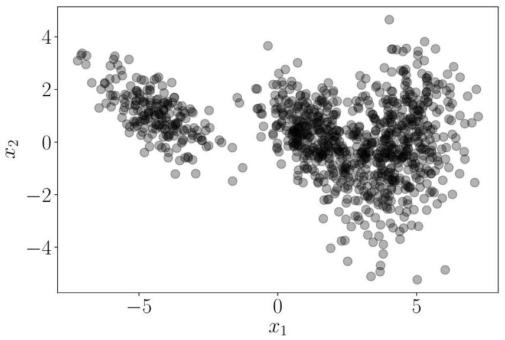

This material is published by Cambridge University Press as Mathematics for Machine Learning by Marc Peter Deisenroth, A. Aldo Faisal, and Cheng Soon Ong (2020). This version is free to view and download for personal use only. Not for re-distribution, re-sale, or use in derivative works. (c)by M. P. Deisenroth, A. A. Faisal, and C. S. Ong, 2024. https://mml-book.com.

In practice, the Gaussian (or similarly all other distributions we encountered so far) have limited modeling capabilities. For example, a Gaussian approximation of the density that generated the data in Figure 11.1 would be a poor approximation. In the following, we will look at a more expressive family of distributions, which we can use for density estimation: mixture models.

Mixture models can be used to describe a distribution $p(\boldsymbol{x})$ by a convex combination of $K$ simple (base) distributions

$$
\begin{aligned}
& p(\boldsymbol{x})=\sum_{k=1}^{K} \pi_{k} p_{k}(\boldsymbol{x}) \\
& 0 \leqslant \pi_{k} \leqslant 1, \quad \sum_{k=1}^{K} \pi_{k}=1
\end{aligned}
$$

where the components $p_{k}$ are members of a family of basic distributions, e.g., Gaussians, Bernoullis, or Gammas, and the $\pi_{k}$ are mixture weights. Mixture models are more expressive than the corresponding base distributions because they allow for multimodal data representations, i.e., they can describe datasets with multiple “clusters”, such as the example in Figure 11.1.

We will focus on Gaussian mixture models (GMMs), where the basic distributions are Gaussians. For a given dataset, we aim to maximize the likelihood of the model parameters to train the GMM. For this purpose, we will use results from Chapter 5, Chapter 6, and Section 7.2. However, unlike other applications we discussed earlier (linear regression or PCA), we will not find a closed-form maximum likelihood solution. Instead, we will arrive at a set of dependent simultaneous equations, which we can only solve iteratively.

### 11.1 Gaussian Mixture Model

A Gaussian mixture model is a density model where we combine a finite number of $K$ Gaussian distributions $\mathcal{N}\left(\boldsymbol{x} \mid \boldsymbol{\mu}_{k}, \boldsymbol{\Sigma}_{k}\right)$ so that

$$
\begin{aligned}
& p(\boldsymbol{x} \mid \boldsymbol{\theta})=\sum_{k=1}^{K} \pi_{k} \mathcal{N}\left(\boldsymbol{x} \mid \boldsymbol{\mu}_{k}, \boldsymbol{\Sigma}_{k}\right) \\
& 0 \leqslant \pi_{k} \leqslant 1, \quad \sum_{k=1}^{K} \pi_{k}=1
\end{aligned}
$$

where we defined $\boldsymbol{\theta}:=\left\{\boldsymbol{\mu}_{k}, \boldsymbol{\Sigma}_{k}, \pi_{k}: k=1, \ldots, K\right\}$ as the collection of all parameters of the model. This convex combination of Gaussian distribution gives us significantly more flexibility for modeling complex densities than a simple Gaussian distribution (which we recover from (11.3) for $K=1)$. An illustration is given in Figure 11.2, displaying the weighted

Gaussian mixture model

Figure 11.2 Gaussian mixture model. The Gaussian mixture distribution (black) is composed of a convex combination of Gaussian distributions and is more expressive than any individual component. Dashed lines represent the weighted Gaussian components.

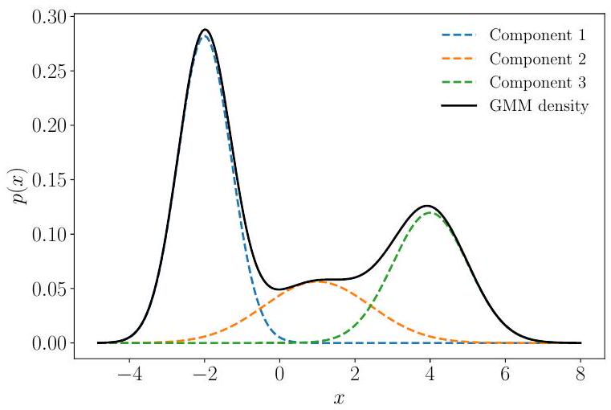

components and the mixture density, which is given as

$$
p(x \mid \boldsymbol{\theta})=0.5 \mathcal{N}\left(x \mid-2, \frac{1}{2}\right)+0.2 \mathcal{N}(x \mid 1,2)+0.3 \mathcal{N}(x \mid 4,1) .
$$

### 11.2 Parameter Learning via Maximum Likelihood

Assume we are given a dataset $\mathcal{X}=\left\{\boldsymbol{x}_{1}, \ldots, \boldsymbol{x}_{N}\right\}$, where $\boldsymbol{x}_{n}, n= 1, \ldots, N$, are drawn i.i.d. from an unknown distribution $p(\boldsymbol{x})$. Our objective is to find a good approximation/representation of this unknown distribution $p(\boldsymbol{x})$ by means of a GMM with $K$ mixture components. The parameters of the GMM are the $K$ means $\boldsymbol{\mu}_{k}$, the covariances $\boldsymbol{\Sigma}_{k}$, and mixture weights $\pi_{k}$. We summarize all these free parameters in $\boldsymbol{\theta}:= \left\{\pi_{k}, \boldsymbol{\mu}_{k}, \boldsymbol{\Sigma}_{k}: k=1, \ldots, K\right\}$.

## Example 11.1 (Initial Setting)

Figure 11.3 Initial setting: GMM (black) with mixture three mixture components (dashed) and seven data points (discs).

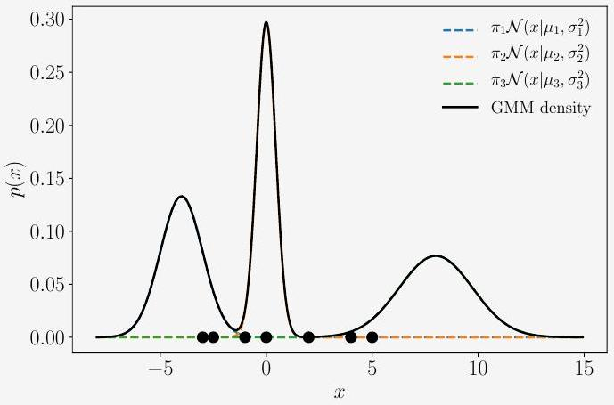

Throughout this chapter, we will have a simple running example that helps us illustrate and visualize important concepts.

We consider a one-dimensional dataset $\mathcal{X}=\{-3,-2.5,-1,0,2,4,5\}$ consisting of seven data points and wish to find a GMM with $K=3$ components that models the density of the data. We initialize the mixture components as

$$
\begin{aligned}
& p_{1}(x)=\mathcal{N}(x \mid-4,1) \\
& p_{2}(x)=\mathcal{N}(x \mid 0,0.2) \\
& p_{3}(x)=\mathcal{N}(x \mid 8,3)
\end{aligned}
$$

and assign them equal weights $\pi_{1}=\pi_{2}=\pi_{3}=\frac{1}{3}$. The corresponding model (and the data points) are shown in Figure 11.3.

In the following, we detail how to obtain a maximum likelihood estimate $\boldsymbol{\theta}_{\mathrm{ML}}$ of the model parameters $\boldsymbol{\theta}$. We start by writing down the likelihood, i.e., the predictive distribution of the training data given the parameters. We exploit our i.i.d. assumption, which leads to the factorized likelihood

$$
p(\mathcal{X} \mid \boldsymbol{\theta})=\prod_{n=1}^{N} p\left(\boldsymbol{x}_{n} \mid \boldsymbol{\theta}\right), \quad p\left(\boldsymbol{x}_{n} \mid \boldsymbol{\theta}\right)=\sum_{k=1}^{K} \pi_{k} \mathcal{N}\left(\boldsymbol{x}_{n} \mid \boldsymbol{\mu}_{k}, \boldsymbol{\Sigma}_{k}\right),
$$

where every individual likelihood term $p\left(\boldsymbol{x}_{n} \mid \boldsymbol{\theta}\right)$ is a Gaussian mixture density. Then we obtain the log-likelihood as

$$
\log p(\mathcal{X} \mid \boldsymbol{\theta})=\sum_{n=1}^{N} \log p\left(\boldsymbol{x}_{n} \mid \boldsymbol{\theta}\right)=\underbrace{\sum_{n=1}^{N} \log \sum_{k=1}^{K} \pi_{k} \mathcal{N}\left(\boldsymbol{x}_{n} \mid \boldsymbol{\mu}_{k}, \boldsymbol{\Sigma}_{k}\right)}_{=: \mathcal{L}} .
$$

We aim to find parameters $\boldsymbol{\theta}_{\mathrm{ML}}^{*}$ that maximize the $\log$-likelihood $\mathcal{L}$ defined in (11.10). Our “normal” procedure would be to compute the gradient $\mathrm{d} \mathcal{L} / \mathrm{d} \boldsymbol{\theta}$ of the log-likelihood with respect to the model parameters $\boldsymbol{\theta}$, set it to $\mathbf{0}$, and solve for $\boldsymbol{\theta}$. However, unlike our previous examples for maximum likelihood estimation (e.g., when we discussed linear regression in Section 9.2), we cannot obtain a closed-form solution. However, we can exploit an iterative scheme to find good model parameters $\boldsymbol{\theta}_{\mathrm{ML}}$, which will turn out to be the EM algorithm for GMMs. The key idea is to update one model parameter at a time while keeping the others fixed.
Remark. If we were to consider a single Gaussian as the desired density, the sum over $k$ in (11.10) vanishes, and the log can be applied directly to the Gaussian component, such that we get

$$
\log \mathcal{N}(\boldsymbol{x} \mid \boldsymbol{\mu}, \boldsymbol{\Sigma})=-\frac{D}{2} \log (2 \pi)-\frac{1}{2} \log \operatorname{det}(\boldsymbol{\Sigma})-\frac{1}{2}(\boldsymbol{x}-\boldsymbol{\mu})^{\top} \boldsymbol{\Sigma}^{-1}(\boldsymbol{x}-\boldsymbol{\mu})
$$

This simple form allows us to find closed-form maximum likelihood estimates of $\boldsymbol{\mu}$ and $\boldsymbol{\Sigma}$, as discussed in Chapter 8. In (11.10), we cannot move
the log into the sum over $k$ so that we cannot obtain a simple closed-form maximum likelihood solution.

Any local optimum of a function exhibits the property that its gradient with respect to the parameters must vanish (necessary condition); see Chapter 7. In our case, we obtain the following necessary conditions when we optimize the log-likelihood in (11.10) with respect to the GMM parameters $\boldsymbol{\mu}_{k}, \boldsymbol{\Sigma}_{k}, \pi_{k}$ :

$$
\begin{aligned}
\frac{\partial \mathcal{L}}{\partial \boldsymbol{\mu}_{k}} & =\mathbf{0}^{\top} \Longleftrightarrow \sum_{n=1}^{N} \frac{\partial \log p\left(\boldsymbol{x}_{n} \mid \boldsymbol{\theta}\right)}{\partial \boldsymbol{\mu}_{k}}=\mathbf{0}^{\top}, \\
\frac{\partial \mathcal{L}}{\partial \boldsymbol{\Sigma}_{k}} & =\mathbf{0} \Longleftrightarrow \sum_{n=1}^{N} \frac{\partial \log p\left(\boldsymbol{x}_{n} \mid \boldsymbol{\theta}\right)}{\partial \boldsymbol{\Sigma}_{k}}=\mathbf{0}, \\
\frac{\partial \mathcal{L}}{\partial \pi_{k}} & =0 \Longleftrightarrow \sum_{n=1}^{N} \frac{\partial \log p\left(\boldsymbol{x}_{n} \mid \boldsymbol{\theta}\right)}{\partial \pi_{k}}=0 .
\end{aligned}
$$

For all three necessary conditions, by applying the chain rule (see Section 5.2.2), we require partial derivatives of the form

$$
\frac{\partial \log p\left(\boldsymbol{x}_{n} \mid \boldsymbol{\theta}\right)}{\partial \boldsymbol{\theta}}=\frac{1}{p\left(x_{n} \mid \theta\right)} \frac{\partial p\left(\boldsymbol{x}_{n} \mid \boldsymbol{\theta}\right)}{\partial \boldsymbol{\theta}},
$$

where $\boldsymbol{\theta}=\left\{\boldsymbol{\mu}_{k}, \boldsymbol{\Sigma}_{k}, \pi_{k}, k=1, \ldots, K\right\}$ are the model parameters and

$$
\frac{1}{p\left(x_{n} \mid \theta\right)}=\frac{1}{\sum_{j=1}^{K} \pi_{j} \mathcal{N}\left(x_{n} \mid \mu_{j}, \Sigma_{j}\right)}
$$

In the following, we will compute the partial derivatives (11.12) through (11.14). But before we do this, we introduce a quantity that will play a central role in the remainder of this chapter: responsibilities.

### 11.2.1 Responsibilities

We define the quantity

$$
r_{n k}:=\frac{\pi_{k} \mathcal{N}\left(\boldsymbol{x}_{n} \mid \boldsymbol{\mu}_{k}, \boldsymbol{\Sigma}_{k}\right)}{\sum_{j=1}^{K} \pi_{j} \mathcal{N}\left(\boldsymbol{x}_{n} \mid \boldsymbol{\mu}_{j}, \boldsymbol{\Sigma}_{j}\right)}
$$

responsibility
$\boldsymbol{r}_{n}$ follows a Boltzmann/Gibbs distribution.
as the responsibility of the $k$ th mixture component for the $n$th data point. The responsibility $r_{n k}$ of the $k$ th mixture component for data point $\boldsymbol{x}_{n}$ is proportional to the likelihood

$$
p\left(\boldsymbol{x}_{n} \mid \pi_{k}, \boldsymbol{\mu}_{k}, \boldsymbol{\Sigma}_{k}\right)=\pi_{k} \mathcal{N}\left(\boldsymbol{x}_{n} \mid \boldsymbol{\mu}_{k}, \boldsymbol{\Sigma}_{k}\right)
$$

of the mixture component given the data point. Therefore, mixture components have a high responsibility for a data point when the data point could be a plausible sample from that mixture component. Note that $\boldsymbol{r}_{n}:=\left[r_{n 1}, \ldots, r_{n K}\right]^{\top} \in \mathbb{R}^{K}$ is a (normalized) probability vector, i.e.,
$\sum_{k} r_{n k}=1$ with $r_{n k} \geqslant 0$. This probability vector distributes probability mass among the $K$ mixture components, and we can think of $\boldsymbol{r}_{n}$ as a “soft assignment” of $\boldsymbol{x}_{n}$ to the $K$ mixture components. Therefore, the responsibility $r_{n k}$ from (11.17) represents the probability that $\boldsymbol{x}_{n}$ has been generated by the $k$ th mixture component.

## Example 11.2 (Responsibilities)

For our example from Figure 11.3, we compute the responsibilities $r_{n k}$

$$
\left[\begin{array}{ccc}
1.0 & 0.0 & 0.0 \\
1.0 & 0.0 & 0.0 \\
0.057 & 0.943 & 0.0 \\
0.001 & 0.999 & 0.0 \\
0.0 & 0.066 & 0.934 \\
0.0 & 0.0 & 1.0 \\
0.0 & 0.0 & 1.0
\end{array}\right] \in \mathbb{R}^{N \times K} .
$$

Here the $n$th row tells us the responsibilities of all mixture components for $x_{n}$. The sum of all $K$ responsibilities for a data point (sum of every row) is 1 . The $k$ th column gives us an overview of the responsibility of the $k$ th mixture component. We can see that the third mixture component (third column) is not responsible for any of the first four data points, but takes much responsibility of the remaining data points. The sum of all entries of a column gives us the values $N_{k}$, i.e., the total responsibility of the $k$ th mixture component. In our example, we get $N_{1}=2.058, N_{2}= 2.008, N_{3}=2.934$.

In the following, we determine the updates of the model parameters $\boldsymbol{\mu}_{k}, \boldsymbol{\Sigma}_{k}, \pi_{k}$ for given responsibilities. We will see that the update equations all depend on the responsibilities, which makes a closed-form solution to the maximum likelihood estimation problem impossible. However, for given responsibilities we will be updating one model parameter at a time, while keeping the others fixed. After this, we will recompute the responsibilities. Iterating these two steps will eventually converge to a local optimum and is a specific instantiation of the EM algorithm. We will discuss this in some more detail in Section 11.3.

### 11.2.2 Updating the Means

Theorem 11.1 (Update of the GMM Means). The update of the mean parameters $\boldsymbol{\mu}_{k}, k=1, \ldots, K$, of the GMM is given by

$$
\boldsymbol{\mu}_{k}^{\text {new }}=\frac{\sum_{n=1}^{N} r_{n k} \boldsymbol{x}_{n}}{\sum_{n=1}^{N} r_{n k}},
$$

where the responsibilities $r_{n k}$ are defined in (11.17).

The responsibility $r_{n k}$ is the probability that the $k$ th mixture component generated the $n$th data point.

Remark. The update of the means $\boldsymbol{\mu}_{k}$ of the individual mixture components in (11.20) depends on all means, covariance matrices $\boldsymbol{\Sigma}_{k}$, and mixture weights $\pi_{k}$ via $r_{n k}$ given in (11.17). Therefore, we cannot obtain a closed-form solution for all $\boldsymbol{\mu}_{k}$ at once.

Proof From (11.15), we see that the gradient of the log-likelihood with respect to the mean parameters $\boldsymbol{\mu}_{k}, k=1, \ldots, K$, requires us to compute the partial derivative

$$
\begin{aligned}
\frac{\partial p\left(\boldsymbol{x}_{n} \mid \boldsymbol{\theta}\right)}{\partial \boldsymbol{\mu}_{k}} & =\sum_{j=1}^{K} \pi_{j} \frac{\partial \mathcal{N}\left(\boldsymbol{x}_{n} \mid \boldsymbol{\mu}_{j}, \boldsymbol{\Sigma}_{j}\right)}{\partial \boldsymbol{\mu}_{k}}=\pi_{k} \frac{\partial \mathcal{N}\left(\boldsymbol{x}_{n} \mid \boldsymbol{\mu}_{k}, \boldsymbol{\Sigma}_{k}\right)}{\partial \boldsymbol{\mu}_{k}} \\
& =\pi_{k}\left(\boldsymbol{x}_{n}-\boldsymbol{\mu}_{k}\right)^{\top} \boldsymbol{\Sigma}_{k}^{-1} \mathcal{N}\left(\boldsymbol{x}_{n} \mid \boldsymbol{\mu}_{k}, \boldsymbol{\Sigma}_{k}\right)
\end{aligned}
$$

where we exploited that only the $k$ th mixture component depends on $\boldsymbol{\mu}_{k}$.
We use our result from (11.21b) in (11.15) and put everything together so that the desired partial derivative of $\mathcal{L}$ with respect to $\boldsymbol{\mu}_{k}$ is given as

$$
\begin{aligned}
\frac{\partial \mathcal{L}}{\partial \boldsymbol{\mu}_{k}} & =\sum_{n=1}^{N} \frac{\partial \log p\left(\boldsymbol{x}_{n} \mid \boldsymbol{\theta}\right)}{\partial \boldsymbol{\mu}_{k}}=\sum_{n=1}^{N} \frac{1}{p\left(x_{n} \mid \theta\right)} \frac{\partial p\left(\boldsymbol{x}_{n} \mid \boldsymbol{\theta}\right)}{\partial \boldsymbol{\mu}_{k}} \\
& =\sum_{n=1}^{N}\left(\boldsymbol{x}_{n}-\boldsymbol{\mu}_{k}\right)^{\top} \boldsymbol{\Sigma}_{k}^{-1} \underbrace{\frac{\pi_{k} \mathcal{N}\left(\boldsymbol{x}_{n} \mid \boldsymbol{\mu}_{k}, \boldsymbol{\Sigma}_{k}\right)}{\sum_{j=1}^{K} \pi_{j} \mathcal{N}\left(x_{n} \mid \mu_{j}, \boldsymbol{\Sigma}_{j}\right)}}_{=r_{n k}} \\
& =\sum_{n=1}^{N} r_{n k}\left(\boldsymbol{x}_{n}-\boldsymbol{\mu}_{k}\right)^{\top} \boldsymbol{\Sigma}_{k}^{-1} \cdot
\end{aligned}
$$

Here we used the identity from (11.16) and the result of the partial derivative in (11.21b) to get to (11.22b). The values $r_{n k}$ are the responsibilities we defined in (11.17).

We now solve (11.22c) for $\boldsymbol{\mu}_{k}^{\text {new }}$ so that $\frac{\partial \mathcal{L}\left(\boldsymbol{\mu}_{k}^{\text {new }}\right)}{\partial \boldsymbol{\mu}_{k}}=\mathbf{0}^{\top}$ and obtain

$$
\sum_{n=1}^{N} r_{n k} \boldsymbol{x}_{n}=\sum_{n=1}^{N} r_{n k} \boldsymbol{\mu}_{k}^{\text {new }} \Longleftrightarrow \boldsymbol{\mu}_{k}^{\text {new }}=\frac{\sum_{n=1}^{N} r_{n k} \boldsymbol{x}_{n}}{\sum_{n=1}^{N} r_{n k}}=\frac{1}{N_{k}} \sum_{n=1}^{N} r_{n k} \boldsymbol{x}_{n}
$$

where we defined

$$
N_{k}:=\sum_{n=1}^{N} r_{n k}
$$

as the total responsibility of the $k$ th mixture component for the entire dataset. This concludes the proof of Theorem 11.1.

Intuitively, (11.20) can be interpreted as an importance-weighted Monte Carlo estimate of the mean, where the importance weights of data point $\boldsymbol{x}_{n}$ are the responsibilities $r_{n k}$ of the $k$ th cluster for $\boldsymbol{x}_{n}, k=1, \ldots, K$.

Therefore, the mean $\boldsymbol{\mu}_{k}$ is pulled toward a data point $\boldsymbol{x}_{n}$ with strength given by $r_{n k}$. The means are pulled stronger toward data points for which the corresponding mixture component has a high responsibility, i.e., a high likelihood. Figure 11.4 illustrates this. We can also interpret the mean update in (11.20) as the expected value of all data points under the distribution given by

$$
\boldsymbol{r}_{k}:=\left[r_{1 k}, \ldots, r_{N k}\right]^{\top} / N_{k},
$$

which is a normalized probability vector, i.e.,

$$
\boldsymbol{\mu}_{k} \leftarrow \mathbb{E}_{\boldsymbol{r}_{k}}[\mathcal{X}] .
$$

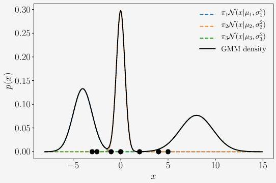

(a) GMM density and individual components prior to updating the mean values.

## Example 11.3 (Mean Updates)

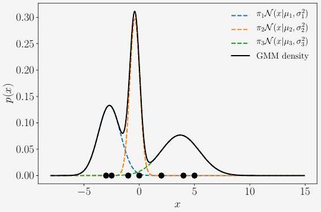

(b) GMM density and individual components after updating the mean values.

In our example from Figure 11.3, the mean values are updated as follows:

$$
\begin{aligned}
& \mu_{1}:-4 \rightarrow-2.7 \\
& \mu_{2}: 0 \rightarrow-0.4 \\
& \mu_{3}: 8 \rightarrow 3.7
\end{aligned}
$$

Here we see that the means of the first and third mixture component move toward the regime of the data, whereas the mean of the second component does not change so dramatically. Figure 11.5 illustrates this change, where Figure 11.5(a) shows the GMM density prior to updating the means and Figure 11.5(b) shows the GMM density after updating the mean values $\mu_{k}$.

The update of the mean parameters in (11.20) look fairly straightforward. However, note that the responsibilities $r_{n k}$ are a function of $\pi_{j}, \boldsymbol{\mu}_{j}, \boldsymbol{\Sigma}_{j}$ for all $j=1, \ldots, K$, such that the updates in (11.20) depend on all parameters of the GMM, and a closed-form solution, which we obtained for linear regression in Section 9.2 or PCA in Chapter 10, cannot be obtained.

Figure 11.4 Update of the mean parameter of mixture component in a GMM. The mean

$\boldsymbol{\mu}$

is being pulled toward individual data points with the weights given by the corresponding responsibilities.

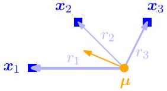

Figure 11.5 Effect of updating the mean values in a GMM. (a) GMM before updating the mean values; (b) GMM after updating the mean values $\mu_{k}$ while retaining the variances and mixture weights.

### 11.2.3 Updating the Covariances

Theorem 11.2 (Updates of the GMM Covariances). The update of the covariance parameters $\boldsymbol{\Sigma}_{k}, k=1, \ldots, K$ of the GMM is given by

$$
\boldsymbol{\Sigma}_{k}^{\text {new }}=\frac{1}{N_{k}} \sum_{n=1}^{N} r_{n k}\left(\boldsymbol{x}_{n}-\boldsymbol{\mu}_{k}\right)\left(\boldsymbol{x}_{n}-\boldsymbol{\mu}_{k}\right)^{\top},
$$

where $r_{n k}$ and $N_{k}$ are defined in (11.17) and (11.24), respectively.
Proof To prove Theorem 11.2, our approach is to compute the partial derivatives of the log-likelihood $\mathcal{L}$ with respect to the covariances $\boldsymbol{\Sigma}_{k}$, set them to $\mathbf{0}$, and solve for $\boldsymbol{\Sigma}_{k}$. We start with our general approach

$$
\frac{\partial \mathcal{L}}{\partial \boldsymbol{\Sigma}_{k}}=\sum_{n=1}^{N} \frac{\partial \log p\left(\boldsymbol{x}_{n} \mid \boldsymbol{\theta}\right)}{\partial \boldsymbol{\Sigma}_{k}}=\sum_{n=1}^{N} \frac{1}{p\left(x_{n} \mid \theta\right)} \frac{\partial p\left(\boldsymbol{x}_{n} \mid \boldsymbol{\theta}\right)}{\partial \boldsymbol{\Sigma}_{k}} .
$$

We already know $1 / p\left(\boldsymbol{x}_{n} \mid \boldsymbol{\theta}\right)$ from (11.16). To obtain the remaining partial derivative $\partial p\left(\boldsymbol{x}_{n} \mid \boldsymbol{\theta}\right) / \partial \boldsymbol{\Sigma}_{k}$, we write down the definition of the Gaussian distribution $p\left(\boldsymbol{x}_{n} \mid \boldsymbol{\theta}\right)$ (see (11.9)) and drop all terms but the $k$ th. We then obtain

$$
\begin{aligned}
& \frac{\partial p\left(\boldsymbol{x}_{n} \mid \boldsymbol{\theta}\right)}{\partial \boldsymbol{\Sigma}_{k}} \\
& =\frac{\partial}{\partial \boldsymbol{\Sigma}_{k}}\left(\pi_{k}(2 \pi)^{-\frac{D}{2}} \operatorname{det}\left(\boldsymbol{\Sigma}_{k}\right)^{-\frac{1}{2}} \exp \left(-\frac{1}{2}\left(\boldsymbol{x}_{n}-\boldsymbol{\mu}_{k}\right)^{\top} \boldsymbol{\Sigma}_{k}^{-1}\left(\boldsymbol{x}_{n}-\boldsymbol{\mu}_{k}\right)\right)\right) \\
& =\pi_{k}(2 \pi)^{-\frac{D}{2}}\left[\frac{\partial}{\partial \boldsymbol{\Sigma}_{k}} \operatorname{det}\left(\boldsymbol{\Sigma}_{k}\right)^{-\frac{1}{2}} \exp \left(-\frac{1}{2}\left(\boldsymbol{x}_{n}-\boldsymbol{\mu}_{k}\right)^{\top} \boldsymbol{\Sigma}_{k}^{-1}\left(\boldsymbol{x}_{n}-\boldsymbol{\mu}_{k}\right)\right)\right. \\
& \left.\quad+\operatorname{det}\left(\boldsymbol{\Sigma}_{k}\right)^{-\frac{1}{2}} \frac{\partial}{\partial \boldsymbol{\Sigma}_{k}} \exp \left(-\frac{1}{2}\left(\boldsymbol{x}_{n}-\boldsymbol{\mu}_{k}\right)^{\top} \boldsymbol{\Sigma}_{k}^{-1}\left(\boldsymbol{x}_{n}-\boldsymbol{\mu}_{k}\right)\right)\right] .
\end{aligned}
$$

We now use the identities

$$
\begin{gathered}
\frac{\partial}{\partial \boldsymbol{\Sigma}_{k}} \operatorname{det}\left(\boldsymbol{\Sigma}_{k}\right)^{-\frac{1}{2}} \stackrel{(5.101)}{=}-\frac{1}{2} \operatorname{det}\left(\boldsymbol{\Sigma}_{k}\right)^{-\frac{1}{2}} \boldsymbol{\Sigma}_{k}^{-1} \\
\frac{\partial}{\partial \boldsymbol{\Sigma}_{k}}\left(\boldsymbol{x}_{n}-\boldsymbol{\mu}_{k}\right)^{\top} \boldsymbol{\Sigma}_{k}^{-1}\left(\boldsymbol{x}_{n}-\boldsymbol{\mu}_{k}\right) \stackrel{(5.103)}{=}-\boldsymbol{\Sigma}_{k}^{-1}\left(\boldsymbol{x}_{n}-\boldsymbol{\mu}_{k}\right)\left(\boldsymbol{x}_{n}-\boldsymbol{\mu}_{k}\right)^{\top} \boldsymbol{\Sigma}_{k}^{-1}
\end{gathered}
$$

and obtain (after some rearranging) the desired partial derivative required in (11.31) as

$$
\begin{aligned}
\frac{\partial p\left(\boldsymbol{x}_{n} \mid \boldsymbol{\theta}\right)}{\partial \boldsymbol{\Sigma}_{k}}= & \pi_{k} \mathcal{N}\left(\boldsymbol{x}_{n} \mid \boldsymbol{\mu}_{k}, \boldsymbol{\Sigma}_{k}\right) \\
& \cdot\left[-\frac{1}{2}\left(\boldsymbol{\Sigma}_{k}^{-1}-\boldsymbol{\Sigma}_{k}^{-1}\left(\boldsymbol{x}_{n}-\boldsymbol{\mu}_{k}\right)\left(\boldsymbol{x}_{n}-\boldsymbol{\mu}_{k}\right)^{\top} \boldsymbol{\Sigma}_{k}^{-1}\right)\right] .
\end{aligned}
$$

Putting everything together, the partial derivative of the log-likelihood
with respect to $\boldsymbol{\Sigma}_{k}$ is given by

$$
\begin{aligned}
\frac{\partial \mathcal{L}}{\partial \boldsymbol{\Sigma}_{k}} & =\sum_{n=1}^{N} \frac{\partial \log p\left(\boldsymbol{x}_{n} \mid \boldsymbol{\theta}\right)}{\partial \boldsymbol{\Sigma}_{k}}=\sum_{n=1}^{N} \frac{1}{p\left(x_{n} \mid \theta\right)} \frac{\partial p\left(\boldsymbol{x}_{n} \mid \boldsymbol{\theta}\right)}{\partial \boldsymbol{\Sigma}_{k}} \\
& =\sum_{n=1}^{N} \underbrace{\frac{\pi_{k} \mathcal{N}\left(\boldsymbol{x}_{n} \mid \boldsymbol{\mu}_{k}, \boldsymbol{\Sigma}_{k}\right)}{\sum_{j=1}^{K} \pi_{j} \mathcal{N}\left(x_{n} \mid \mu_{j}, \boldsymbol{\Sigma}_{j}\right)}}_{=r_{n k}} \\
& \cdot\left[-\frac{1}{2}\left(\boldsymbol{\Sigma}_{k}^{-1}-\boldsymbol{\Sigma}_{k}^{-1}\left(\boldsymbol{x}_{n}-\boldsymbol{\mu}_{k}\right)\left(\boldsymbol{x}_{n}-\boldsymbol{\mu}_{k}\right)^{\top} \boldsymbol{\Sigma}_{k}^{-1}\right)\right] \\
& =-\frac{1}{2} \sum_{n=1}^{N} r_{n k}\left(\boldsymbol{\Sigma}_{k}^{-1}-\boldsymbol{\Sigma}_{k}^{-1}\left(\boldsymbol{x}_{n}-\boldsymbol{\mu}_{k}\right)\left(\boldsymbol{x}_{n}-\boldsymbol{\mu}_{k}\right)^{\top} \boldsymbol{\Sigma}_{k}^{-1}\right) \\
& =-\frac{1}{2} \boldsymbol{\Sigma}_{k}^{-1} \underbrace{\sum_{n=1}^{N} r_{n k}}_{=N_{k}}+\frac{1}{2} \boldsymbol{\Sigma}_{k}^{-1}\left(\sum_{n=1}^{N} r_{n k}\left(\boldsymbol{x}_{n}-\boldsymbol{\mu}_{k}\right)\left(\boldsymbol{x}_{n}-\boldsymbol{\mu}_{k}\right)^{\top}\right) \boldsymbol{\Sigma}_{k}^{-1}
\end{aligned}
$$

We see that the responsibilities $r_{n k}$ also appear in this partial derivative. Setting this partial derivative to $\mathbf{0}$, we obtain the necessary optimality condition

$$
\begin{aligned}
& N_{k} \boldsymbol{\Sigma}_{k}^{-1}=\boldsymbol{\Sigma}_{k}^{-1}\left(\sum_{n=1}^{N} r_{n k}\left(\boldsymbol{x}_{n}-\boldsymbol{\mu}_{k}\right)\left(\boldsymbol{x}_{n}-\boldsymbol{\mu}_{k}\right)^{\top}\right) \boldsymbol{\Sigma}_{k}^{-1} \\
\Longleftrightarrow & N_{k} \boldsymbol{I}=\left(\sum_{n=1}^{N} r_{n k}\left(\boldsymbol{x}_{n}-\boldsymbol{\mu}_{k}\right)\left(\boldsymbol{x}_{n}-\boldsymbol{\mu}_{k}\right)^{\top}\right) \boldsymbol{\Sigma}_{k}^{-1}
\end{aligned}
$$

By solving for $\boldsymbol{\Sigma}_{k}$, we obtain

$$
\boldsymbol{\Sigma}_{k}^{\mathrm{new}}=\frac{1}{N_{k}} \sum_{n=1}^{N} r_{n k}\left(\boldsymbol{x}_{n}-\boldsymbol{\mu}_{k}\right)\left(\boldsymbol{x}_{n}-\boldsymbol{\mu}_{k}\right)^{\top},
$$

where $\boldsymbol{r}_{k}$ is the probability vector defined in (11.25). This gives us a simple update rule for $\boldsymbol{\Sigma}_{k}$ for $k=1, \ldots, K$ and proves Theorem 11.2.

Similar to the update of $\boldsymbol{\mu}_{k}$ in (11.20), we can interpret the update of the covariance in (11.30) as an importance-weighted expected value of the square of the centered data $\tilde{\mathcal{X}}_{k}:=\left\{\boldsymbol{x}_{1}-\boldsymbol{\mu}_{k}, \ldots, \boldsymbol{x}_{N}-\boldsymbol{\mu}_{k}\right\}$.

## Example 11.4 (Variance Updates)

In our example from Figure 11.3, the variances are updated as follows:

$$
\begin{aligned}
& \sigma_{1}^{2}: 1 \rightarrow 0.14 \\
& \sigma_{2}^{2}: 0.2 \rightarrow 0.44 \\
& \sigma_{3}^{2}: 3 \rightarrow 1.53
\end{aligned}
$$

Here we see that the variances of the first and third component shrink significantly, whereas the variance of the second component increases slightly.

Figure 11.6 illustrates this setting. Figure 11.6(a) is identical (but zoomed in) to Figure 11.5(b) and shows the GMM density and its individual components prior to updating the variances. Figure 11.6(b) shows the GMM density after updating the variances.

Figure 11.6 Effect of updating the variances in a GMM. (a) GMM before updating the variances; (b) GMM after updating the variances while retaining the means and mixture weights.

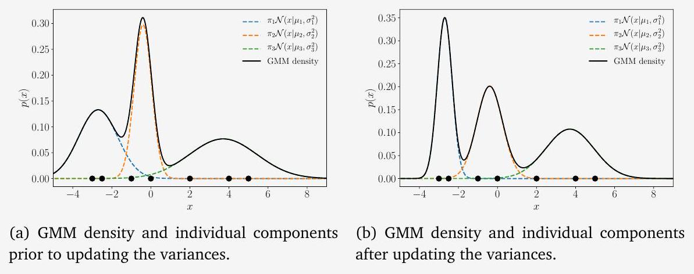

Similar to the update of the mean parameters, we can interpret (11.30) as a Monte Carlo estimate of the weighted covariance of data points $\boldsymbol{x}_{n}$ associated with the $k$ th mixture component, where the weights are the responsibilities $r_{n k}$. As with the updates of the mean parameters, this update depends on all $\pi_{j}, \boldsymbol{\mu}_{j}, \boldsymbol{\Sigma}_{j}, j=1, \ldots, K$, through the responsibilities $r_{n k}$, which prohibits a closed-form solution.

### 11.2.4 Updating the Mixture Weights

Theorem 11.3 (Update of the GMM Mixture Weights). The mixture weights of the GMM are updated as

$$
\pi_{k}^{\text {new }}=\frac{N_{k}}{N}, \quad k=1, \ldots, K,
$$

where $N$ is the number of data points and $N_{k}$ is defined in (11.24).
Proof To find the partial derivative of the log-likelihood with respect to the weight parameters $\pi_{k}, k=1, \ldots, K$, we account for the constraint $\sum_{k} \pi_{k}=1$ by using Lagrange multipliers (see Section 7.2). The Lagrangian is

$$
\mathfrak{L}=\mathcal{L}+\lambda\left(\sum_{k=1}^{K} \pi_{k}-1\right)
$$

$$
=\sum_{n=1}^{N} \log \sum_{k=1}^{K} \pi_{k} \mathcal{N}\left(\boldsymbol{x}_{n} \mid \boldsymbol{\mu}_{k}, \boldsymbol{\Sigma}_{k}\right)+\lambda\left(\sum_{k=1}^{K} \pi_{k}-1\right),
$$

where $\mathcal{L}$ is the log-likelihood from (11.10) and the second term encodes for the equality constraint that all the mixture weights need to sum up to 1. We obtain the partial derivative with respect to $\pi_{k}$ as

$$
\begin{aligned}
\frac{\partial \mathfrak{L}}{\partial \pi_{k}} & =\sum_{n=1}^{N} \frac{\mathcal{N}\left(\boldsymbol{x}_{n} \mid \boldsymbol{\mu}_{k}, \boldsymbol{\Sigma}_{k}\right)}{\sum_{j=1}^{K} \pi_{j} \mathcal{N}\left(\boldsymbol{x}_{n} \mid \boldsymbol{\mu}_{j}, \boldsymbol{\Sigma}_{j}\right)}+\lambda \\
& =\frac{1}{\pi_{k}} \underbrace{\sum_{n=1}^{N} \frac{\pi_{k} \mathcal{N}\left(\boldsymbol{x}_{n} \mid \boldsymbol{\mu}_{k}, \boldsymbol{\Sigma}_{k}\right)}{\sum_{j=1}^{K} \pi_{j} \mathcal{N}\left(\boldsymbol{x}_{n} \mid \boldsymbol{\mu}_{j}, \boldsymbol{\Sigma}_{j}\right)}}_{=N_{k}}+\lambda=\frac{N_{k}}{\pi_{k}}+\lambda
\end{aligned}
$$

and the partial derivative with respect to the Lagrange multiplier $\lambda$ as

$$
\frac{\partial \mathfrak{L}}{\partial \lambda}=\sum_{k=1}^{K} \pi_{k}-1
$$

Setting both partial derivatives to $\mathbf{0}$ (necessary condition for optimum) yields the system of equations

$$
\begin{aligned}
\pi_{k} & =-\frac{N_{k}}{\lambda}, \\
1 & =\sum_{k=1}^{K} \pi_{k}
\end{aligned}
$$

Using (11.46) in (11.47) and solving for $\pi_{k}$, we obtain

$$
\sum_{k=1}^{K} \pi_{k}=1 \Longleftrightarrow-\sum_{k=1}^{K} \frac{N_{k}}{\lambda}=1 \Longleftrightarrow-\frac{N}{\lambda}=1 \Longleftrightarrow \lambda=-N .
$$

This allows us to substitute $-N$ for $\lambda$ in (11.46) to obtain

$$
\pi_{k}^{\mathrm{new}}=\frac{N_{k}}{N}
$$

which gives us the update for the weight parameters $\pi_{k}$ and proves Theorem 11.3.

We can identify the mixture weight in (11.42) as the ratio of the total responsibility of the $k$ th cluster and the number of data points. Since $N=\sum_{k} N_{k}$, the number of data points can also be interpreted as the total responsibility of all mixture components together, such that $\pi_{k}$ is the relative importance of the $k$ th mixture component for the dataset.
Remark. Since $N_{k}=\sum_{i=1}^{N} r_{n k}$, the update equation (11.42) for the mixture weights $\pi_{k}$ also depends on all $\pi_{j}, \boldsymbol{\mu}_{j}, \boldsymbol{\Sigma}_{j}, j=1, \ldots, K$ via the responsibilities $r_{n k}$.

## Example 11.5 (Weight Parameter Updates)

Figure 11.7 Effect of updating the mixture weights in a GMM. (a) GMM before updating the mixture weights; (b) GMM after updating the mixture weights while retaining the means and variances. Note the different scales of the vertical axes.

EM algorithm
rithm) was proposed by Dempster et al. (1977) and is a general iterative scheme for learning parameters (maximum likelihood or MAP) in mixture models and, more generally, latent-variable models.

In our example of the Gaussian mixture model, we choose initial values for $\boldsymbol{\mu}_{k}, \boldsymbol{\Sigma}_{k}, \pi_{k}$ and alternate until convergence between

- E-step: Evaluate the responsibilities $r_{n k}$ (posterior probability of data point $n$ belonging to mixture component $k$ ).
- M-step: Use the updated responsibilities to reestimate the parameters $\boldsymbol{\mu}_{k}, \boldsymbol{\Sigma}_{k}, \pi_{k}$.

Every step in the EM algorithm increases the log-likelihood function (Neal and Hinton, 1999). For convergence, we can check the log-likelihood or the parameters directly. A concrete instantiation of the EM algorithm for estimating the parameters of a GMM is as follows:

1. Initialize $\boldsymbol{\mu}_{k}, \boldsymbol{\Sigma}_{k}, \pi_{k}$.
2. E-step: Evaluate responsibilities $r_{n k}$ for every data point $\boldsymbol{x}_{n}$ using current parameters $\pi_{k}, \boldsymbol{\mu}_{k}, \boldsymbol{\Sigma}_{k}$ :

$$
r_{n k}=\frac{\pi_{k} \mathcal{N}\left(\boldsymbol{x}_{n} \mid \boldsymbol{\mu}_{k}, \boldsymbol{\Sigma}_{k}\right)}{\sum_{j} \pi_{j} \mathcal{N}\left(\boldsymbol{x}_{n} \mid \boldsymbol{\mu}_{j}, \boldsymbol{\Sigma}_{j}\right)} .
$$

1. M-step: Reestimate parameters $\pi_{k}, \boldsymbol{\mu}_{k}, \boldsymbol{\Sigma}_{k}$ using the current responsibilities $r_{n k}$ (from E-step):

$$
\begin{aligned}
\boldsymbol{\mu}_{k} & =\frac{1}{N_{k}} \sum_{n=1}^{N} r_{n k} \boldsymbol{x}_{n}, \\
\boldsymbol{\Sigma}_{k} & =\frac{1}{N_{k}} \sum_{n=1}^{N} r_{n k}\left(\boldsymbol{x}_{n}-\boldsymbol{\mu}_{k}\right)\left(\boldsymbol{x}_{n}-\boldsymbol{\mu}_{k}\right)^{\top}, \\
\pi_{k} & =\frac{N_{k}}{N} .
\end{aligned}
$$

## Example 11.6 (GMM Fit)

Having updated the means $\boldsymbol{\mu}_{k}$ in (11.54), they are subsequently used in (11.55) to update the corresponding covariances.

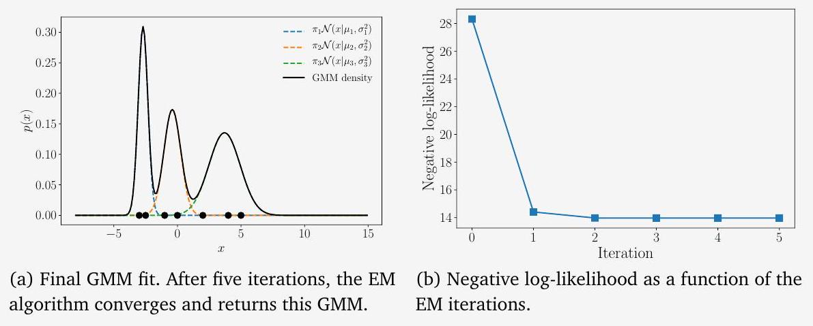

Figure 11.8 EM algorithm applied to the GMM from Figure 11.2. (a) Final GMM fit; (b) negative log-likelihood as a function of the EM iteration.

Figure 11.10(a) shows the final GMM fit.

Figure 11.9 Illustration of the EM algorithm for fitting a Gaussian mixture model with three components to a two-dimensional dataset. (a) Dataset; (b) negative log-likelihood (lower is better) as a function of the EM iterations. The red dots indicate the iterations for which the mixture components of the corresponding GMM fits are shown in (c) through (f). The yellow discs indicate the means of the Gaussian mixture components.

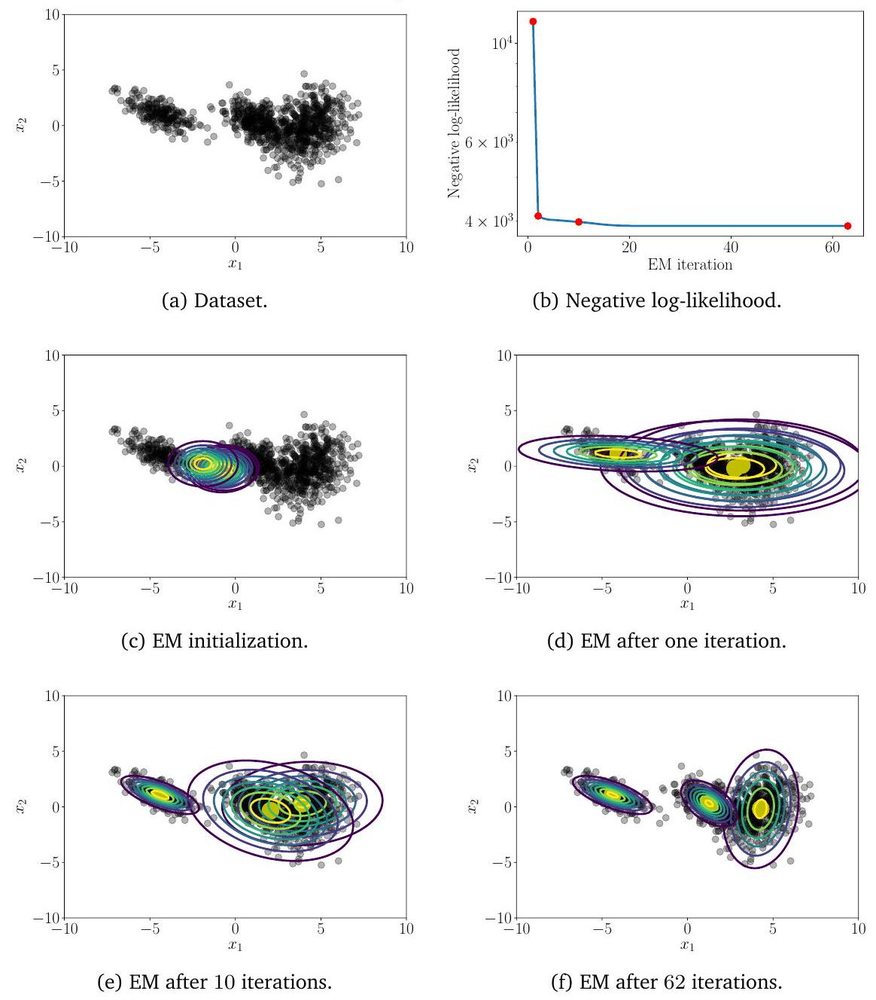

When we run EM on our example from Figure 11.3, we obtain the final result shown in Figure 11.8(a) after five iterations, and Figure 11.8(b) shows how the negative log-likelihood evolves as a function of the EM iterations. The final GMM is given as

$$
\begin{aligned}
p(x)= & 0.29 \mathcal{N}(x \mid-2.75,0.06)+0.28 \mathcal{N}(x \mid-0.50,0.25) \\
& +0.43 \mathcal{N}(x \mid 3.64,1.63)
\end{aligned}
$$

We applied the EM algorithm to the two-dimensional dataset shown in Figure 11.1 with $K=3$ mixture components. Figure 11.9 illustrates some steps of the EM algorithm and shows the negative log-likelihood as a function of the EM iteration (Figure 11.9(b)). Figure 11.10(a) shows

### 11.4 Latent-Variable Perspective

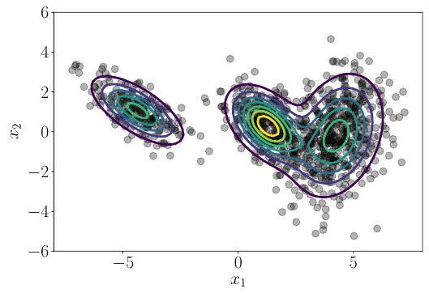

(a) GMM fit after 62 iterations.

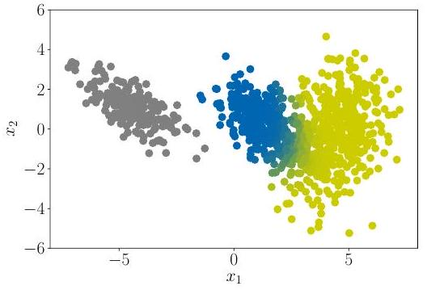

(b) Dataset colored according to the responsibilities of the mixture components.

Figure 11.10 GMM fit and responsibilities when EM converges. (a) GMM fit when EM converges; (b) each data point is colored according to the responsibilities of the mixture components.
the corresponding final GMM fit. Figure 11.10(b) visualizes the final responsibilities of the mixture components for the data points. The dataset is colored according to the responsibilities of the mixture components when EM converges. While a single mixture component is clearly responsible for the data on the left, the overlap of the two data clusters on the right could have been generated by two mixture components. It becomes clear that there are data points that cannot be uniquely assigned to a single component (either blue or yellow), such that the responsibilities of these two clusters for those points are around 0.5.

### 11.4 Latent-Variable Perspective

We can look at the GMM from the perspective of a discrete latent-variable model, i.e., where the latent variable $\boldsymbol{z}$ can attain only a finite set of values. This is in contrast to PCA, where the latent variables were continuousvalued numbers in $\mathbb{R}^{M}$.

The advantages of the probabilistic perspective are that (i) it will justify some ad hoc decisions we made in the previous sections, (ii) it allows for a concrete interpretation of the responsibilities as posterior probabilities, and (iii) the iterative algorithm for updating the model parameters can be derived in a principled manner as the EM algorithm for maximum likelihood parameter estimation in latent-variable models.

### 11.4.1 Generative Process and Probabilistic Model

To derive the probabilistic model for GMMs, it is useful to think about the generative process, i.e., the process that allows us to generate data, using a probabilistic model.

We assume a mixture model with $K$ components and that a data point $\boldsymbol{x}$ can be generated by exactly one mixture component. We introduce a binary indicator variable $z_{k} \in\{0,1\}$ with two states (see Section 6.2) that indicates whether the $k$ th mixture component generated that data point
one-hot encoding 1-of- $K$ representation

Figure 11.11
Graphical model for a GMM with a single data point.

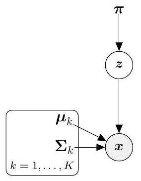

ancestral sampling
so that

$$
p\left(\boldsymbol{x} \mid z_{k}=1\right)=\mathcal{N}\left(\boldsymbol{x} \mid \boldsymbol{\mu}_{k}, \boldsymbol{\Sigma}_{k}\right) .
$$

We define $\boldsymbol{z}:=\left[z_{1}, \ldots, z_{K}\right]^{\top} \in \mathbb{R}^{K}$ as a probability vector consisting of $K-1$ many 0 s and exactly one 1 . For example, for $K=3$, a valid $\boldsymbol{z}$ would be $\boldsymbol{z}=\left[z_{1}, z_{2}, z_{3}\right]^{\top}=[0,1,0]^{\top}$, which would select the second mixture component since $z_{2}=1$.
Remark. Sometimes this kind of probability distribution is called “multinoulli”, a generalization of the Bernoulli distribution to more than two values (Murphy, 2012).

The properties of $\boldsymbol{z}$ imply that $\sum_{k=1}^{K} z_{k}=1$. Therefore, $\boldsymbol{z}$ is a one-hot encoding (also: 1-of-K representation).

Thus far, we assumed that the indicator variables $z_{k}$ are known. However, in practice, this is not the case, and we place a prior distribution

$$
p(\boldsymbol{z})=\boldsymbol{\pi}=\left[\pi_{1}, \ldots, \pi_{K}\right]^{\top}, \quad \sum_{k=1}^{K} \pi_{k}=1,
$$

on the latent variable $\boldsymbol{z}$. Then the $k$ th entry

$$
\pi_{k}=p\left(z_{k}=1\right)
$$

of this probability vector describes the probability that the $k$ th mixture component generated data point $\boldsymbol{x}$.
Remark (Sampling from a GMM). The construction of this latent-variable model (see the corresponding graphical model in Figure 11.11) lends itself to a very simple sampling procedure (generative process) to generate data:

1. Sample $z^{(i)} \sim p(\boldsymbol{z})$.
2. Sample $\boldsymbol{x}^{(i)} \sim p\left(\boldsymbol{x} \mid z^{(i)}=1\right)$.

In the first step, we select a mixture component $i$ (via the one-hot encoding $\boldsymbol{z}$ ) at random according to $p(\boldsymbol{z})=\boldsymbol{\pi}$; in the second step we draw a sample from the corresponding mixture component. When we discard the samples of the latent variable so that we are left with the $\boldsymbol{x}^{(i)}$, we have valid samples from the GMM. This kind of sampling, where samples of random variables depend on samples from the variable’s parents in the graphical model, is called ancestral sampling.

Generally, a probabilistic model is defined by the joint distribution of the data and the latent variables (see Section 8.4). With the prior $p(\boldsymbol{z})$ defined in (11.59) and (11.60) and the conditional $p(\boldsymbol{x} \mid \boldsymbol{z})$ from (11.58), we obtain all $K$ components of this joint distribution via

$$
p\left(\boldsymbol{x}, z_{k}=1\right)=p\left(\boldsymbol{x} \mid z_{k}=1\right) p\left(z_{k}=1\right)=\pi_{k} \mathcal{N}\left(\boldsymbol{x} \mid \boldsymbol{\mu}_{k}, \boldsymbol{\Sigma}_{k}\right)
$$

for $k=1, \ldots, K$, so that

$$
p(\boldsymbol{x}, \boldsymbol{z})=\left[\begin{array}{c}
p\left(\boldsymbol{x}, z_{1}=1\right) \\
\vdots \\
p\left(\boldsymbol{x}, z_{K}=1\right)
\end{array}\right]=\left[\begin{array}{c}
\pi_{1} \mathcal{N}\left(\boldsymbol{x} \mid \boldsymbol{\mu}_{1}, \boldsymbol{\Sigma}_{1}\right) \\
\vdots \\
\pi_{K} \mathcal{N}\left(\boldsymbol{x} \mid \boldsymbol{\mu}_{K}, \boldsymbol{\Sigma}_{K}\right)
\end{array}\right],
$$

which fully specifies the probabilistic model.

### 11.4.2 Likelihood

To obtain the likelihood $p(\boldsymbol{x} \mid \boldsymbol{\theta})$ in a latent-variable model, we need to marginalize out the latent variables (see Section 8.4.3). In our case, this can be done by summing out all latent variables from the joint $p(\boldsymbol{x}, \boldsymbol{z})$ in (11.62) so that

$$
p(\boldsymbol{x} \mid \boldsymbol{\theta})=\sum_{\boldsymbol{z}} p(\boldsymbol{x} \mid \boldsymbol{\theta}, \boldsymbol{z}) p(\boldsymbol{z} \mid \boldsymbol{\theta}), \quad \boldsymbol{\theta}:=\left\{\boldsymbol{\mu}_{k}, \boldsymbol{\Sigma}_{k}, \pi_{k}: k=1, \ldots, K\right\} .
$$

We now explicitly condition on the parameters $\boldsymbol{\theta}$ of the probabilistic model, which we previously omitted. In (11.63), we sum over all $K$ possible onehot encodings of $z$, which is denoted by $\sum_{z}$. Since there is only a single nonzero single entry in each $\boldsymbol{z}$ there are only $K$ possible configurations/ settings of $\boldsymbol{z}$. For example, if $K=3$, then $\boldsymbol{z}$ can have the configurations

$$
\left[\begin{array}{l}
1 \\
0 \\
0
\end{array}\right],\left[\begin{array}{l}
0 \\
1 \\
0
\end{array}\right],\left[\begin{array}{l}
0 \\
0 \\
1
\end{array}\right] .
$$

Summing over all possible configurations of $\boldsymbol{z}$ in (11.63) is equivalent to looking at the nonzero entry of the $\boldsymbol{z}$-vector and writing

$$
\begin{aligned}
p(\boldsymbol{x} \mid \boldsymbol{\theta}) & =\sum_{\boldsymbol{z}} p(\boldsymbol{x} \mid \boldsymbol{\theta}, \boldsymbol{z}) p(\boldsymbol{z} \mid \boldsymbol{\theta}) \\
& =\sum_{k=1}^{K} p\left(\boldsymbol{x} \mid \boldsymbol{\theta}, z_{k}=1\right) p\left(z_{k}=1 \mid \boldsymbol{\theta}\right)
\end{aligned}
$$

so that the desired marginal distribution is given as

$$
\begin{aligned}
p(\boldsymbol{x} \mid \boldsymbol{\theta}) & \stackrel{(11.65 \mathrm{~b})}{=} \sum_{k=1}^{K} p\left(\boldsymbol{x} \mid \boldsymbol{\theta}, z_{k}=1\right) p\left(z_{k}=1 \mid \boldsymbol{\theta}\right) \\
& =\sum_{k=1}^{K} \pi_{k} \mathcal{N}\left(\boldsymbol{x} \mid \boldsymbol{\mu}_{k}, \mathbf{\Sigma}_{k}\right)
\end{aligned}
$$

which we identify as the GMM model from (11.3). Given a dataset $\mathcal{X}$, we immediately obtain the likelihood

$$
p(\mathcal{X} \mid \boldsymbol{\theta})=\prod_{n=1}^{N} p\left(\boldsymbol{x}_{n} \mid \boldsymbol{\theta}\right) \stackrel{(11.66 \mathrm{~b})}{=} \prod_{n=1}^{N} \sum_{k=1}^{K} \pi_{k} \mathcal{N}\left(\boldsymbol{x}_{n} \mid \boldsymbol{\mu}_{k}, \boldsymbol{\Sigma}_{k}\right),
$$

Figure 11.12 Graphical model for a GMM with

$N$

data points.

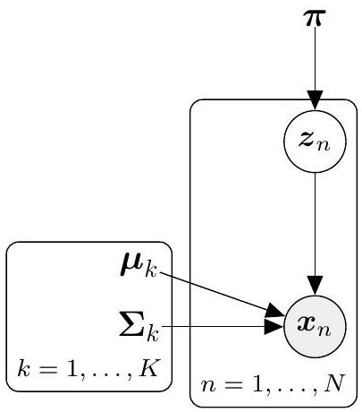

which is exactly the GMM likelihood from (11.9). Therefore, the latentvariable model with latent indicators $z_{k}$ is an equivalent way of thinking about a Gaussian mixture model.

### 11.4.3 Posterior Distribution

Let us have a brief look at the posterior distribution on the latent variable $\boldsymbol{z}$. According to Bayes’ theorem, the posterior of the $k$ th component having generated data point $\boldsymbol{x}$

$$
p\left(z_{k}=1 \mid \boldsymbol{x}\right)=\frac{p\left(z_{k}=1\right) p\left(\boldsymbol{x} \mid z_{k}=1\right)}{p(\boldsymbol{x})},
$$

where the marginal $p(\boldsymbol{x})$ is given in (11.66b). This yields the posterior distribution for the $k$ th indicator variable $z_{k}$

$$
p\left(z_{k}=1 \mid \boldsymbol{x}\right)=\frac{p\left(z_{k}=1\right) p\left(\boldsymbol{x} \mid z_{k}=1\right)}{\sum_{j=1}^{K} p\left(z_{j}=1\right) p\left(\boldsymbol{x} \mid z_{j}=1\right)}=\frac{\pi_{k} \mathcal{N}\left(\boldsymbol{x} \mid \boldsymbol{\mu}_{k}, \boldsymbol{\Sigma}_{k}\right)}{\sum_{j=1}^{K} \pi_{j} \mathcal{N}\left(\boldsymbol{x} \mid \boldsymbol{\mu}_{j}, \boldsymbol{\Sigma}_{j}\right)},
$$

which we identify as the responsibility of the $k$ th mixture component for data point $\boldsymbol{x}$. Note that we omitted the explicit conditioning on the GMM parameters $\pi_{k}, \boldsymbol{\mu}_{k}, \boldsymbol{\Sigma}_{k}$ where $k=1, \ldots, K$.

### 11.4.4 Extension to a Full Dataset

Thus far, we have only discussed the case where the dataset consists only of a single data point $\boldsymbol{x}$. However, the concepts of the prior and posterior can be directly extended to the case of $N$ data points $\mathcal{X}:=\left\{\boldsymbol{x}_{1}, \ldots, \boldsymbol{x}_{N}\right\}$.

In the probabilistic interpretation of the GMM, every data point $\boldsymbol{x}_{n}$ possesses its own latent variable

$$
\boldsymbol{z}_{n}=\left[z_{n 1}, \ldots, z_{n K}\right]^{\top} \in \mathbb{R}^{K} .
$$

Previously (when we only considered a single data point $\boldsymbol{x}$ ), we omitted the index $n$, but now this becomes important.

We share the same prior distribution $\boldsymbol{\pi}$ across all latent variables $\boldsymbol{z}_{n}$. The corresponding graphical model is shown in Figure 11.12, where we use the plate notation.

The conditional distribution $p\left(\boldsymbol{x}_{1}, \ldots, \boldsymbol{x}_{N} \mid \boldsymbol{z}_{1}, \ldots, \boldsymbol{z}_{N}\right)$ factorizes over the data points and is given as

$$
p\left(\boldsymbol{x}_{1}, \ldots, \boldsymbol{x}_{N} \mid \boldsymbol{z}_{1}, \ldots, \boldsymbol{z}_{N}\right)=\prod_{n=1}^{N} p\left(\boldsymbol{x}_{n} \mid \boldsymbol{z}_{n}\right)
$$

To obtain the posterior distribution $p\left(z_{n k}=1 \mid \boldsymbol{x}_{n}\right)$, we follow the same reasoning as in Section 11.4.3 and apply Bayes’ theorem to obtain

$$
\begin{aligned}
p\left(z_{n k}=1 \mid \boldsymbol{x}_{n}\right) & =\frac{p\left(\boldsymbol{x}_{n} \mid z_{n k}=1\right) p\left(z_{n k}=1\right)}{\sum_{j=1}^{K} p\left(\boldsymbol{x}_{n} \mid z_{n j}=1\right) p\left(z_{n j}=1\right)} \\
& =\frac{\pi_{k} \mathcal{N}\left(\boldsymbol{x}_{n} \mid \boldsymbol{\mu}_{k}, \boldsymbol{\Sigma}_{k}\right)}{\sum_{j=1}^{K} \pi_{j} \mathcal{N}\left(\boldsymbol{x}_{n} \mid \boldsymbol{\mu}_{j}, \boldsymbol{\Sigma}_{j}\right)}=r_{n k}
\end{aligned}
$$

This means that $p\left(z_{k}=1 \mid \boldsymbol{x}_{n}\right)$ is the (posterior) probability that the $k$ th mixture component generated data point $\boldsymbol{x}_{n}$ and corresponds to the responsibility $r_{n k}$ we introduced in (11.17). Now the responsibilities also have not only an intuitive but also a mathematically justified interpretation as posterior probabilities.

### 11.4.5 EM Algorithm Revisited

The EM algorithm that we introduced as an iterative scheme for maximum likelihood estimation can be derived in a principled way from the latentvariable perspective. Given a current setting $\boldsymbol{\theta}^{(t)}$ of model parameters, the E-step calculates the expected log-likelihood

$$
\begin{aligned}
Q\left(\boldsymbol{\theta} \mid \boldsymbol{\theta}^{(t)}\right) & =\mathbb{E}_{\boldsymbol{z} \mid \boldsymbol{x}, \boldsymbol{\theta}^{(t)}}[\log p(\boldsymbol{x}, \boldsymbol{z} \mid \boldsymbol{\theta})] \\
& =\int \log p(\boldsymbol{x}, \boldsymbol{z} \mid \boldsymbol{\theta}) p\left(\boldsymbol{z} \mid \boldsymbol{x}, \boldsymbol{\theta}^{(t)}\right) \mathrm{d} \boldsymbol{z}
\end{aligned}
$$

where the expectation of $\log p(\boldsymbol{x}, \boldsymbol{z} \mid \boldsymbol{\theta})$ is taken with respect to the posterior $p\left(\boldsymbol{z} \mid \boldsymbol{x}, \boldsymbol{\theta}^{(t)}\right)$ of the latent variables. The M-step selects an updated set of model parameters $\boldsymbol{\theta}^{(t+1)}$ by maximizing (11.73b).

Although an EM iteration does increase the log-likelihood, there are no guarantees that EM converges to the maximum likelihood solution. It is possible that the EM algorithm converges to a local maximum of the log-likelihood. Different initializations of the parameters $\boldsymbol{\theta}$ could be used in multiple EM runs to reduce the risk of ending up in a bad local optimum. We do not go into further details here, but refer to the excellent expositions by Rogers and Girolami (2016) and Bishop (2006).

### 11.5 Further Reading

The GMM can be considered a generative model in the sense that it is straightforward to generate new data using ancestral sampling (Bishop, 2006). For given GMM parameters $\pi_{k}, \boldsymbol{\mu}_{k}, \boldsymbol{\Sigma}_{k}, k=1, \ldots, K$, we sample an index $k$ from the probability vector $\left[\pi_{1}, \ldots, \pi_{K}\right]^{\top}$ and then sample a data point $\boldsymbol{x} \sim \mathcal{N}\left(\boldsymbol{\mu}_{k}, \boldsymbol{\Sigma}_{k}\right)$. If we repeat this $N$ times, we obtain a dataset that has been generated by a GMM. Figure 11.1 was generated using this procedure.

Throughout this chapter, we assumed that the number of components $K$ is known. In practice, this is often not the case. However, we could use nested cross-validation, as discussed in Section 8.6.1, to find good models.

Gaussian mixture models are closely related to the $K$-means clustering algorithm. $K$-means also uses the EM algorithm to assign data points to clusters. If we treat the means in the GMM as cluster centers and ignore the covariances (or set them to $\boldsymbol{I}$ ), we arrive at $K$-means. As also nicely described by MacKay (2003), $K$-means makes a “hard” assignment of data points to cluster centers $\boldsymbol{\mu}_{k}$, whereas a GMM makes a “soft” assignment via the responsibilities.

We only touched upon the latent-variable perspective of GMMs and the EM algorithm. Note that EM can be used for parameter learning in general latent-variable models, e.g., nonlinear state-space models (Ghahramani and Roweis, 1999; Roweis and Ghahramani, 1999) and for reinforcement learning as discussed by Barber (2012). Therefore, the latent-variable perspective of a GMM is useful to derive the corresponding EM algorithm in a principled way (Bishop, 2006; Barber, 2012; Murphy, 2012).

We only discussed maximum likelihood estimation (via the EM algorithm) for finding GMM parameters. The standard criticisms of maximum likelihood also apply here:

- As in linear regression, maximum likelihood can suffer from severe overfitting. In the GMM case, this happens when the mean of a mixture component is identical to a data point and the covariance tends to 0. Then, the likelihood approaches infinity. Bishop (2006) and Barber (2012) discuss this issue in detail.
- We only obtain a point estimate of the parameters $\pi_{k}, \boldsymbol{\mu}_{k}, \boldsymbol{\Sigma}_{k}$ for $k= 1, \ldots, K$, which does not give any indication of uncertainty in the parameter values. A Bayesian approach would place a prior on the parameters, which can be used to obtain a posterior distribution on the parameters. This posterior allows us to compute the model evidence (marginal likelihood), which can be used for model comparison, which gives us a principled way to determine the number of mixture components. Unfortunately, closed-form inference is not possible in this setting because there is no conjugate prior for this model. However, approximations, such as variational inference, can be used to obtain an approximate posterior (Bishop, 2006).

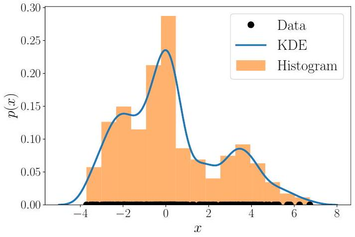

Figure 11.13 Histogram (orange bars) and kernel density estimation (blue line). The kernel density estimator produces a smooth estimate of the underlying density, whereas the histogram is an unsmoothed count measure of how many data points (black) fall into a single bin.
Figure 11.13
Histogram (orange density estimation (blue line). The kernel density estimator produces of the underlying histogram is an unsmoothed count many data points (black) fall into a single bin.

In this chapter, we discussed mixture models for density estimation. There is a plethora of density estimation techniques available. In practice, we often use histograms and kernel density estimation.

Histograms provide a nonparametric way to represent continuous densities and have been proposed by Pearson (1895). A histogram is constructed by “binning” the data space and count, how many data points fall into each bin. Then a bar is drawn at the center of each bin, and the height of the bar is proportional to the number of data points within that bin. The bin size is a critical hyperparameter, and a bad choice can lead to overfitting and underfitting. Cross-validation, as discussed in Section 8.2.4, can be used to determine a good bin size.

Kernel density estimation, independently proposed by Rosenblatt (1956) and Parzen (1962), is a nonparametric way for density estimation. Given $N$ i.i.d. samples, the kernel density estimator represents the underlying distribution as

$$
p(\boldsymbol{x})=\frac{1}{N h} \sum_{n=1}^{N} k\left(\frac{\boldsymbol{x}-\boldsymbol{x}_{n}}{h}\right),
$$

where $k$ is a kernel function, i.e., a nonnegative function that integrates to 1 and $h>0$ is a smoothing/bandwidth parameter, which plays a similar role as the bin size in histograms. Note that we place a kernel on every single data point $\boldsymbol{x}_{n}$ in the dataset. Commonly used kernel functions are the uniform distribution and the Gaussian distribution. Kernel density estimates are closely related to histograms, but by choosing a suitable kernel, we can guarantee smoothness of the density estimate. Figure 11.13 illustrates the difference between a histogram and a kernel density estimator (with a Gaussian-shaped kernel) for a given dataset of 250 data points. –
histogram m
histogram
kernel density estimation

```
 kernel density
estimation
```

, T ”