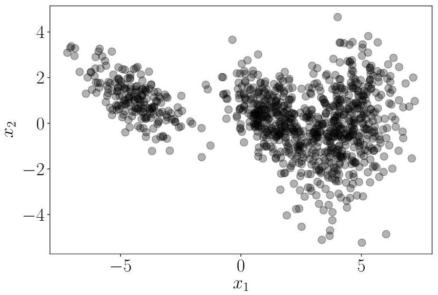
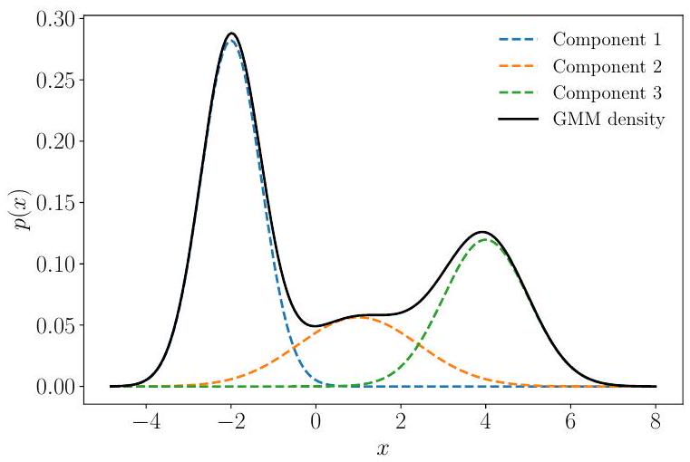

# 2020_mml-book-354-375（和訳版）

## ガウス混合モデルによる密度推定（Density Estimation with Gaussian Mixture Models）

これまでの章では、機械学習における2つの基本的な問題、すなわち回帰（第9章）と次元削減（第10章）についてすでに取り上げました。本章では、機械学習の第3の柱である**密度推定（density estimation）**について見ていきます。その過程で、期待値最大化（EM）アルゴリズムや、混合モデルを用いた密度推定の潜在変数的な視点など、重要な概念を紹介します。

機械学習をデータに適用する際、私たちはしばしば何らかの方法でデータを表現することを目指します。最も直接的な方法は、データポイントそのものをデータの表現とすることです（例として図11.1を参照）。しかし、データセットが巨大な場合や、データの特性を表現することに興味がある場合には、このアプローチは役に立たないかもしれません。密度推定では、パラメトリックな族（ガウス分布やベータ分布など）の密度を用いてデータをコンパクトに表現します。例えば、ガウス分布を用いてデータをコンパクトに表現するために、データセットの平均と分散を探すことがあります。平均と分散は、8.3節で議論した手法、すなわち最大尤度（最尤）推定または最大事後（MAP）推定を用いて見つけることができます。そして、このガウス分布の平均と分散を使用してデータに内在する分布を表現できます。つまり、その分布からサンプリングを行うとすれば、そのデータセットはその分布からの典型的な実現値であると考えるのです。

図11.1 ガウス分布では意味のある表現ができない二次元データセット。

実際には、ガウス分布（およびこれまでに出会った他のすべての分布も同様に）はモデリング能力に限界があります。例えば、図11.1のデータを生成した密度の近似としてガウス分布を用いるのは、不適切な近似となるでしょう。以下では、密度推定に使用できる、より表現力の高い分布の族である**混合モデル（mixture models）**を見ていきます。

混合モデルは、分布 $p(\boldsymbol{x})$ を $K$ 個の単純な（基底）分布の**凸結合（convex combination）**によって記述するために使用できます。

$$
\begin{aligned}
& p(\boldsymbol{x})=\sum_{k=1}^{K} \pi_{k} p_{k}(\boldsymbol{x}) \\
& 0 \leqslant \pi_{k} \leqslant 1, \quad \sum_{k=1}^{K} \pi_{k}=1
\end{aligned}
$$

ここで、コンポーネント $p_{k}$ は基本的な分布の族（ガウス分布、ベルヌーイ分布、ガンマ分布など）のメンバーであり、$\pi_{k}$ は**混合重み（mixture weights）**です。混合モデルは、対応する基底分布よりも表現力が高いです。なぜなら、多峰性（multimodal）のデータ表現が可能であり、図11.1の例のように複数の「クラスター」を持つデータセットを記述できるからです。

本書では、基本分布がガウス分布である**ガウス混合モデル（GMM: Gaussian Mixture Models）**に焦点を当てます。与えられたデータセットに対して、GMMを訓練するためにモデルパラメータの尤度を最大化することを目指します。この目的のために、第5章、第6章、および7.2節の結果を使用します。ただし、以前に議論した他の応用（線形回帰やPCA）とは異なり、解析的な（閉じた形の）最大尤度解は見つかりません。代わりに、反復的にしか解くことができない、互いに依存し合う同時方程式のセットに到達することになります。

### 11.1 ガウス混合モデル（Gaussian Mixture Model）

ガウス混合モデルは、有限個（$K$ 個）のガウス分布 $\mathcal{N}\left(\boldsymbol{x} \mid \boldsymbol{\mu}_{k}, \boldsymbol{\Sigma}_{k}\right)$ を組み合わせた密度モデルであり、次のように表されます。

$$
\begin{aligned}
& p(\boldsymbol{x} \mid \boldsymbol{\theta})=\sum_{k=1}^{K} \pi_{k} \mathcal{N}\left(\boldsymbol{x} \mid \boldsymbol{\mu}_{k}, \boldsymbol{\Sigma}_{k}\right) \\
& 0 \leqslant \pi_{k} \leqslant 1, \quad \sum_{k=1}^{K} \pi_{k}=1
\end{aligned}
$$

ここで、モデルのすべてのパラメータの集合として $\boldsymbol{\theta}:=\left\{\boldsymbol{\mu}_{k}, \boldsymbol{\Sigma}_{k}, \pi_{k}: k=1, \ldots, K\right\}$ を定義しました。このガウス分布の凸結合は、単純なガウス分布（(11.3)において $K=1$ とした場合に相当）よりも、複雑な密度をモデリングするための柔軟性を大幅に提供します。図11.2にイラストを示します。加重された各コンポーネントと混合密度が表示されており、混合密度は次のように与えられます。

$$
p(x \mid \boldsymbol{\theta})=0.5 \mathcal{N}\left(x \mid-2, \frac{1}{2}\right)+0.2 \mathcal{N}(x \mid 1,2)+0.3 \mathcal{N}(x \mid 4,1) .
$$

図11.2 ガウス混合モデル。ガウス混合分布（黒線）は、ガウス分布の凸結合で構成されており、個々のどのコンポーネントよりも表現力が高い。破線は、重み付けされたガウスコンポーネントを表す。

