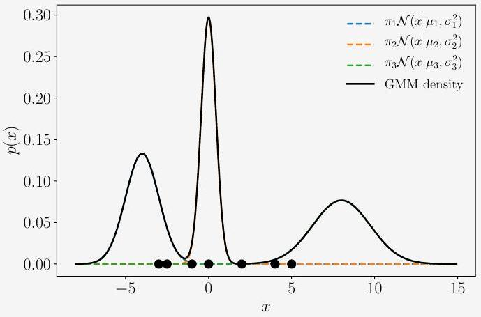

### 11.2 最大尤度法によるパラメータ学習（Parameter Learning via Maximum Likelihood）

データセット $\mathcal{X}=\left\{\boldsymbol{x}_{1}, \ldots, \boldsymbol{x}_{N}\right\}$ が与えられており、各 $\boldsymbol{x}_{n} (n= 1, \ldots, N)$ は未知の分布 $p(\boldsymbol{x})$ から独立同一分布（i.i.d.）に従って生成されたと仮定します。私たちの目的は、$K$ 個の混合成分を持つGMMを用いて、この未知の分布 $p(\boldsymbol{x})$ の適切な近似/表現を見つけることです。GMMのパラメータは、$K$ 個の平均 $\boldsymbol{\mu}_{k}$、共分散行列 $\boldsymbol{\Sigma}_{k}$、および混合重み $\pi_{k}$ です。これらすべての自由パラメータを $\boldsymbol{\theta}:=\left\{\pi_{k}, \boldsymbol{\mu}_{k}, \boldsymbol{\Sigma}_{k}: k=1, \ldots, K\right\}$ とまとめます。

## 例 11.1（初期設定）

図 11.3 初期設定：3つの混合成分（破線）を持つGMM（黒線）と7つのデータポイント（丸印）。

本章を通じて、重要な概念を説明し視覚化するのに役立つ単純な継続例を使用します。

7つのデータポイントからなる一次元データセット $\mathcal{X}=\{-3,-2.5,-1,0,2,4,5\}$ を考え、データの密度をモデル化する $K=3$ 個の成分を持つGMMを見つけたいとします。混合成分を次のように初期化します。

$$
\begin{aligned}
& p_{1}(x)=\mathcal{N}(x \mid-4,1) \\
& p_{2}(x)=\mathcal{N}(x \mid 0,0.2) \\
& p_{3}(x)=\mathcal{N}(x \mid 8,3)
\end{aligned}
$$

そして、それらに等しい重み $\pi_{1}=\pi_{2}=\pi_{3}=\frac{1}{3}$ を割り当てます。対応するモデル（およびデータポイント）を図11.3に示します。

以下では、モデルパラメータ $\boldsymbol{\theta}$ の最大尤度推定値 $\boldsymbol{\theta}_{\mathrm{ML}}$ を得る方法を詳しく説明します。まず、尤度、すなわちパラメータが与えられたときの訓練データの予測分布を書き下ろします。i.i.d.の仮定を利用すると、尤度は次のように因数分解されます。

$$
p(\mathcal{X} \mid \boldsymbol{\theta})=\prod_{n=1}^{N} p\left(\boldsymbol{x}_{n} \mid \boldsymbol{\theta}\right), \quad p\left(\boldsymbol{x}_{n} \mid \boldsymbol{\theta}\right)=\sum_{k=1}^{K} \pi_{k} \mathcal{N}\left(\boldsymbol{x}_{n} \mid \boldsymbol{\mu}_{k}, \boldsymbol{\Sigma}_{k}\right),
$$

ここで、個々の尤度項 $p\left(\boldsymbol{x}_{n} \mid \boldsymbol{\theta}\right)$ はガウス混合密度です。次に、対数尤度を次のように得ます。

$$
\log p(\mathcal{X} \mid \boldsymbol{\theta})=\sum_{n=1}^{N} \log p\left(\boldsymbol{x}_{n} \mid \boldsymbol{\theta}\right)=\underbrace{\sum_{n=1}^{N} \log \sum_{k=1}^{K} \pi_{k} \mathcal{N}\left(\boldsymbol{x}_{n} \mid \boldsymbol{\mu}_{k}, \boldsymbol{\Sigma}_{k}\right)}_{=: \mathcal{L}} .
$$

(11.10)で定義された対数尤度 $\mathcal{L}$ を最大化するパラメータ $\boldsymbol{\theta}_{\mathrm{ML}}^{*}$ を見つけることを目指します。私たちの「通常」の手順は、モデルパラメータ $\boldsymbol{\theta}$ に関する対数尤度の勾配 $\mathrm{d} \mathcal{L} / \mathrm{d} \boldsymbol{\theta}$ を計算し、それを $\mathbf{0}$ と置いて $\boldsymbol{\theta}$ について解くことでしょう。しかし、最大尤度推定の以前の例（例えば9.2節で議論した線形回帰など）とは異なり、解析的な解を得ることはできません。しかし、反復スキームを利用して適切なモデルパラメータ $\boldsymbol{\theta}_{\mathrm{ML}}$ を見つけることができます。これが、GMMに対するEMアルゴリズムであることが判明します。鍵となるアイデアは、他のパラメータを固定したまま、一度に1つのモデルパラメータを更新することです。

**備考：** もし所望の密度として単一のガウス分布を考えるならば、(11.10)の $k$ に関する和は消え、対数はガウス成分に直接適用でき、次のようになります。

$$
\log \mathcal{N}(\boldsymbol{x} \mid \boldsymbol{\mu}, \boldsymbol{\Sigma})=-\frac{D}{2} \log (2 \pi)-\frac{1}{2} \log \operatorname{det}(\boldsymbol{\Sigma})-\frac{1}{2}(\boldsymbol{x}-\boldsymbol{\mu})^{\top} \boldsymbol{\Sigma}^{-1}(\boldsymbol{x}-\boldsymbol{\mu})
$$

この単純な形式により、第8章で議論したように、$\boldsymbol{\mu}$ と $\boldsymbol{\Sigma}$ の解析的な最大尤度推定値を見つけることができます。(11.10)では、対数を $k$ に関する和の中に入れることができないため、単純な解析的な最大尤度解を得ることができません。

関数の局所最適解は、パラメータに関する勾配が消滅しなければならないという性質を持ちます（必要条件、第7章参照）。私たちのケースでは、(11.10)の対数尤度をGMMのパラメータ $\boldsymbol{\mu}_{k}, \boldsymbol{\Sigma}_{k}, \pi_{k}$ に関して最適化すると、以下の必要条件が得られます。

$$
\begin{aligned}
\frac{\partial \mathcal{L}}{\partial \boldsymbol{\mu}_{k}} & = \mathbf{0}^{\top} \Longleftrightarrow \sum_{n=1}^{N} \frac{\partial \log p\left(\boldsymbol{x}_{n} \mid \boldsymbol{\theta}\right)}{\partial \boldsymbol{\mu}_{k}} = \mathbf{0}^{\top}, \\
\frac{\partial \mathcal{L}}{\partial \boldsymbol{\Sigma}_{k}} & = \mathbf{0} \Longleftrightarrow \sum_{n=1}^{N} \frac{\partial \log p\left(\boldsymbol{x}_{n} \mid \boldsymbol{\theta}\right)}{\partial \boldsymbol{\Sigma}_{k}} = \mathbf{0}, \\
\frac{\partial \mathcal{L}}{\partial \pi_{k}} & = 0 \Longleftrightarrow \sum_{n=1}^{N} \frac{\partial \log p\left(\boldsymbol{x}_{n} \mid \boldsymbol{\theta}\right)}{\partial \pi_{k}} = 0 .
\end{aligned}
$$

3つの必要条件すべてにおいて、連鎖律（5.2.2節参照）を適用することにより、次のような形式の偏微分が必要となります。

$$
\frac{\partial \log p\left(\boldsymbol{x}_{n} \mid \boldsymbol{\theta}\right)}{\partial \boldsymbol{\theta}}=\frac{1}{p\left(x_{n} \mid \theta\right)} \frac{\partial p\left(\boldsymbol{x}_{n} \mid \boldsymbol{\theta}\right)}{\partial \boldsymbol{\theta}},
$$

ここで $\boldsymbol{\theta}=\left\{\boldsymbol{\mu}_{k}, \boldsymbol{\Sigma}_{k}, \pi_{k}, k=1, \ldots, K\right\}$ はモデルパラメータであり、

$$
\frac{1}{p\left(x_{n} \mid \theta\right)}=\frac{1}{\sum_{j=1}^{K} \pi_{j} \mathcal{N}\left(x_{n} \mid \mu_{j}, \Sigma_{j}\right)}
$$

です。以下では、(11.12)から(11.14)の偏微分を計算します。しかしその前に、本章の残りの部分で中心的な役割を果たすことになる量、**負担率（responsibilities）**を導入します。

### 11.2.1 負担率（Responsibilities）

次の量を定義します。

$$
r_{n k}:=\frac{\pi_{k} \mathcal{N}\left(\boldsymbol{x}_{n} \mid \boldsymbol{\mu}_{k}, \boldsymbol{\Sigma}_{k}\right)}{\sum_{j=1}^{K} \pi_{j} \mathcal{N}\left(\boldsymbol{x}_{n} \mid \boldsymbol{\mu}_{j}, \boldsymbol{\Sigma}_{j}\right)}
$$

これを、$n$ 番目のデータポイントに対する $k$ 番目の混合成分の**負担率（responsibility）**と呼びます。データポイント $\boldsymbol{x}_{n}$ に対する $k$ 番目の混合成分の負担率 $r_{n k}$ は、データポイントが与えられたときの混合成分の尤度

$$
p\left(\boldsymbol{x}_{n} \mid \pi_{k}, \boldsymbol{\mu}_{k}, \boldsymbol{\Sigma}_{k}\right)=\pi_{k} \mathcal{N}\left(\boldsymbol{x}_{n} \mid \boldsymbol{\mu}_{k}, \boldsymbol{\Sigma}_{k}\right)
$$

に比例します。したがって、あるデータポイントがその混合成分からの妥当なサンプルとなり得る場合、その混合成分はそのデータポイントに対して高い負担率を持ちます。$\boldsymbol{r}_{n}:=\left[r_{n 1}, \ldots, r_{n K}\right]^{\top} \in \mathbb{R}^{K}$ は（正規化された）確率ベクトル、すなわち $r_{n k} \geqslant 0$ かつ $\sum_{k} r_{n k}=1$ であることに注意してください。この確率ベクトルは $K$ 個の混合成分の間で確率質量を分配するものであり、$\boldsymbol{r}_{n}$ を $K$ 個の混合成分への $\boldsymbol{x}_{n}$ の「ソフトな割り当て（soft assignment）」と考えることができます。したがって、(11.17)の負担率 $r_{n k}$ は、$\boldsymbol{x}_{n}$ が $k$ 番目の混合成分によって生成された確率を表します。

## 例 11.2（負担率）

図11.3の例について、負担率 $r_{n k}$ を計算します。

$$
\left[\begin{array}{ccc}
1.0 & 0.0 & 0.0 \\
1.0 & 0.0 & 0.0 \\
0.057 & 0.943 & 0.0 \\
0.001 & 0.999 & 0.0 \\
0.0 & 0.066 & 0.934 \\
0.0 & 0.0 & 1.0 \\
0.0 & 0.0 & 1.0
\end{array}\right] \in \mathbb{R}^{N \times K} .
$$

ここで、$n$ 行目は $x_{n}$ に対するすべての混合成分の負担率を示しています。あるデータポイントに対する $K$ 個すべての負担率の和（各行の和）は1です。$k$ 列目は、$k$ 番目の混合成分の負担率の概要を示しています。3番目の混合成分（第3列）は最初の4つのデータポイントについては責任を負っていませんが、残りのデータポイントについては多くの責任を負っていることがわかります。列のすべての要素の和は、値 $N_{k}$、すなわち $k$ 番目の混合成分の総負担率を与えます。この例では、$N_{1}=2.058, N_{2}= 2.008, N_{3}=2.934$ となります。
