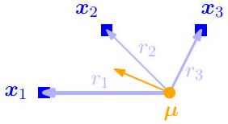
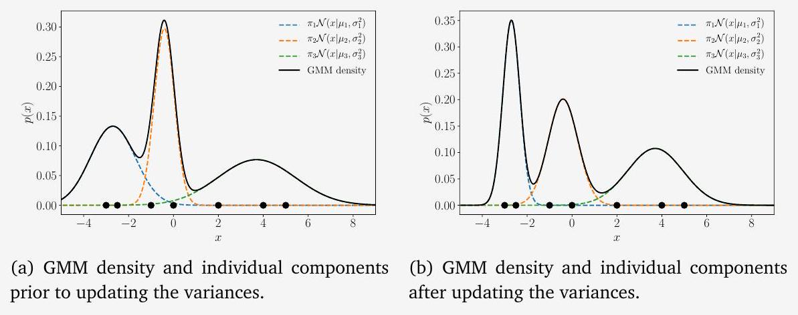

### 11.2.2 平均の更新（Updating the Means）

**定理 11.1（GMMの平均の更新）。** GMMの平均パラメータ $\boldsymbol{\mu}_{k} (k=1, \ldots, K)$ の更新式は次のように与えられます。

$$
\boldsymbol{\mu}_{k}^{\text {new }}=\frac{\sum_{n=1}^{N} r_{n k} \boldsymbol{x}_{n}}{\sum_{n=1}^{N} r_{n k}},
$$

ここで、負担率 $r_{n k}$ は(11.17)で定義されています。

**備考：** (11.20)における個々の混合成分の平均 $\boldsymbol{\mu}_{k}$ の更新は、(11.17)で与えられる $r_{n k}$ を介して、すべての平均、共分散行列 $\boldsymbol{\Sigma}_{k}$、および混合重み $\pi_{k}$ に依存します。したがって、すべての $\boldsymbol{\mu}_{k}$ を一度に求める解析的な解を得ることはできません。

**証明：** (11.15)より、平均パラメータ $\boldsymbol{\mu}_{k} (k=1, \ldots, K)$ に関する対数尤度の勾配を求めるには、次の偏微分を計算する必要があります。

$$
\begin{aligned}
\frac{\partial p\left(\boldsymbol{x}_{n} \mid \boldsymbol{\theta}\right)}{\partial \boldsymbol{\mu}_{k}} & =\sum_{j=1}^{K} \pi_{j} \frac{\partial \mathcal{N}\left(\boldsymbol{x}_{n} \mid \boldsymbol{\mu}_{j}, \boldsymbol{\Sigma}_{j}\right)}{\partial \boldsymbol{\mu}_{k}}=\pi_{k} \frac{\partial \mathcal{N}\left(\boldsymbol{x}_{n} \mid \boldsymbol{\mu}_{k}, \boldsymbol{\Sigma}_{k}\right)}{\partial \boldsymbol{\mu}_{k}} \\
& =\pi_{k}\left(\boldsymbol{x}_{n}-\boldsymbol{\mu}_{k}\right)^{\top} \boldsymbol{\Sigma}_{k}^{-1} \mathcal{N}\left(\boldsymbol{x}_{n} \mid \boldsymbol{\mu}_{k}, \boldsymbol{\Sigma}_{k}\right)
\end{aligned}
$$

ここで、$k$ 番目の混合成分のみが $\boldsymbol{\mu}_{k}$ に依存するという事実を利用しました。(11.21b)の結果を(11.15)に代入してすべてをまとめると、$\boldsymbol{\mu}_{k}$ に関する $\mathcal{L}$ の目的の偏微分は次のように与えられます。

$$
\begin{aligned}
\frac{\partial \mathcal{L}}{\partial \boldsymbol{\mu}_{k}} & =\sum_{n=1}^{N} \frac{\partial \log p\left(\boldsymbol{x}_{n} \mid \boldsymbol{\theta}\right)}{\partial \boldsymbol{\mu}_{k}}=\sum_{n=1}^{N} \frac{1}{p\left(x_{n} \mid \theta\right)} \frac{\partial p\left(\boldsymbol{x}_{n} \mid \boldsymbol{\theta}\right)}{\partial \boldsymbol{\mu}_{k}} \\
& =\sum_{n=1}^{N}\left(\boldsymbol{x}_{n}-\boldsymbol{\mu}_{k}\right)^{\top} \boldsymbol{\Sigma}_{k}^{-1} \underbrace{\frac{\pi_{k} \mathcal{N}\left(\boldsymbol{x}_{n} \mid \boldsymbol{\mu}_{k}, \boldsymbol{\Sigma}_{k}\right)}{\sum_{j=1}^{K} \pi_{j} \mathcal{N}\left(x_{n} \mid \mu_{j}, \Sigma_{j}\right)}}_{=r_{n k}} \\
& =\sum_{n=1}^{N} r_{n k}\left(\boldsymbol{x}_{n}-\boldsymbol{\mu}_{k}\right)^{\top} \boldsymbol{\Sigma}_{k}^{-1} .
\end{aligned}
$$

ここで、(11.16)の恒等式と(11.21b)の偏微分の結果を使用して(11.22b)を導きました。値 $r_{n k}$ は(11.17)で定義した負担率です。

次に、$\frac{\partial \mathcal{L}\left(\boldsymbol{\mu}_{k}^{\text {new }}\right)}{\partial \boldsymbol{\mu}_{k}}=\mathbf{0}^{\top}$ となるように (11.22c) を $\boldsymbol{\mu}_{k}^{\text {new }}$ について解くと、次が得られます。

$$
\sum_{n=1}^{N} r_{n k} \boldsymbol{x}_{n}=\sum_{n=1}^{N} r_{n k} \boldsymbol{\mu}_{k}^{\text {new }} \Longleftrightarrow \boldsymbol{\mu}_{k}^{\text {new }}=\frac{\sum_{n=1}^{N} r_{n k} \boldsymbol{x}_{n}}{\sum_{n=1}^{N} r_{n k}}=\frac{1}{N_{k}} \sum_{n=1}^{N} r_{n k} \boldsymbol{x}_{n}
$$

ここで、データセット全体に対する $k$ 番目の混合成分の総負担率として次を定義しました。

$$
N_{k}:=\sum_{n=1}^{N} r_{n k}
$$

これで定理11.1の証明が完了しました。

直感的には、(11.20)は平均の**重要度加重モンテカルロ推定（importance-weighted Monte Carlo estimate）**と解釈でき、データポイント $\boldsymbol{x}_{n}$ の重要度重みは、$\boldsymbol{x}_{n}$ に対する $k$ 番目のクラスターの負担率 $r_{n k} (k=1, \ldots, K)$ です。

したがって、平均 $\boldsymbol{\mu}_{k}$ は、負担率 $r_{n k}$ によって与えられる強さでデータポイント $\boldsymbol{x}_{n}$ の方へ引き寄せられます。平均は、対応する混合成分が高い負担率（すなわち高い尤度）を持つデータポイントの方へ、より強く引き寄せられます。図11.4にこれを示します。また、(11.20)の平均の更新は、次の正規化された確率ベクトル

$$
\boldsymbol{r}_{k}:=\left[r_{1 k}, \ldots, r_{N k}\right]^{\top} / N_{k}
$$

によって与えられる分布の下での、すべてのデータポイントの期待値として解釈することもできます。すなわち、

$$
\boldsymbol{\mu}_{k} \leftarrow \mathbb{E}_{\boldsymbol{r}_{k}}[\mathcal{X}]
$$

です。

## 例 11.3（平均の更新）

図11.3の例において、平均値は次のように更新されます。

$$
\begin{aligned}
& \mu_{1}:-4 \rightarrow-2.7 \\
& \mu_{2}: 0 \rightarrow-0.4 \\
& \mu_{3}: 8 \rightarrow 3.7
\end{aligned}
$$

ここでは、1番目と3番目の混合成分の平均がデータの存在する領域に向かって移動しているのに対し、2番目の成分の平均はそれほど劇的には変化していないことがわかります。図11.5はこの変化を示しており、図11.5(a)は平均を更新する前のGMM密度を、図11.5(b)は平均値 $\mu_{k}$ を更新した後のGMM密度を示しています。

(11.20)の平均パラメータの更新はかなり単純に見えます。しかし、負担率 $r_{n k}$ はすべての $j=1, \ldots, K$ について $\pi_{j}, \boldsymbol{\mu}_{j}, \boldsymbol{\Sigma}_{j}$ の関数であるため、(11.20)の更新はGMMのすべてのパラメータに依存しており、9.2節の線形回帰や第10章のPCAで得られたような解析的な解は得られないことに注意してください。

図 11.4 GMMにおける混合成分の平均パラメータの更新。平均 $\boldsymbol{\mu}$ は、対応する負担率によって与えられる重みで個々のデータポイントの方へ引き寄せられる。

図 11.5 GMMにおける平均値更新の効果。(a) 平均値を更新する前のGMM、(b) 分散と混合重みを維持したまま平均値 $\mu_{k}$ を更新した後のGMM。

### 11.2.3 共分散の更新（Updating the Covariances）

**定理 11.2（GMMの共分散の更新）。** GMMの共分散パラメータ $\boldsymbol{\Sigma}_{k} (k=1, \ldots, K)$ の更新式は次のように与えられます。

$$
\boldsymbol{\Sigma}_{k}^{\text {new }}=\frac{1}{N_{k}} \sum_{n=1}^{N} r_{n k}\left(\boldsymbol{x}_{n}-\boldsymbol{\mu}_{k}\right)\left(\boldsymbol{x}_{n}-\boldsymbol{\mu}_{k}\right)^{\top},
$$

ここで、$r_{n k}$ と $N_{k}$ はそれぞれ(11.17)と(11.24)で定義されています。

**証明：** 定理11.2を証明するために、共分散 $\boldsymbol{\Sigma}_{k}$ に関する対数尤度 $\mathcal{L}$ の偏微分を計算し、それを $\mathbf{0}$ と置いて $\boldsymbol{\Sigma}_{k}$ について解きます。まず一般的なアプローチから始めます。

$$
\frac{\partial \mathcal{L}}{\partial \boldsymbol{\Sigma}_{k}}=\sum_{n=1}^{N} \frac{\partial \log p\left(\boldsymbol{x}_{n} \mid \boldsymbol{\theta}\right)}{\partial \boldsymbol{\Sigma}_{k}}=\sum_{n=1}^{N} \frac{1}{p\left(x_{n} \mid \theta\right)} \frac{\partial p\left(\boldsymbol{x}_{n} \mid \boldsymbol{\theta}\right)}{\partial \boldsymbol{\Sigma}_{k}} .
$$

$1/p\left(\boldsymbol{x}_{n} \mid \boldsymbol{\theta}\right)$ はすでに(11.16)からわかっています。残りの偏微分 $\partial p\left(\boldsymbol{x}_{n} \mid \boldsymbol{\theta}\right) / \partial \boldsymbol{\Sigma}_{k}$ を得るために、ガウス分布 $p\left(\boldsymbol{x}_{n} \mid \boldsymbol{\theta}\right)$ の定義（(11.9)参照）を書き下し、$k$ 番目以外のすべての項を落とします。すると次が得られます。

$$
\begin{aligned}
& \frac{\partial p\left(\boldsymbol{x}_{n} \mid \boldsymbol{\theta}\right)}{\partial \boldsymbol{\Sigma}_{k}} \\
& =\frac{\partial}{\partial \boldsymbol{\Sigma}_{k}}\left(\pi_{k}(2 \pi)^{-\frac{D}{2}} \operatorname{det}\left(\boldsymbol{\Sigma}_{k}\right)^{-\frac{1}{2}} \exp \left(-\frac{1}{2}\left(\boldsymbol{x}_{n}-\boldsymbol{\mu}_{k}\right)^{\top} \boldsymbol{\Sigma}_{k}^{-1}\left(\boldsymbol{x}_{n}-\boldsymbol{\mu}_{k}\right)\right)\right) \\
& =\pi_{k}(2 \pi)^{-\frac{D}{2}}\left[\frac{\partial}{\partial \boldsymbol{\Sigma}_{k}} \operatorname{det}\left(\boldsymbol{\Sigma}_{k}\right)^{-\frac{1}{2}} \exp \left(-\frac{1}{2}\left(\boldsymbol{x}_{n}-\boldsymbol{\mu}_{k}\right)^{\top} \boldsymbol{\Sigma}_{k}^{-1}\left(\boldsymbol{x}_{n}-\boldsymbol{\mu}_{k}\right)\right)\right. \\
& \left.\quad+\operatorname{det}\left(\boldsymbol{\Sigma}_{k}\right)^{-\frac{1}{2}} \frac{\partial}{\partial \boldsymbol{\Sigma}_{k}} \exp \left(-\frac{1}{2}\left(\boldsymbol{x}_{n}-\boldsymbol{\mu}_{k}\right)^{\top} \boldsymbol{\Sigma}_{k}^{-1}\left(\boldsymbol{x}_{n}-\boldsymbol{\mu}_{k}\right)\right)\right] .
\end{aligned}
$$

ここで、次の恒等式を使用します。

$$
\begin{gathered}
\frac{\partial}{\partial \boldsymbol{\Sigma}_{k}} \operatorname{det}\left(\boldsymbol{\Sigma}_{k}\right)^{-\frac{1}{2}} \stackrel{(5.101)}{=}-\frac{1}{2} \operatorname{det}\left(\boldsymbol{\Sigma}_{k}\right)^{-\frac{1}{2}} \boldsymbol{\Sigma}_{k}^{-1} \\
\frac{\partial}{\partial \boldsymbol{\Sigma}_{k}}\left(\boldsymbol{x}_{n}-\boldsymbol{\mu}_{k}\right)^{\top} \boldsymbol{\Sigma}_{k}^{-1}\left(\boldsymbol{x}_{n}-\boldsymbol{\mu}_{k}\right) \stackrel{(5.103)}{=}-\boldsymbol{\Sigma}_{k}^{-1}\left(\boldsymbol{x}_{n}-\boldsymbol{\mu}_{k}\right)\left(\boldsymbol{x}_{n}-\boldsymbol{\mu}_{k}\right)^{\top} \boldsymbol{\Sigma}_{k}^{-1}
\end{gathered}
$$

（整理した後）(11.31)で必要とされる目的の偏微分を次のように得ます。

$$
\begin{aligned}
\frac{\partial p\left(\boldsymbol{x}_{n} \mid \boldsymbol{\theta}\right)}{\partial \boldsymbol{\Sigma}_{k}}= & \pi_{k} \mathcal{N}\left(\boldsymbol{x}_{n} \mid \boldsymbol{\mu}_{k}, \boldsymbol{\Sigma}_{k}\right) \\
& \cdot\left[-\frac{1}{2}\left(\boldsymbol{\Sigma}_{k}^{-1}-\boldsymbol{\Sigma}_{k}^{-1}\left(\boldsymbol{x}_{n}-\boldsymbol{\mu}_{k}\right)\left(\boldsymbol{x}_{n}-\boldsymbol{\mu}_{k}\right)^{\top} \boldsymbol{\Sigma}_{k}^{-1}\right)\right] .
\end{aligned}
$$

すべてをまとめると、$\boldsymbol{\Sigma}_{k}$ に関する対数尤度の偏微分は次のように与えられます。

$$
\begin{aligned}
\frac{\partial \mathcal{L}}{\partial \boldsymbol{\Sigma}_{k}} & =\sum_{n=1}^{N} \frac{\partial \log p\left(\boldsymbol{x}_{n} \mid \boldsymbol{\theta}\right)}{\partial \boldsymbol{\Sigma}_{k}}=\sum_{n=1}^{N} \frac{1}{p\left(x_{n} \mid \theta\right)} \frac{\partial p\left(\boldsymbol{x}_{n} \mid \boldsymbol{\theta}\right)}{\partial \boldsymbol{\Sigma}_{k}} \\
& =\sum_{n=1}^{N} \underbrace{\frac{\pi_{k} \mathcal{N}\left(\boldsymbol{x}_{n} \mid \boldsymbol{\mu}_{k}, \boldsymbol{\Sigma}_{k}\right)}{\sum_{j=1}^{K} \pi_{j} \mathcal{N}\left(x_{n} \mid \mu_{j}, \Sigma_{j}\right)}}_{=r_{n k}} \\
& \cdot\left[-\frac{1}{2}\left(\boldsymbol{\Sigma}_{k}^{-1}-\boldsymbol{\Sigma}_{k}^{-1}\left(\boldsymbol{x}_{n}-\boldsymbol{\mu}_{k}\right)\left(\boldsymbol{x}_{n}-\boldsymbol{\mu}_{k}\right)^{\top} \boldsymbol{\Sigma}_{k}^{-1}\right)\right] \\
& =-\frac{1}{2} \sum_{n=1}^{N} r_{n k}\left(\boldsymbol{\Sigma}_{k}^{-1}-\boldsymbol{\Sigma}_{k}^{-1}\left(\boldsymbol{x}_{n}-\boldsymbol{\mu}_{k}\right)\left(\boldsymbol{x}_{n}-\boldsymbol{\mu}_{k}\right)^{\top} \boldsymbol{\Sigma}_{k}^{-1}\right) \\
& =-\frac{1}{2} \boldsymbol{\Sigma}_{k}^{-1} \underbrace{\sum_{n=1}^{N} r_{n k}}_{=N_{k}}+\frac{1}{2} \boldsymbol{\Sigma}_{k}^{-1}\left(\sum_{n=1}^{N} r_{n k}\left(\boldsymbol{x}_{n}-\boldsymbol{\mu}_{k}\right)\left(\boldsymbol{x}_{n}-\boldsymbol{\mu}_{k}\right)^{\top}\right) \boldsymbol{\Sigma}_{k}^{-1}
\end{aligned}$$

負担率 $r_{n k}$ がこの偏微分にも現れることがわかります。この偏微分を $\mathbf{0}$ と置くことで、必要な最適条件が得られます。

$$
\begin{aligned}
& N_{k} \boldsymbol{\Sigma}_{k}^{-1}=\boldsymbol{\Sigma}_{k}^{-1}\left(\sum_{n=1}^{N} r_{n k}\left(\boldsymbol{x}_{n}-\boldsymbol{\mu}_{k}\right)\left(\boldsymbol{x}_{n}-\boldsymbol{\mu}_{k}\right)^{\top}\right) \boldsymbol{\Sigma}_{k}^{-1} \\
\Longleftrightarrow & N_{k} \boldsymbol{I}=\left(\sum_{n=1}^{N} r_{n k}\left(\boldsymbol{x}_{n}-\boldsymbol{\mu}_{k}\right)\left(\boldsymbol{x}_{n}-\boldsymbol{\mu}_{k}\right)^{\top}\right) \boldsymbol{\Sigma}_{k}^{-1}
\end{aligned}$$

これを $\boldsymbol{\Sigma}_{k}$ について解くことにより、次を得ます。

$$
\boldsymbol{\Sigma}_{k}^{\mathrm{new}}=\frac{1}{N_{k}} \sum_{n=1}^{N} r_{n k}\left(\boldsymbol{x}_{n}-\boldsymbol{\mu}_{k}\right)\left(\boldsymbol{x}_{n}-\boldsymbol{\mu}_{k}\right)^{\top},
$$

ここで $\boldsymbol{r}_{k}$ は(11.25)で定義された確率ベクトルです。これにより、$k=1, \ldots, K$ に対する $\boldsymbol{\Sigma}_{k}$ の単純な更新規則が得られ、定理11.2が証明されました。

(11.20)における $\boldsymbol{\mu}_{k}$ の更新と同様に、(11.30)における共分散の更新は、中心化されたデータ $\tilde{\mathcal{X}}_{k}:=\left\{\boldsymbol{x}_{1}-\boldsymbol{\mu}_{k}, \ldots, \boldsymbol{x}_{N}-\boldsymbol{\mu}_{k}\right\}$ の二乗の重要度加重期待値として解釈できます。

## 例 11.4（分散の更新）

図11.3の例において、分散は次のように更新されます。

$$
\begin{aligned}
& \sigma_{1}^{2}: 1 \rightarrow 0.14 \\
& \sigma_{2}^{2}: 0.2 \rightarrow 0.44 \\
& \sigma_{3}^{2}: 3 \rightarrow 1.53
\end{aligned}
$$

ここでは、1番目と3番目の成分の分散が大幅に縮小しているのに対し、2番目の成分の分散はわずかに増加していることがわかります。

図11.6はこの設定を示しています。図11.6(a)は図11.5(b)と同一（ただしズームアップしたもの）であり、分散を更新する前のGMM密度とその個々の成分を示しています。図11.6(b)は分散を更新した後のGMM密度を示しています。

図 11.6 GMMにおける分散更新の効果。(a) 分散を更新する前のGMM、(b) 平均と混合重みを維持したまま分散を更新した後のGMM。

平均パラメータの更新と同様に、(11.30)を、$k$ 番目の混合成分に関連付けられたデータポイント $\boldsymbol{x}_{n}$ の加重共分散のモンテカルロ推定と解釈でき、その重みは負担率 $r_{n k}$ です。平均パラメータの更新と同様、この更新も負担率 $r_{n k}$ を通じてすべての $\pi_{j}, \boldsymbol{\mu}_{j}, \boldsymbol{\Sigma}_{j} (j=1, \ldots, K)$ に依存するため、解析的な解を得ることはできません。
