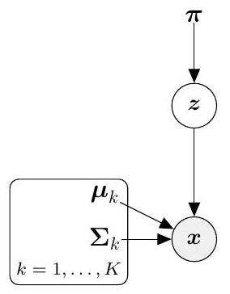
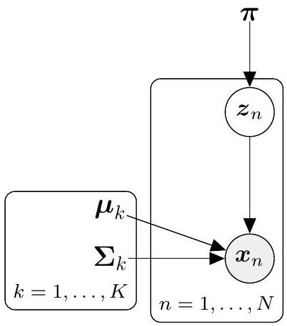

### 11.4 潜在変数的な視点（Latent-Variable Perspective）

GMMを、離散的な**潜在変数モデル（latent-variable model）**の観点から見ることができます。すなわち、潜在変数 $\boldsymbol{z}$ が有限の集合の値のみを取ることができるモデルです。これは、潜在変数が $\mathbb{R}^{M}$ 内の連続値であったPCAとは対照的です。

確率的な視点の利点は、(i) 前のセクションで行ったいくつかのその場しのぎ（ad hoc）の決定を正当化できること、(ii) 負担率を事後確率として具体的に解釈できること、(iii) モデルパラメータを更新するための反復アルゴリズムを、潜在変数モデルにおける最大尤度パラメータ推定のためのEMアルゴリズムとして体系的な方法で導出できることです。

### 11.4.1 生成プロセスと確率モデル（Generative Process and Probabilistic Model）

GMMの確率モデルを導出するには、生成プロセス、すなわち確率モデルを用いてデータを生成することを可能にするプロセスについて考えるのが有益です。

$K$ 個のコンポーネントを持つ混合モデルを想定し、あるデータポイント $\boldsymbol{x}$ はちょうど1つの混合成分によって生成されると仮定します。そのデータポイントを $k$ 番目の混合成分が生成したかどうかを示す、2つの状態を持つバイナリのインジケータ変数 $z_{k} \in\{0,1\}$ を導入します（6.2節参照）。これにより、次のように書けます。

$$
p\left(\boldsymbol{x} \mid z_{k}=1\right)=\mathcal{N}\left(\boldsymbol{x} \mid \boldsymbol{\mu}_{k}, \boldsymbol{\Sigma}_{k}\right) .
$$

$\boldsymbol{z}:=\left[z_{1}, \ldots, z_{K}\right]^{\top} \in \mathbb{R}^{K}$ を、$K-1$ 個の 0 とちょうど1つの 1 からなる確率ベクトルとして定義します。例えば $K=3$ の場合、有効な $\boldsymbol{z}$ は $\boldsymbol{z}=\left[z_{1}, z_{2}, z_{3}\right]^{\top}=[0,1,0]^{\top}$ のようになり、これは $z_{2}=1$ であるため2番目の混合成分を選択することを意味します。

**備考：** この種の確率分布は、ベルヌーイ分布を2つ以上の値に一般化した「マルチヌーイ（multinoulli）」分布と呼ばれることもあります(Murphy, 2012)。

$\boldsymbol{z}$ の性質は $\sum_{k=1}^{K} z_{k}=1$ であることを意味します。したがって、$\boldsymbol{z}$ は**ワンホットエンコーディング（one-hot encoding）**（別名：1-of-K 表現）です。

これまでは、インジケータ変数 $z_{k}$ が既知であると仮定してきました。しかし、実際にはそうではなく、潜在変数 $\boldsymbol{z}$ に対して次のような**事前分布（prior distribution）**を置きます。

$$
p(\boldsymbol{z})=\boldsymbol{\pi}=\left[\pi_{1}, \ldots, \pi_{K}\right]^{\top}, \quad \sum_{k=1}^{K} \pi_{k}=1 .
$$

すると、この確率ベクトルの $k$ 番目の要素

$$
\pi_{k}=p\left(z_{k}=1\right)
$$

は、$k$ 番目の混合成分がデータポイント $\boldsymbol{x}$ を生成した確率を表します。

図 11.11 単一のデータポイントを持つGMMのグラフィカルモデル。

**備考（GMMからのサンプリング）：** この潜在変数モデルの構築（図11.11の対応するグラフィカルモデルを参照）は、データを生成するための非常に単純なサンプリング手順（生成プロセス）に適しています。

1. $z^{(i)} \sim p(\boldsymbol{z})$ をサンプリングする。
2. $\boldsymbol{x}^{(i)} \sim p\left(\boldsymbol{x} \mid z^{(i)}=1\right)$ をサンプリングする。

最初のステップでは、（ワンホットエンコーディング $\boldsymbol{z}$ を介して）$p(\boldsymbol{z})=\boldsymbol{\pi}$ に従って混合成分 $i$ をランダムに選択します。2番目のステップでは、対応する混合成分からサンプルを抽出します。潜在変数のサンプルを破棄して $\boldsymbol{x}^{(i)}$ だけを残すと、GMMからの有効なサンプルが得られます。確率変数のサンプルがグラフィカルモデルにおけるその変数の親のサンプルに依存するこのようなサンプリングは、**アンスエストラルサンプリング（ancestral sampling）**と呼ばれます。

一般に、確率モデルはデータと潜在変数の同時分布によって定義されます（8.4節参照）。(11.59)と(11.60)で定義された事前分布 $p(\boldsymbol{z})$ と、(11.58)の条件付き分布 $p(\boldsymbol{x} \mid \boldsymbol{z})$ を用いると、この同時分布の $K$ 個すべての成分は次のように得られます。

$$
p\left(\boldsymbol{x}, z_{k}=1\right)=p\left(\boldsymbol{x} \mid z_{k}=1\right) p\left(z_{k}=1\right)=\pi_{k} \mathcal{N}\left(\boldsymbol{x} \mid \boldsymbol{\mu}_{k}, \boldsymbol{\Sigma}_{k}\right)
$$

これを $k=1, \ldots, K$ についてまとめると、

$$
p(\boldsymbol{x}, \boldsymbol{z})=\left[\begin{array}{c}
p\left(\boldsymbol{x}, z_{1}=1\right) \\
\vdots \\
p\left(\boldsymbol{x}, z_{K}=1\right)
\end{array}\right]=\left[\begin{array}{c}
\pi_{1} \mathcal{N}\left(\boldsymbol{x} \mid \boldsymbol{\mu}_{1}, \boldsymbol{\Sigma}_{1}\right) \\
\vdots \\
\pi_{K} \mathcal{N}\left(\boldsymbol{x} \mid \boldsymbol{\mu}_{K}, \boldsymbol{\Sigma}_{K}\right)
\end{array}\right]
$$

となり、これで確率モデルが完全に指定されました。

### 11.4.2 尤度（Likelihood）

潜在変数モデルにおいて尤度 $p(\boldsymbol{x} \mid \boldsymbol{\theta})$ を得るには、潜在変数を周辺化（周辺消去）する必要があります（8.4.3節参照）。私たちのケースでは、(11.62)の同時分布 $p(\boldsymbol{x}, \boldsymbol{z})$ からすべての潜在変数を足し合わせることでこれを行うことができます。

$$
p(\boldsymbol{x} \mid \boldsymbol{\theta})=\sum_{\boldsymbol{z}} p(\boldsymbol{x} \mid \boldsymbol{\theta}, \boldsymbol{z}) p(\boldsymbol{z} \mid \boldsymbol{\theta}), \quad \boldsymbol{\theta}:=\left\{\boldsymbol{\mu}_{k}, \boldsymbol{\Sigma}_{k}, \pi_{k}: k=1, \ldots, K\right\} .
$$

ここでは、以前は省略していた確率モデルのパラメータ $\boldsymbol{\theta}$ を明示的に条件として付けています。(11.63)では、$\boldsymbol{z}$ のすべての可能なワンホットエンコーディングにわたって和を取っており、これを $\sum_{\boldsymbol{z}}$ で表しています。各 $\boldsymbol{z}$ には非ゼロの要素が1つしかないため、$\boldsymbol{z}$ の可能な構成/設定は $K$ 個しかありません。例えば $K=3$ の場合、$\boldsymbol{z}$ は次の構成を取り得ます。

$$
\left[\begin{array}{l}
1 \\
0 \\
0
\end{array}\right], \left[\begin{array}{l}
0 \\
1 \\
0
\end{array}\right], \left[\begin{array}{l}
0 \\
0 \\
1
\end{array}\right] .
$$

(11.63)において $\boldsymbol{z}$ のすべての可能な構成にわたって和を取ることは、$\boldsymbol{z}$ ベクトルの非ゼロ要素に注目して次のように書くことと同等です。

$$
\begin{aligned}
p(\boldsymbol{x} \mid \boldsymbol{\theta}) & =\sum_{\boldsymbol{z}} p(\boldsymbol{x} \mid \boldsymbol{\theta}, \boldsymbol{z}) p(\boldsymbol{z} \mid \boldsymbol{\theta}) \\
& =\sum_{k=1}^{K} p\left(\boldsymbol{x} \mid \boldsymbol{\theta}, z_{k}=1\right) p\left(z_{k}=1 \mid \boldsymbol{\theta}\right)
\end{aligned}
$$

したがって、求める周辺分布は次のように与えられます。

$$
\begin{aligned}
p(\boldsymbol{x} \mid \boldsymbol{\theta}) & \stackrel{(11.65 \mathrm{~b})}{=} \sum_{k=1}^{K} p\left(\boldsymbol{x} \mid \boldsymbol{\theta}, z_{k}=1\right) p\left(z_{k}=1 \mid \boldsymbol{\theta}\right) \\
& =\sum_{k=1}^{K} \pi_{k} \mathcal{N}\left(\boldsymbol{x} \mid \boldsymbol{\mu}_{k}, \mathbf{\Sigma}_{k}\right)
\end{aligned}
$$

これは(11.3)のGMMモデルと同一であることがわかります。データセット $\mathcal{X}$ が与えられたとき、直ちに尤度が得られます。

$$
p(\mathcal{X} \mid \boldsymbol{\theta})=\prod_{n=1}^{N} p\left(\boldsymbol{x}_{n} \mid \boldsymbol{\theta}\right) \stackrel{(11.66 \mathrm{~b})}{=} \prod_{n=1}^{N} \sum_{k=1}^{K} \pi_{k} \mathcal{N}\left(\boldsymbol{x}_{n} \mid \boldsymbol{\mu}_{k}, \boldsymbol{\Sigma}_{k}\right),
$$

これはまさに(11.9)のGMMの尤度です。したがって、潜在的なインジケータ $z_{k}$ を用いた潜在変数モデルは、ガウス混合モデルについて考えるための同等な方法です。

### 11.4.3 事後分布（Posterior Distribution）

潜在変数 $\boldsymbol{z}$ の事後分布について簡単に見てみましょう。ベイズの定理によれば、データポイント $\boldsymbol{x}$ を $k$ 番目のコンポーネントが生成した事後確率は次のようになります。

$$
p\left(z_{k}=1 \mid \boldsymbol{x}\right)=\frac{p\left(z_{k}=1\right) p\left(\boldsymbol{x} \mid z_{k}=1\right)}{p(\boldsymbol{x})},
$$

ここで周辺分布 $p(\boldsymbol{x})$ は(11.66b)で与えられます。これにより、$k$ 番目のインジケータ変数 $z_{k}$ の事後分布は次のように得られます。

$$
p\left(z_{k}=1 \mid \boldsymbol{x}\right)=\frac{p\left(z_{k}=1\right) p\left(\boldsymbol{x} \mid z_{k}=1\right)}{\sum_{j=1}^{K} p\left(z_{j}=1\right) p\left(\boldsymbol{x} \mid z_{j}=1\right)}=\frac{\pi_{k} \mathcal{N}\left(\boldsymbol{x} \mid \boldsymbol{\mu}_{k}, \boldsymbol{\Sigma}_{k}\right)}{\sum_{j=1}^{K} \pi_{j} \mathcal{N}\left(\boldsymbol{x} \mid \boldsymbol{\mu}_{j}, \boldsymbol{\Sigma}_{j}\right)},
$$

これは、データポイント $\boldsymbol{x}$ に対する $k$ 番目の混合成分の負担率（responsibility）として識別できます。ここでは、GMMのパラメータ $\pi_{k}, \boldsymbol{\mu}_{k}, \boldsymbol{\Sigma}_{k} (k=1, \ldots, K)$ に対する明示的な条件付けを省略していることに注意してください。

### 11.4.4 データセット全体への拡張（Extension to a Full Dataset）

これまでは、データセットが単一のデータポイント $\boldsymbol{x}$ のみからなる場合について議論してきました。しかし、事前分布と事後分布の概念は、$N$ 個のデータポイント $\mathcal{X}:=\left\{\boldsymbol{x}_{1}, \ldots, \boldsymbol{x}_{N}\right\}$ の場合に直接拡張できます。

GMMの確率的な解釈において、すべてのデータポイント $\boldsymbol{x}_{n}$ はそれぞれ独自の潜在変数を持っています。

$$
\boldsymbol{z}_{n}=\left[z_{n 1}, \ldots, z_{n K}\right]^{\top} \in \mathbb{R}^{K} .
$$

以前（単一のデータポイント $\boldsymbol{x}$ のみを考慮したとき）はインデックス $n$ を省略していましたが、ここではこれが重要になります。

すべての潜在変数 $\boldsymbol{z}_{n}$ に対して同じ事前分布 $\boldsymbol{\pi}$ を共有します。対応するグラフィカルモデルを図11.12に示します。ここではプレート表記（plate notation）を使用しています。

条件付き分布 $p\left(\boldsymbol{x}_{1}, \ldots, \boldsymbol{x}_{N} \mid \boldsymbol{z}_{1}, \ldots, \boldsymbol{z}_{N}\right)$ はデータポイントに関して因数分解され、次のように与えられます。

$$
p\left(\boldsymbol{x}_{1}, \ldots, \boldsymbol{x}_{N} \mid \boldsymbol{z}_{1}, \ldots, \boldsymbol{z}_{N}\right)=\prod_{n=1}^{N} p\left(\boldsymbol{x}_{n} \mid \boldsymbol{z}_{n}\right)
$$

事後分布 $p\left(z_{n k}=1 \mid \boldsymbol{x}_{n}\right)$ を得るには、11.4.3節と同じ論理に従ってベイズの定理を適用し、次を得ます。

$$
\begin{aligned}
p\left(z_{n k}=1 \mid \boldsymbol{x}_{n}\right) & = \frac{p\left(\boldsymbol{x}_{n} \mid z_{n k}=1\right) p\left(z_{n k}=1\right)}{\sum_{j=1}^{K} p\left(\boldsymbol{x}_{n} \mid z_{n j}=1\right) p\left(z_{n j}=1\right)} \\
& = \frac{\pi_{k} \mathcal{N}\left(\boldsymbol{x}_{n} \mid \boldsymbol{\mu}_{k}, \boldsymbol{\Sigma}_{k}\right)}{\sum_{j=1}^{K} \pi_{j} \mathcal{N}\left(\boldsymbol{x}_{n} \mid \boldsymbol{\mu}_{j}, \boldsymbol{\Sigma}_{j}\right)} = r_{n k}
\end{aligned}
$$

これは、$p\left(z_{k}=1 \mid \boldsymbol{x}_{n}\right)$ が「$k$ 番目の混合成分がデータポイント $\boldsymbol{x}_{n}$ を生成した」という（事後）確率であることを意味し、(11.17)で導入した負担率 $r_{n k}$ に対応します。これで、負担率は直感的なだけでなく、事後確率として数学的に正当化された解釈も得られたことになります。

図 11.12 $N$ 個のデータポイントを持つGMMのグラフィカルモデル。

### 11.4.5 EMアルゴリズム再訪（EM Algorithm Revisited）

最大尤度推定のための反復スキームとして導入したEMアルゴリズムは、潜在変数的な視点から体系的に導出することができます。モデルパラメータの現在の設定 $\boldsymbol{\theta}^{(t)}$ が与えられたとき、Eステップでは期待対数尤度を計算します。

$$
\begin{aligned}
Q\left(\boldsymbol{\theta} \mid \boldsymbol{\theta}^{(t)}\right) & = \mathbb{E}_{\boldsymbol{z} \mid \boldsymbol{x}, \boldsymbol{\theta}^{(t)}}[\log p(\boldsymbol{x}, \boldsymbol{z} \mid \boldsymbol{\theta})] \\
& = \int \log p(\boldsymbol{x}, \boldsymbol{z} \mid \boldsymbol{\theta}) p\left(\boldsymbol{z} \mid \boldsymbol{x}, \boldsymbol{\theta}^{(t)}\right) \mathrm{d} \boldsymbol{z}
\end{aligned}
$$

ここで、$\log p(\boldsymbol{x}, \boldsymbol{z} \mid \boldsymbol{\theta})$ の期待値は、潜在変数の事後分布 $p\left(\boldsymbol{z} \mid \boldsymbol{x}, \boldsymbol{\theta}^{(t)}\right)$ に関して取られます。Mステップでは、(11.73b)を最大化することによって更新されたモデルパラメータのセット $\boldsymbol{\theta}^{(t+1)}$ を選択します。

EMの反復は対数尤度を増加させますが、EMが最大尤度解に収束するという保証はありません。EMアルゴリズムが対数尤度の局所最大解に収束する可能性があります。不適切な局所最適解に陥るリスクを減らすために、複数のEM実行においてパラメータ $\boldsymbol{\theta}$ の異なる初期化を使用することができます。ここではこれ以上の詳細には踏み込みませんが、Rogers and Girolami (2016) や Bishop (2006) による優れた解説を参照してください。
