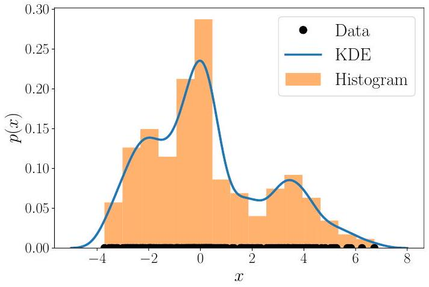

### 11.5 さらに詳しく知るために（Further Reading）

GMMは、アンスエストラルサンプリング（Bishop, 2006）を用いて新しいデータを生成することが容易であるという意味で、**生成モデル（generative model）**と見なすことができます。与えられたGMMのパラメータ $\pi_{k}, \boldsymbol{\mu}_{k}, \boldsymbol{\Sigma}_{k} (k=1, \ldots, K)$ に対して、確率ベクトル $[\pi_{1}, \ldots, \pi_{K}]^{\top}$ からインデックス $k$ をサンプリングし、次にデータポイント $\boldsymbol{x} \sim \mathcal{N}\left(\boldsymbol{\mu}_{k}, \boldsymbol{\Sigma}_{k}\right)$ をサンプリングします。これを $N$ 回繰り返すと、GMMによって生成されたデータセットが得られます。図11.1はこの手順を使用して生成されました。

本章を通じて、コンポーネントの数 $K$ は既知であると仮定してきました。実際には、そうでない場合が多いです。しかし、8.6.1節で議論したように、ネステッド交差検証（nested cross-validation）を使用して適切なモデルを見つけることができます。

ガウス混合モデルは、$K$-means（$K$平均法）クラスタリングアルゴリズムと密接に関連しています。$K$-meansもまた、データポイントをクラスターに割り当てるためにEMアルゴリズムを使用します。GMMにおける平均をクラスターの中心として扱い、共分散を無視する（または $\boldsymbol{I}$ に設定する）と、$K$-meansに到達します。MacKay (2003) によっても詳しく説明されているように、$K$-meansはデータポイントをクラスター中心 $\boldsymbol{\mu}_{k}$ に「ハード」に割り当てるのに対し、GMMは負担率を介して「ソフト」な割り当てを行います。

本章ではGMMとEMアルゴリズムの潜在変数的な視点についてのみ触れました。EMは、一般的な潜在変数モデルのパラメータ学習に使用できることに注意してください。例えば、非線形状態空間モデル（Ghahramani and Roweis, 1999; Roweis and Ghahramani, 1999）や、Barber (2012) によって議論されている強化学習などが挙げられます。したがって、GMMの潜在変数的な視点は、対応するEMアルゴリズムを体系的に導出するのに役立ちます(Bishop, 2006; Barber, 2012; Murphy, 2012)。

GMMのパラメータを見つけるために、EMアルゴリズムを介した最大尤度（最尤）推定についてのみ議論しました。最大尤度法に対する標準的な批判は、ここでも当てはまります。

- 線形回帰と同様に、最大尤度法は深刻な**過学習（overfitting）**に陥る可能性があります。GMMの場合、これはある混合成分の平均がデータポイントと一致し、共分散が 0 に近づくときに発生します。このとき、尤度は無限大に近づきます。Bishop (2006) と Barber (2012) はこの問題を詳細に議論しています。
- パラメータ $\pi_{k}, \boldsymbol{\mu}_{k}, \boldsymbol{\Sigma}_{k} (k= 1, \ldots, K)$ の**点推定値（point estimate）**しか得られず、パラメータ値の不確実性を示すものは何も得られません。ベイズ的アプローチでは、パラメータに事前分布を置き、それを使用してパラメータの事後分布を得ます。この事後分布により、**モデル証拠（model evidence）**（周辺尤度）を計算でき、これをモデル比較に使用することで、混合成分の数を決定するための体系的な方法が得られます。残念ながら、このモデルには共役事前分布が存在しないため、この設定で解析的な推論を行うことは不可能です。しかし、**変分推論（variational inference）**などの近似手法を使用して、近似的な事後分布を得ることができます（Bishop, 2006）。

図 11.13 ヒストグラム（オレンジ色の棒）とカーネル密度推定（青色の線）。カーネル密度推定器は内在する密度の滑らかな推定値を生成するのに対し、ヒストグラムは単一のビン（bin）にいくつのデータポイント（黒点）が落ちるかを示す、平滑化されていないカウント尺度である。

本章では、密度推定のための混合モデルについて議論しました。利用可能な密度推定技術は他にも数多く存在します。実際には、**ヒストグラム（histograms）**や**カーネル密度推定（kernel density estimation）**がしばしば使用されます。

ヒストグラムは、連続的な密度を表現するための非パラメトリックな方法を提供し、Pearson (1895) によって提案されました。ヒストグラムは、データ空間を「ビン（bin）」に分割し、各ビンにいくつのデータポイントが含まれるかをカウントすることによって構築されます。次に、各ビンの中心に棒が描かれ、棒の高さはそのビン内のデータポイントの数に比例します。ビンのサイズは重要なハイパーパラメータであり、不適切な選択は過学習や学習不足（アンダーフィッティング）につながる可能性があります。8.2.4節で議論したように、交差検証を使用して適切なビンサイズを決定できます。

Rosenblatt (1956) と Parzen (1962) によって独立に提案されたカーネル密度推定は、密度推定のための非パラメトリックな方法です。$N$ 個の i.i.d. サンプルが与えられたとき、カーネル密度推定器は内在する分布を次のように表現します。

$$
p(\boldsymbol{x})=\frac{1}{N h} \sum_{n=1}^{N} k\left(\frac{\boldsymbol{x}-\boldsymbol{x}_{n}}{h}\right),
$$

ここで $k$ はカーネル関数（すなわち、積分すると 1 になる非負の関数）であり、$h > 0$ は平滑化パラメータ（またはバンド幅パラメータ）であり、ヒストグラムにおけるビンサイズと同様の役割を果たします。データセット内のすべてのデータポイント $\boldsymbol{x}_{n}$ にカーネルを配置することに注意してください。一般的に使用されるカーネル関数は一様分布やガウス分布です。カーネル密度推定はヒストグラムと密接に関連していますが、適切なカーネルを選択することで、密度推定値の滑らかさを保証できます。図11.13は、250個のデータポイントからなるデータセットに対する、ヒストグラムと（ガウス型カーネルを用いた）カーネル密度推定器の違いを示しています。
