# 2020_mml-book-354-375（和訳版）

## ガウス混合モデルによる密度推定（Density Estimation with Gaussian Mixture Models）

これまでの章では、機械学習における2つの基本的な問題、すなわち回帰（第9章）と次元削減（第10章）についてすでに取り上げました。本章では、機械学習の第3の柱である**密度推定（density estimation）**について見ていきます。その過程で、期待値最大化（EM）アルゴリズムや、混合モデルを用いた密度推定の潜在変数的な視点など、重要な概念を紹介します。

機械学習をデータに適用する際、私たちはしばしば何らかの方法でデータを表現することを目指します。最も直接的な方法は、データポイントそのものをデータの表現とすることです（例として図11.1を参照）。しかし、データセットが巨大な場合や、データの特性を表現することに興味がある場合には、このアプローチは役に立たないかもしれません。密度推定では、パラメトリックな族（ガウス分布やベータ分布など）の密度を用いてデータをコンパクトに表現します。例えば、ガウス分布を用いてデータをコンパクトに表現するために、データセットの平均と分散を探すことがあります。平均と分散は、8.3節で議論した手法、すなわち最大尤度（最尤）推定または最大事後（MAP）推定を用いて見つけることができます。そして、このガウス分布の平均と分散を使用してデータに内在する分布を表現できます。つまり、その分布からサンプリングを行うとすれば、そのデータセットはその分布からの典型的な実現値であると考えるのです。

図11.1 ガウス分布では意味のある表現ができない二次元データセット。

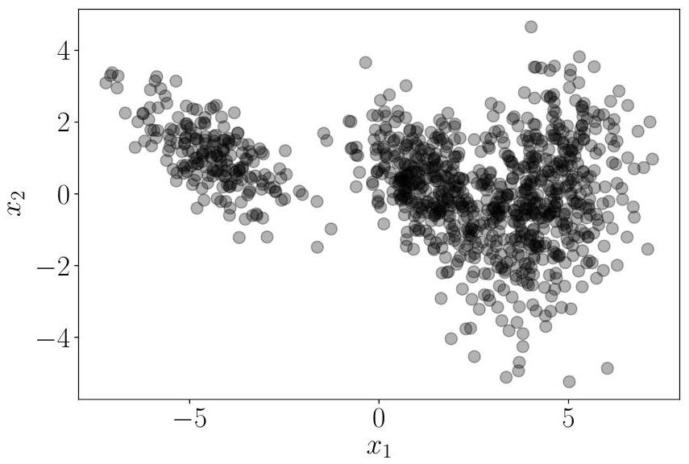

実際には、ガウス分布（およびこれまでに出会った他のすべての分布も同様に）はモデリング能力に限界があります。例えば、図11.1のデータを生成した密度の近似としてガウス分布を用いるのは、不適切な近似となるでしょう。以下では、密度推定に使用できる、より表現力の高い分布の族である**混合モデル（mixture models）**を見ていきます。

混合モデルは、分布 $p(\boldsymbol{x})$ を $K$ 個の単純な（基底）分布の**凸結合（convex combination）**によって記述するために使用できます。

$$
\begin{aligned}
& p(\boldsymbol{x})=\sum_{k=1}^{K} \pi_{k} p_{k}(\boldsymbol{x}) \\
& 0 \leqslant \pi_{k} \leqslant 1, \quad \sum_{k=1}^{K} \pi_{k}=1
\end{aligned}
$$

ここで、コンポーネント $p_{k}$ は基本的な分布の族（ガウス分布、ベルヌーイ分布、ガンマ分布など）のメンバーであり、$\pi_{k}$ は**混合重み（mixture weights）**です。混合モデルは、対応する基底分布よりも表現力が高いです。なぜなら、多峰性（multimodal）のデータ表現が可能であり、図11.1の例のように複数の「クラスター」を持つデータセットを記述できるからです。

本書では、基本分布がガウス分布である**ガウス混合モデル（GMM: Gaussian Mixture Models）**に焦点を用意します。与えられたデータセットに対して、GMMを訓練するためにモデルパラメータの尤度を最大化することを目指します。この目的のために、第5章、第6章、および7.2節の結果を使用します。ただし、以前に議論した他の応用（線形回帰やPCA）とは異なり、解析的な（閉じた形の）最大尤度解は見つかりません。代わりに、反復的にしか解くことができない、互いに依存し合う同時方程式のセットに到達することになります。

### 11.1 ガウス混合モデル（Gaussian Mixture Model）

ガウス混合モデルは、有限個（$K$ 個）のガウス分布 $\mathcal{N}\left(\boldsymbol{x} \mid \boldsymbol{\mu}_{k}, \boldsymbol{\Sigma}_{k}\right)$ を組み合わせた密度モデルであり、次のように表されます。

$$
\begin{aligned}
& p(\boldsymbol{x} \mid \boldsymbol{\theta})=\sum_{k=1}^{K} \pi_{k} \mathcal{N}\left(\boldsymbol{x} \mid \boldsymbol{\mu}_{k}, \boldsymbol{\Sigma}_{k}\right) \\
& 0 \leqslant \pi_{k} \leqslant 1, \quad \sum_{k=1}^{K} \pi_{k}=1
\end{aligned}
$$

ここで、モデルのすべてのパラメータの集合として $\boldsymbol{\theta}:=\left\{\boldsymbol{\mu}_{k}, \boldsymbol{\Sigma}_{k}, \pi_{k}: k=1, \ldots, K\right\}$ を定義しました。このガウス分布の凸結合は、単純なガウス分布（(11.3)において $K=1$ とした場合に相当）よりも、複雑な密度をモデリングするための柔軟性を大幅に提供します。図11.2にイラストを示します。加重された各コンポーネントと混合密度が表示されており、混合密度は次のように与えられます。

$$
p(x \mid \boldsymbol{\theta})=0.5 \mathcal{N}\left(x \mid-2, \frac{1}{2}\right)+0.2 \mathcal{N}(x \mid 1,2)+0.3 \mathcal{N}(x \mid 4,1) .
$$

図11.2 ガウス混合モデル。ガウス混合分布（黒線）は、ガウス分布の凸結合で構成されており、個々のどのコンポーネントよりも表現力が高い。破線は、重み付けされたガウスコンポーネントを表す。

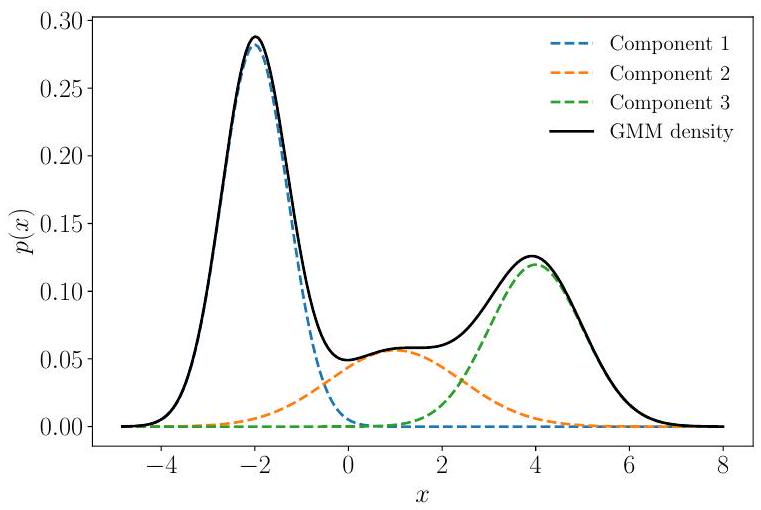

### 11.2 最大尤度法によるパラメータ学習（Parameter Learning via Maximum Likelihood）

データセット $\mathcal{X}=\left\{\boldsymbol{x}_{1}, \ldots, \boldsymbol{x}_{N}\right\}$ が与えられており、各 $\boldsymbol{x}_{n} (n= 1, \ldots, N)$ は未知の分布 $p(\boldsymbol{x})$ から独立同一分布（i.i.d.）に従って生成されたと仮定します。私たちの目的は、$K$ 個の混合成分を持つGMMを用いて、この未知の分布 $p(\boldsymbol{x})$ の適切な近似/表現を見つけることです。GMMのパラメータは、$K$ 個の平均 $\boldsymbol{\mu}_{k}$、共分散行列 $\boldsymbol{\Sigma}_{k}$、および混合重み $\pi_{k}$ です。これらすべての自由パラメータを $\boldsymbol{\theta}:=\left\{\pi_{k}, \boldsymbol{\mu}_{k}, \boldsymbol{\Sigma}_{k}: k=1, \ldots, K\right\}$ とまとめます。

## 例 11.1（初期設定）

図 11.3 初期設定：3つの混合成分（破線）を持つGMM（黒線）と7つのデータポイント（丸印）。

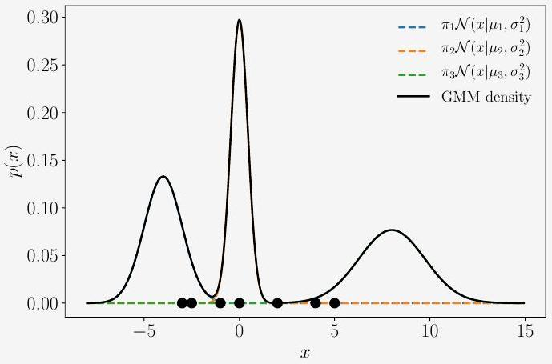

本章を通じて、重要な概念を説明し視覚化するのに役立つ単純な継続例を使用します。

7つのデータポイントからなる一次元データセット $\mathcal{X}=\{-3,-2.5,-1,0,2,4,5\}$ を考え、データの密度をモデル化する $K=3$ 個の成分を持つGMMを見つけたいとします。混合成分を次のように初期化します。

$$
\begin{aligned}
& p_{1}(x)=\mathcal{N}(x \mid-4,1) \\
& p_{2}(x)=\mathcal{N}(x \mid 0,0.2) \\
& p_{3}(x)=\mathcal{N}(x \mid 8,3)
\end{aligned}
$$

そして、それらに等しい重み $\pi_{1}=\pi_{2}=\pi_{3}=\frac{1}{3}$ を割り当てます。対応するモデル（およびデータポイント）を図11.3に示します。

以下では、モデルパラメータ $\boldsymbol{\theta}$ の最大尤度推定値 $\boldsymbol{\theta}_{\mathrm{ML}}$ を得る方法を詳しく説明します。まず、尤度、すなわちパラメータが与えられたときの訓練データの予測分布を書き下ろします。i.i.d.の仮定を利用すると、尤度は次のように因数分解されます。

$$
p(\mathcal{X} \mid \boldsymbol{\theta})=\prod_{n=1}^{N} p\left(\boldsymbol{x}_{n} \mid \boldsymbol{\theta}\right), \quad p\left(\boldsymbol{x}_{n} \mid \boldsymbol{\theta}\right)=\sum_{k=1}^{K} \pi_{k} \mathcal{N}\left(\boldsymbol{x}_{n} \mid \boldsymbol{\mu}_{k}, \boldsymbol{\Sigma}_{k}\right),
$$

ここで、個々の尤度項 $p\left(\boldsymbol{x}_{n} \mid \boldsymbol{\theta}\right)$ はガウス混合密度です。次に、対数尤度を次のように得ます。

$$
\log p(\mathcal{X} \mid \boldsymbol{\theta})=\sum_{n=1}^{N} \log p\left(\boldsymbol{x}_{n} \mid \boldsymbol{\theta}\right)=\underbrace{\sum_{n=1}^{N} \log \sum_{k=1}^{K} \pi_{k} \mathcal{N}\left(\boldsymbol{x}_{n} \mid \boldsymbol{\mu}_{k}, \boldsymbol{\Sigma}_{k}\right)}_{=: \mathcal{L}} .
$$

(11.10)で定義された対数尤度 $\mathcal{L}$ を最大化するパラメータ $\boldsymbol{\theta}_{\mathrm_{\mathrm{ML}}}^{*}$ を見つけることを目指します。私たちの「通常」の手順は、モデルパラメータ $\boldsymbol{\theta}$ に関する対数尤度の勾配 $\mathrm{d} \mathcal{L} / \mathrm{d} \boldsymbol{\theta}$ を計算し、それを $\mathbf{0}$ と置いて $\boldsymbol{\theta}$ について解くことでしょう。しかし、最大尤度推定の以前の例（例えば9.2節で議論した線形回帰など）とは異なり、解析的な解を得ることはできません。しかし、反復スキームを利用して適切なモデルパラメータ $\boldsymbol{\theta}_{\mathrm{ML}}$ を見つけることができます。これが、GMMに対する EMアルゴリズムであることが判明します。鍵となるアイデアは、他のパラメータを固定したまま、一度に1つのモデルパラメータを更新することです。

**備考：** もし所望の密度として単一のガウス分布を考えるならば、(11.10)の $k$ に関する和は消え、対数はガウス成分に直接適用でき、次のようになります。

$$
\log \mathcal{N}(\boldsymbol{x} \mid \boldsymbol{\mu}, \boldsymbol{\Sigma})=-\frac{D}{2} \log (2 \pi)-\frac{1}{2} \log \operatorname{det}(\boldsymbol{\Sigma})-\frac{1}{2}(\boldsymbol{x}-\boldsymbol{\mu})^{\top} \boldsymbol{\Sigma}^{-1}(\boldsymbol{x}-\boldsymbol{\mu})
$$

この単純な形式により、第8章で議論したように、$\boldsymbol{\mu}$ と $\boldsymbol{\Sigma}$ の解析的な最大尤度推定値を見つけることができます。(11.10)では、対数を $k$ に関する和の中に入れることができないため、単純な解析的な最大尤度解を得ることができません。

関数の局所最適解は、パラメータに関する勾配が消滅しなければならないという性質を持ちます（必要条件、第7章参照）。私たちのケースでは、(11.10)の対数尤度をGMMのパラメータ $\boldsymbol{\mu}_{k}, \boldsymbol{\Sigma}_{k}, \pi_{k}$ に関して最適化すると、以下の必要条件が得られます。

$$
\begin{aligned}
\frac{\partial \mathcal{L}}{\partial \boldsymbol{\mu}_{k}} & = \mathbf{0}^{\top} \Longleftrightarrow \sum_{n=1}^{N} \frac{\partial \log p\left(\boldsymbol{x}_{n} \mid \boldsymbol{\theta}\right)}{\partial \boldsymbol{\mu}_{k}} = \mathbf{0}^{\top}, \\
\frac{\partial \mathcal{L}}{\partial \boldsymbol{\Sigma}_{k}} & = \mathbf{0} \Longleftrightarrow \sum_{n=1}^{N} \frac{\partial \log p\left(\boldsymbol{x}_{n} \mid \boldsymbol{\theta}\right)}{\partial \boldsymbol{\Sigma}_{k}} = \mathbf{0}, \\
\frac{\partial \mathcal{L}}{\partial \pi_{k}} & = 0 \Longleftrightarrow \sum_{n=1}^{N} \frac{\partial \log p\left(\boldsymbol{x}_{n} \mid \boldsymbol{\theta}\right)}{\partial \pi_{k}} = 0 .
\end{aligned}
$$

3つの必要条件すべてにおいて、連鎖律（5.2.2節参照）を適用することにより、次のような形式の偏微分が必要となります。

$$
\frac{\partial \log p\left(\boldsymbol{x}_{n} \mid \boldsymbol{\theta}\right)}{\partial \boldsymbol{\theta}}=\frac{1}{p\left(x_{n} \mid \theta\right)} \frac{\partial p\left(\boldsymbol{x}_{n} \mid \boldsymbol{\theta}\right)}{\partial \boldsymbol{\theta}},
$$

ここで $\boldsymbol{\theta}=\left\{\boldsymbol{\mu}_{k}, \boldsymbol{\Sigma}_{k}, \pi_{k}, k=1, \ldots, K\right\}$ はモデルパラメータであり、

$$
\frac{1}{p\left(x_{n} \mid \theta\right)}=\frac{1}{\sum_{j=1}^{K} \pi_{j} \mathcal{N}\left(x_{n} \mid \mu_{j}, \Sigma_{j}\right)}
$$

です。以下では、(11.12)から(11.14)の偏微分を計算します。しかしその前に、本章の残りの部分で中心的な役割を果たすことになる量、**負担率（responsibilities）**を導入します。

### 11.2.1 負担率（Responsibilities）

次の量を定義します。

$$
r_{n k}:=\frac{\pi_{k} \mathcal{N}\left(\boldsymbol{x}_{n} \mid \boldsymbol{\mu}_{k}, \boldsymbol{\Sigma}_{k}\right)}{\sum_{j=1}^{K} \pi_{j} \mathcal{N}\left(\boldsymbol{x}_{n} \mid \boldsymbol{\mu}_{j}, \boldsymbol{\Sigma}_{j}\right)}
$$

これを、$n$ 番目のデータポイントに対する $k$ 番目の混合成分の**負担率（responsibility）**と呼びます。データポイント $\boldsymbol{x}_{n}$ に対する $k$ 番目の混合成分の負担率 $r_{n k}$ は、データポイントが与えられたときの混合成分の尤度

$$
p\left(\boldsymbol{x}_{n} \mid \pi_{k}, \boldsymbol{\mu}_{k}, \boldsymbol{\Sigma}_{k}\right)=\pi_{k} \mathcal{N}\left(\boldsymbol{x}_{n} \mid \boldsymbol{\mu}_{k}, \boldsymbol{\Sigma}_{k}\right)
$$

に比例します。したがって、あるデータポイントがその混合成分からの妥当なサンプルとなり得る場合、その混合成分はそのデータポイントに対して高い負担率を持ちます。$\boldsymbol{r}_{n}:=\left[r_{n 1}, \ldots, r_{n K}\right]^{\top} \in \mathbb{R}^{K}$ は（正規化された）確率ベクトル、すなわち $r_{n k} \geqslant 0$ かつ $\sum_{k} r_{n k}=1$ であることに注意してください。この確率ベクトルは $K$ 個の混合成分の間で確率質量を分配するものであり、$\boldsymbol{r}_{n}$ を $K$ 個の混合成分への $\boldsymbol{x}_{n}$ の「ソフトな割り当て（soft assignment）」と考えることができます。したがって、(11.17)の負担率 $r_{n k}$ は、$\boldsymbol{x}_{n}$ が $k$ 番目の混合成分によって生成された確率を表します。

## 例 11.2（負担率）

図11.3の例について、負担率 $r_{n k}$ を計算します。

$$
\left[\begin{array}{ccc}
1.0 & 0.0 & 0.0 \\
1.0 & 0.0 & 0.0 \\
0.057 & 0.943 & 0.0 \\
0.001 & 0.999 & 0.0 \\
0.0 & 0.066 & 0.934 \\
0.0 & 0.0 & 1.0 \\
0.0 & 0.0 & 1.0
\end{array}\right] \in \mathbb{R}^{N \times K} .
$$

ここで、$n$ 行目は $x_{n}$ に対するすべての混合成分の負担率を示しています。あるデータポイントに対する $K$ 個すべての負担率の和（各行の和）は1です。$k$ 列目は、$k$ 番目の混合成分の負担率の概要を示しています。3番目の混合成分（第3列）は最初の4つのデータポイントについては責任を負っていませんが、残りのデータポイントについては多くの責任を負っていることがわかります。列のすべての要素の和は、値 $N_{k}$、すなわち $k$ 番目の混合成分の総負担率を与えます。この例では、$N_{1}=2.058, N_{2}= 2.008, N_{3}=2.934$ となります。

### 11.2.2 平均の更新（Updating the Means）

**定理 11.1（GMMの平均の更新）。** GMMの平均パラメータ $\boldsymbol{\mu}_{k} (k=1, \ldots, K)$ の更新式は次のように与えられます。

$$
\boldsymbol{\mu}_{k}^{\text {new }}=\frac{\sum_{n=1}^{N} r_{n k} \boldsymbol{x}_{n}}{\sum_{n=1}^{N} r_{n k}},
$$

ここで、負担率 $r_{n k}$ は(11.17)で定義されています。

**備考：** (11.20)における個々の混合成分の平均 $\boldsymbol{\mu}_{k}$ の更新は、(11.17)で与えられる $r_{n k}$ を介して、すべての平均、共分散行列 $\boldsymbol{\Sigma}_{k}$、および混合重み $\pi_{k}$ に依存します。したがって、すべての $\boldsymbol{\mu}_{k}$ を一度に求める解析的な解を得ることはできません。

**証明：** (11.15)より、平均パラメータ $\boldsymbol{\mu}_{k} (k=1, \ldots, K)$ に関する対数尤度の勾配を求めるには、次の偏微分を計算する必要があります。

$$
\begin{aligned}
\frac{\partial p\left(\boldsymbol{x}_{n} \mid \boldsymbol{\theta}\right)}{\partial \boldsymbol{\mu}_{k}} & =\sum_{j=1}^{K} \pi_{j} \frac{\partial \mathcal{N}\left(\boldsymbol{x}_{n} \mid \boldsymbol{\mu}_{j}, \boldsymbol{\Sigma}_{j}\right)}{\partial \boldsymbol{\mu}_{k}}=\pi_{k} \frac{\partial \mathcal{N}\left(\boldsymbol{x}_{n} \mid \boldsymbol{\mu}_{k}, \boldsymbol{\Sigma}_{k}\right)}{\partial \boldsymbol{\mu}_{k}} \\
& =\pi_{k}\left(\boldsymbol{x}_{n}-\boldsymbol{\mu}_{k}\right)^{\top} \boldsymbol{\Sigma}_{k}^{-1} \mathcal{N}\left(\boldsymbol{x}_{n} \mid \boldsymbol{\mu}_{k}, \boldsymbol{\Sigma}_{k}\right)
\end{aligned}
$$

ここで、$k$ 番目の混合成分のみが $\boldsymbol{\mu}_{k}$ に依存するという事実を利用しました。(11.21b)の結果を(11.15)に代入してすべてをまとめると、$\boldsymbol{\mu}_{k}$ に関する $\mathcal{L}$ の目的の偏微分は次のように与えられます。

$$
\begin{aligned}
\frac{\partial \mathcal{L}}{\partial \boldsymbol{\mu}_{k}} & =\sum_{n=1}^{N} \frac{\partial \log p\left(\boldsymbol{x}_{n} \mid \boldsymbol{\theta}\right)}{\partial \boldsymbol{\mu}_{k}}=\sum_{n=1}^{N} \frac{1}{p\left(x_{n} \mid \theta\right)} \frac{\partial p\left(\boldsymbol{x}_{n} \mid \boldsymbol{\theta}\right)}{\partial \boldsymbol{\mu}_{k}} \\
& =\sum_{n=1}^{N}\left(\boldsymbol{x}_{n}-\boldsymbol{\mu}_{k}\right)^{\top} \boldsymbol{\Sigma}_{k}^{-1} \underbrace{\frac{\pi_{k} \mathcal{N}\left(\boldsymbol{x}_{n} \mid \boldsymbol{\mu}_{k}, \boldsymbol{\Sigma}_{k}\right)}{\sum_{j=1}^{K} \pi_{j} \mathcal{N}\left(x_{n} \mid \mu_{j}, \Sigma_{j}\right)}}_{=r_{n k}} \\
& =\sum_{n=1}^{N} r_{n k}\left(\boldsymbol{x}_{n}-\boldsymbol{\mu}_{k}\right)^{\top} \boldsymbol{\Sigma}_{k}^{-1} .
\end{aligned}
$$

ここで、(11.16)の恒等式と(11.21b)の偏微分の結果を使用して(11.22b)を導きました。値 $r_{n k}$ は(11.17)で定義した負担率です。

次に、$\frac{\partial \mathcal{L}\left(\boldsymbol{\mu}_{k}^{\text {new }}\right)}{\partial \boldsymbol{\mu}_{k}}=\mathbf{0}^{\top}$ となるように (11.22c) を $\boldsymbol{\mu}_{k}^{\text {new }}$ について解くと、次が得られます。

$$
\sum_{n=1}^{N} r_{n k} \boldsymbol{x}_{n}=\sum_{n=1}^{N} r_{n k} \boldsymbol{\mu}_{k}^{\text {new }} \Longleftrightarrow \boldsymbol{\mu}_{k}^{\text {new }}=\frac{\sum_{n=1}^{N} r_{n k} \boldsymbol{x}_{n}}{\sum_{n=1}^{N} r_{n k}}=\frac{1}{N_{k}} \sum_{n=1}^{N} r_{n k} \boldsymbol{x}_{n}
$$

ここで、データセット全体に対する $k$ 番目の混合成分の総負担率として次を定義しました。

$$
N_{k}:=\sum_{n=1}^{N} r_{n k}
$$

これで定理11.1の証明が完了しました。

直感的には、(11.20)は平均の**重要度加重モンテカルロ推定（importance-weighted Monte Carlo estimate）**と解釈でき、データポイント $\boldsymbol{x}_{n}$ の重要度重みは、$\boldsymbol{x}_{n}$ に対する $k$ 番目のクラスターの負担率 $r_{n k} (k=1, \ldots, K)$ です。

したがって、平均 $\boldsymbol{\mu}_{k}$ は、負担率 $r_{n k}$ によって与えられる強さでデータポイント $\boldsymbol{x}_{n}$ の方へ引き寄せられます。平均は、対応する混合成分が高い負担率（すなわち高い尤度）を持つデータポイントの方へ、より強く引き寄せられます。図11.4にこれを示します。また、(11.20)の平均の更新は、次の正規化された確率ベクトル

$$
\boldsymbol{r}_{k}:=\left[r_{1 k}, \ldots, r_{N k}\right]^{\top} / N_{k}
$$

によって与えられる分布の下での、すべてのデータポイントの期待値として解釈することもできます。すなわち、

$$
\boldsymbol{\mu}_{k} \leftarrow \mathbb{E}_{\boldsymbol{r}_{k}}[\mathcal{X}]
$$

です。

## 例 11.3（平均の更新）

図11.3の例において、平均値は次のように更新されます。

$$
\begin{aligned}
& \mu_{1}:-4 \rightarrow-2.7 \\
& \mu_{2}: 0 \rightarrow-0.4 \\
& \mu_{3}: 8 \rightarrow 3.7
\end{aligned}
$$

ここでは、1番目と3番目の混合成分の平均がデータの存在する領域に向かって移動しているのに対し、2番目の成分の平均はそれほど劇的には変化していないことがわかります。図11.5はこの変化を示しており、図11.5(a)は平均を更新する前のGMM密度を、図11.5(b)は平均値 $\mu_{k}$ を更新した後のGMM密度を示しています。

(11.20)の平均パラメータの更新はかなり単純に見えます。しかし、負担率 $r_{n k}$ はすべての $j=1, \ldots, K$ について $\pi_{j}, \boldsymbol{\mu}_{j}, \boldsymbol{\Sigma}_{j}$ の関数であるため、(11.20)の更新はGMMのすべてのパラメータに依存しており、9.2節の線形回帰や第10章のPCAで得られたような解析的な解は得られないことに注意してください。

図 11.4 GMMにおける混合成分の平均パラメータの更新。平均 $\boldsymbol{\mu}$ は、対応する負担率によって与えられる重みで個々のデータポイントの方へ引き寄せられる。

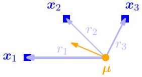

図 11.5 GMMにおける平均値更新の効果。(a) 平均値を更新する前のGMM、(b) 分散と混合重みを維持したまま平均値 $\mu_{k}$ を更新した後のGMM。

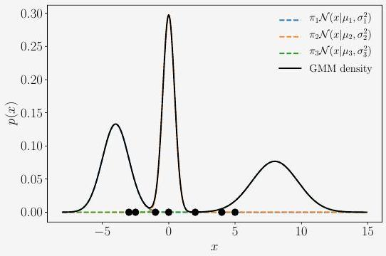
(a) 平均値を更新する前のGMM。

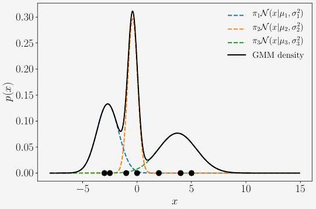
(b) 平均値 $\mu_{k}$ を更新した後のGMM。

### 11.2.3 共分散の更新（Updating the Covariances）

**定理 11.2（GMMの共分散の更新）。** GMMの共分散パラメータ $\boldsymbol{\Sigma}_{k} (k=1, \ldots, K)$ の更新式は次のように与えられます。

$$
\boldsymbol{\Sigma}_{k}^{\text {new }}=\frac{1}{N_{k}} \sum_{n=1}^{N} r_{n k}\left(\boldsymbol{x}_{n}-\boldsymbol{\mu}_{k}\right)\left(\boldsymbol{x}_{n}-\boldsymbol{\mu}_{k}\right)^{\top},
$$

ここで、$r_{n k}$ と $N_{k}$ はそれぞれ(11.17)と(11.24)で定義されています。

**証明：** 定理11.2を証明するために、共分散 $\boldsymbol{\Sigma}_{k}$ に関する対数尤度 $\mathcal{L}$ の偏微分を計算し、それを $\mathbf{0}$ と置いて $\boldsymbol{\Sigma}_{k}$ について解きます。まず一般的なアプローチから始めます。

$$
\frac{\partial \mathcal{L}}{\partial \boldsymbol{\Sigma}_{k}}=\sum_{n=1}^{N} \frac{\partial \log p\left(\boldsymbol{x}_{n} \mid \boldsymbol{\theta}\right)}{\partial \boldsymbol{\Sigma}_{k}}=\sum_{n=1}^{N} \frac{1}{p\left(x_{n} \mid \theta\right)} \frac{\partial p\left(\boldsymbol{x}_{n} \mid \boldsymbol{\theta}\right)}{\partial \boldsymbol{\Sigma}_{k}} .
$$

$1/p\left(\boldsymbol{x}_{n} \mid \boldsymbol{\theta}\right)$ はすでに(11.16)からわかっています。残りの偏微分 $\partial p\left(\boldsymbol{x}_{n} \mid \boldsymbol{\theta}\right) / \partial \boldsymbol{\Sigma}_{k}$ を得るために、ガウス分布 $p\left(\boldsymbol{x}_{n} \mid \boldsymbol{\theta}\right)$ の定義（(11.9)参照）を書き下し、$k$ 番目以外のすべての項を落とします。すると次が得られます。

$$
\begin{aligned}
& \frac{\partial p\left(\boldsymbol{x}_{n} \mid \boldsymbol{\theta}\right)}{\partial \boldsymbol{\Sigma}_{k}} \\
& = \frac{\partial}{\partial \boldsymbol{\Sigma}_{k}}\left(\pi_{k}(2 \pi)^{-\frac{D}{2}} \operatorname{det}\left(\boldsymbol{\Sigma}_{k}\right)^{-\frac{1}{2}} \exp \left(-\frac{1}{2}\left(\boldsymbol{x}_{n}-\boldsymbol{\mu}_{k}\right)^{\top} \boldsymbol{\Sigma}_{k}^{-1}\left(\boldsymbol{x}_{n}-\boldsymbol{\mu}_{k}\right)\right)\right) \\
& = \pi_{k}(2 \pi)^{-\frac{D}{2}}\left[\frac{\partial}{\partial \boldsymbol{\Sigma}_{k}} \operatorname{det}\left(\boldsymbol{\Sigma}_{k}\right)^{-\frac{1}{2}} \exp \left(-\frac{1}{2}\left(\boldsymbol{x}_{n}-\boldsymbol{\mu}_{k}\right)^{\top} \boldsymbol{\Sigma}_{k}^{-1}\left(\boldsymbol{x}_{n}-\boldsymbol{\mu}_{k}\right)\right)\right. \\
& \left.\quad + \operatorname{det}\left(\boldsymbol{\Sigma}_{k}\right)^{-\frac{1}{2}} \frac{\partial}{\partial \boldsymbol{\Sigma}_{k}} \exp \left(-\frac{1}{2}\left(\boldsymbol{x}_{n}-\boldsymbol{\mu}_{k}\right)^{\top} \boldsymbol{\Sigma}_{k}^{-1}\left(\boldsymbol{x}_{n}-\boldsymbol{\mu}_{k}\right)\right)\right] .
\end{aligned}
$$

ここで、次の恒等式を使用します。

$$
\begin{gathered}
\frac{\partial}{\partial \boldsymbol{\Sigma}_{k}} \operatorname{det}\left(\boldsymbol{\Sigma}_{k}\right)^{-\frac{1}{2}} \stackrel{(5.101)}{=}-\frac{1}{2} \operatorname{det}\left(\boldsymbol{\Sigma}_{k}\right)^{-\frac{1}{2}} \boldsymbol{\Sigma}_{k}^{-1} \\
\frac{\partial}{\partial \boldsymbol{\Sigma}_{k}}\left(\boldsymbol{x}_{n}-\boldsymbol{\mu}_{k}\right)^{\top} \boldsymbol{\Sigma}_{k}^{-1}\left(\boldsymbol{x}_{n}-\boldsymbol{\mu}_{k}\right) \stackrel{(5.103)}{=}-\boldsymbol{\Sigma}_{k}^{-1}\left(\boldsymbol{x}_{n}-\boldsymbol{\mu}_{k}\right)\left(\boldsymbol{x}_{n}-\boldsymbol{\mu}_{k}\right)^{\top} \boldsymbol{\Sigma}_{k}^{-1}
\end{gathered}
$$

（整理した後）(11.31)で必要とされる目的の偏微分を次のように得ます。

$$
\begin{aligned}
\frac{\partial p\left(\boldsymbol{x}_{n} \mid \boldsymbol{\theta}\right)}{\partial \boldsymbol{\Sigma}_{k}}= & \pi_{k} \mathcal{N}\left(\boldsymbol{x}_{n} \mid \boldsymbol{\mu}_{k}, \boldsymbol{\Sigma}_{k}\right) \\
& \cdot\left[-\frac{1}{2}\left(\boldsymbol{\Sigma}_{k}^{-1}-\boldsymbol{\Sigma}_{k}^{-1}\left(\boldsymbol{x}_{n}-\boldsymbol{\mu}_{k}\right)\left(\boldsymbol{x}_{n}-\boldsymbol{\mu}_{k}\right)^{\top} \boldsymbol{\Sigma}_{k}^{-1}\right)\right] .
\end{aligned}
$$

すべてをまとめると、$\boldsymbol{\Sigma}_{k}$ に関する対数尤度の偏微分は次のように与えられます。

$$
\begin{aligned}
\frac{\partial \mathcal{L}}{\partial \boldsymbol{\Sigma}_{k}} & = \sum_{n=1}^{N} \frac{\partial \log p\left(\boldsymbol{x}_{n} \mid \boldsymbol{\theta}\right)}{\partial \boldsymbol{\Sigma}_{k}}=\sum_{n=1}^{N} \frac{1}{p\left(x_{n} \mid theta\right)} \frac{\partial p\left(\boldsymbol{x}_{n} \mid \boldsymbol{\theta}\right)}{\partial \boldsymbol{\Sigma}_{k}} \\
& = \sum_{n=1}^{N} \underbrace{\frac{\pi_{k} \mathcal{N}\left(\boldsymbol{x}_{n} \mid \boldsymbol{\mu}_{k}, \boldsymbol{\Sigma}_{k}\right)}{\sum_{j=1}^{K} \pi_{j} \mathcal{N}\left(x_{n} \mid \mu_{j}, \Sigma_{j}\right)}}_{=r_{n k}} \\
& \cdot \left[-\frac{1}{2}\left(\boldsymbol{\Sigma}_{k}^{-1}-\boldsymbol{\Sigma}_{k}^{-1}\left(\boldsymbol{x}_{n}-\boldsymbol{\mu}_{k}\right)\left(\boldsymbol{x}_{n}-\boldsymbol{\mu}_{k}\right)^{\top} \boldsymbol{\Sigma}_{k}^{-1}\right)\right] \\
& = -\frac{1}{2} \sum_{n=1}^{N} r_{n k}\left(\boldsymbol{\Sigma}_{k}^{-1}-\boldsymbol{\Sigma}_{k}^{-1}\left(\boldsymbol{x}_{n}-\boldsymbol{\mu}_{k}\right)\left(\boldsymbol{x}_{n}-\boldsymbol{\mu}_{k}\right)^{\top} \boldsymbol{\Sigma}_{k}^{-1}\right) \\
& = -\frac{1}{2} \boldsymbol{\Sigma}_{k}^{-1} \underbrace{\sum_{n=1}^{N} r_{n k}}_{=N_{k}} + \frac{1}{2} \boldsymbol{\Sigma}_{k}^{-1}\left(\sum_{n=1}^{N} r_{n k}\left(\boldsymbol{x}_{n}-\boldsymbol{\mu}_{k}\right)\left(\boldsymbol{x}_{n}-\boldsymbol{\mu}_{k}\right)^{\top}\right) \boldsymbol{\Sigma}_{k}^{-1}
\end{aligned}$$

負担率 $r_{n k}$ がこの偏微分にも現れることがわかります。この偏微分を $\mathbf{0}$ と置くことで、必要な最適条件が得られます。

$$
\begin{aligned}
& N_{k} \boldsymbol{\Sigma}_{k}^{-1} = \boldsymbol{\Sigma}_{k}^{-1}\left(\sum_{n=1}^{N} r_{n k}\left(\boldsymbol{x}_{n}-\boldsymbol{\mu}_{k}\right)\left(\boldsymbol{x}_{n}-\boldsymbol{\mu}_{k}\right)^{\top}\right) \boldsymbol{\Sigma}_{k}^{-1} \\
\Longleftrightarrow & N_{k} \boldsymbol{I} = \left(\sum_{n=1}^{N} r_{n k}\left(\boldsymbol{x}_{n}-\boldsymbol{\mu}_{k}\right)\left(\boldsymbol{x}_{n}-\boldsymbol{\mu}_{k}\right)^{\top}\right) \boldsymbol{\Sigma}_{k}^{-1}
\end{aligned}$$

これを $\boldsymbol{\Sigma}_{k}$ について解くことにより、次を得ます。

$$
\boldsymbol{\Sigma}_{k}^{\mathrm{new}} = \frac{1}{N_{k}} \sum_{n=1}^{N} r_{n k}\left(\boldsymbol{x}_{n}-\boldsymbol{\mu}_{k}\right)\left(\boldsymbol{x}_{n}-\boldsymbol{\mu}_{k}\right)^{\top},
$$

ここで $\boldsymbol{r}_{k}$ は(11.25)で定義された確率ベクトルです。これにより、$k=1, \ldots, K$ に対する $\boldsymbol{\Sigma}_{k}$ の単純な更新規則が得られ、定理11.2が証明されました。

(11.20)における $\boldsymbol{\mu}_{k}$ の更新と同様に、(11.30)における共分散の更新は、中心化されたデータ $\tilde{\mathcal{X}}_{k}:=\left\{\boldsymbol{x}_{1}-\boldsymbol{\mu}_{k}, \ldots, \boldsymbol{x}_{N}-\boldsymbol{\mu}_{k}\right\}$ の二乗の重要度加重期待値として解釈できます。

## 例 11.4（分散の更新）

図11.3の例において、分散は次のように更新されます。

$$
\begin{aligned}
& \sigma_{1}^{2}: 1 \rightarrow 0.14 \\
& \sigma_{2}^{2}: 0.2 \rightarrow 0.44 \\
& \sigma_{3}^{2}: 3 \rightarrow 1.53
\end{aligned}
$$

ここでは、1番目と3番目の成分の分散が大幅に縮小しているのに対し、2番目の成分の分散はわずかに増加していることがわかります。

図11.6はこの設定を示しています。図11.6(a)は図11.5(b)と同一（ただしズームアップしたもの）であり、分散を更新する前のGMM密度とその個々の成分を示しています。図11.6(b)は分散を更新した後のGMM密度を示しています。

図 11.6 GMMにおける分散更新の効果。(a) 分散を更新する前のGMM、(b) 平均と混合重みを維持したまま分散を更新した後のGMM。

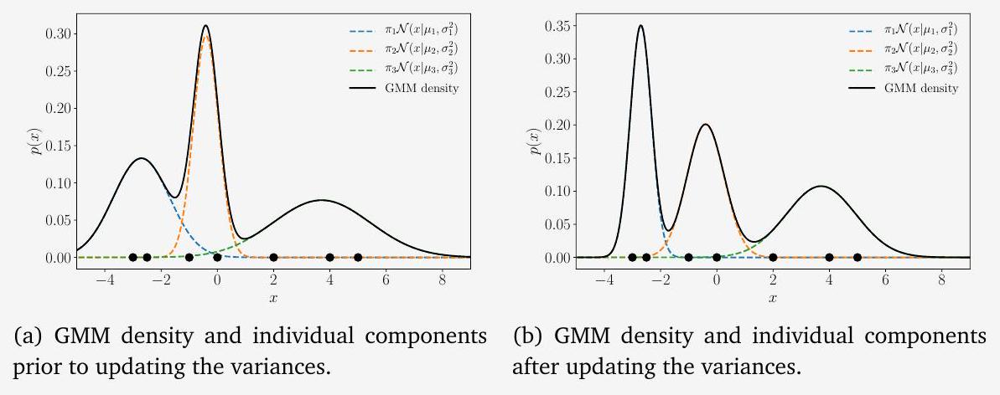

平均パラメータの更新と同様に、(11.30)を、$k$ 番目の混合成分に関連付けられたデータポイント $\boldsymbol{x}_{n}$ の加重共分散のモンテカルロ推定と解釈でき、その重みは負担率 $r_{n k}$ です。平均パラメータの更新と同様、この更新も負担率 $r_{n k}$ を通じてすべての $\pi_{j}, \boldsymbol{\mu}_{j}, \boldsymbol{\Sigma}_{j} (j=1, \ldots, K)$ に依存するため、解析的な解を得ることはできません。

### 11.2.4 混合重みの更新（Updating the Mixture Weights）

**定理 11.3（GMMの混合重みの更新）。** GMMの混合重み $\pi_{k} (k=1, \ldots, K)$ は次のように更新されます。

$$
\pi_{k}^{\text {new }}=\frac{N_{k}}{N}, \quad k=1, \ldots, K,
$$

ここで、$N$ はデータポイントの数であり、$N_{k}$ は(11.24)で定義されています。

**証明：** 重みパラメータ $\pi_{k} (k=1, \ldots, K)$ に関する対数尤度の偏微分を求める際、制約条件 $\sum_{k} \pi_{k}=1$ を考慮するためにラグランジュの未定乗数法（7.2節参照）を使用します。ラグランジュ関数は次のようになります。

$$
\mathfrak{L} = \mathcal{L} + \lambda\left(\sum_{k=1}^{K} \pi_{k}-1\right)
$$

$$
= \sum_{n=1}^{N} \log \sum_{k=1}^{K} \pi_{k} \mathcal{N}\left(\boldsymbol{x}_{n} \mid \boldsymbol{\mu}_{k}, \boldsymbol{\Sigma}_{k}\right) + \lambda\left(\sum_{k=1}^{K} \pi_{k}-1\right),
$$

ここで、$\mathcal{L}$ は(11.10)の対数尤度であり、第2項はすべての混合重みの和が1にならなければならないという等式制約をコード化したものです。$\pi_{k}$ に関する偏微分を次のように得ます。

$$
\begin{aligned}
\frac{\partial \mathfrak{L}}{\partial \pi_{k}} & = \sum_{n=1}^{N} \frac{\mathcal{N}\left(\boldsymbol{x}_{n} \mid \boldsymbol{\mu}_{k}, \boldsymbol{\Sigma}_{k}\right)}{\sum_{j=1}^{K} \pi_{j} \mathcal{N}\left(\boldsymbol{x}_{n} \mid \boldsymbol{\mu}_{j}, \boldsymbol{\Sigma}_{j}\right)} + \lambda \\
& = \frac{1}{\pi_{k}} \underbrace{\sum_{n=1}^{N} \frac{\pi_{k} \mathcal{N}\left(\boldsymbol{x}_{n} \mid \boldsymbol{\mu}_{k}, \boldsymbol{\Sigma}_{k}\right)}{\sum_{j=1}^{K} \pi_{j} \mathcal{N}\left(\boldsymbol{x}_{n} \mid \boldsymbol{\mu}_{j}, \boldsymbol{\Sigma}_{j}\right)}}_{=N_{k}} + \lambda = \frac{N_{k}}{\pi_{k}} + \lambda
\end{aligned}
$$

また、ラグランジュ乗数 $\lambda$ に関する偏微分を次のように得ます。

$$
\frac{\partial \mathfrak{L}}{\partial \lambda} = \sum_{k=1}^{K} \pi_{k}-1
$$

両方の偏微分を $\mathbf{0}$ と置く（最適解の必要条件）ことにより、次の方程式系が得られます。

$$
\begin{aligned}
\pi_{k} & = -\frac{N_{k}}{\lambda}, \\
1 & = \sum_{k=1}^{K} \pi_{k}
\end{aligned}
$$

(11.46)を(11.47)に代入して $\pi_{k}$ について解くと、次が得られます。

$$
\sum_{k=1}^{K} \pi_{k} = 1 \Longleftrightarrow -\sum_{k=1}^{K} \frac{N_{k}}{\lambda} = 1 \Longleftrightarrow -\frac{N}{\lambda} = 1 \Longleftrightarrow \lambda = -N .
$$

これにより、(11.46)の $\lambda$ を $-N$ で置き換えることができ、次を得ます。

$$
\pi_{k}^{\mathrm{new}} = \frac{N_{k}}{N}
$$

これが重みパラメータ $\pi_{k}$ の更新式となり、定理11.3が証明されました。

(11.42)の混合重みは、$k$ 番目のクラスターの総負担率とデータポイントの数の比として識別できます。$N=\sum_{k} N_{k}$ であるため、データポイントの数はすべての混合成分の総負担率の合計としても解釈でき、$\pi_{k}$ はデータセットに対する $k$ 番目の混合成分の相対的な重要度となります。

**備考：** $N_{k}=\sum_{i=1}^{N} r_{n k}$ であるため、混合重み $\pi_{k}$ の更新式(11.42)も、負担率 $r_{n k}$ を介してすべての $\pi_{j}, \boldsymbol{\mu}_{j}, \boldsymbol{\Sigma}_{j} (j=1, \ldots, K)$ に依存します。

## 例 11.5（重みパラメータの更新）

図 11.7 GMMにおける混合重み更新の効果。(a) 混合重みを更新する前のGMM、(b) 平均と分散を維持したまま混合重みを更新した後のGMM。垂直軸のスケールが異なることに注意。

### 11.3 EMアルゴリズム（EM Algorithm）

期待値最大化（EM: Expectation Maximization）アルゴリズムは、Dempsterら(1977)によって提案されたもので、混合モデルやより一般的には潜在変数モデルにおけるパラメータ学習（最尤推定またはMAP推定）のための一般的な反復スキームです。

ガウス混合モデルの例では、$\boldsymbol{\mu}_{k}, \boldsymbol{\Sigma}_{k}, \pi_{k}$ の初期値を選択し、収束するまで以下のステップを交互に繰り返します。

- **Eステップ：** 負担率 $r_{n k}$（データポイント $n$ が混合成分 $k$ に属する事後確率）を評価する。
- **Mステップ：** 更新された負担率を使用して、パラメータ $\boldsymbol{\mu}_{k}, \boldsymbol{\Sigma}_{k}, \pi_{k}$ を再推定する。

EMアルゴリズムのすべてのステップは、対数尤度関数を増加させます(Neal and Hinton, 1999)。収束については、対数尤度またはパラメータを直接チェックできます。GMMのパラメータを推定するためのEMアルゴリズムの具体的なインスタンス化は以下の通りです。

1. $\boldsymbol{\mu}_{k}, \boldsymbol{\Sigma}_{k}, \pi_{k}$ を初期化する。
2. **Eステップ：** 現在のパラメータ $\pi_{k}, \boldsymbol{\mu}_{k}, \boldsymbol{\Sigma}_{k}$ を使用して、すべてのデータポイント $\boldsymbol{x}_{n}$ について負担率 $r_{n k}$ を評価する。

$$
r_{n k} = \frac{\pi_{k} \mathcal{N}\left(\boldsymbol{x}_{n} \mid \boldsymbol{\mu}_{k}, \boldsymbol{\Sigma}_{k}\right)}{\sum_{j} \pi_{j} \mathcal{N}\left(\boldsymbol{x}_{n} \mid \boldsymbol{\mu}_{j}, \boldsymbol{\Sigma}_{j}\right)} .
$$

3. **Mステップ：** 現在の（Eステップからの）負担率 $r_{n k}$ を使用して、パラメータ $\pi_{k}, \boldsymbol{\mu}_{k}, \boldsymbol{\Sigma}_{k}$ を再推定する。

$$
\begin{aligned}
\boldsymbol{\mu}_{k} & = \frac{1}{N_{k}} \sum_{n=1}^{N} r_{n k} \boldsymbol{x}_{n}, \\
\boldsymbol{\Sigma}_{k} & = \frac{1}{N_{k}} \sum_{n=1}^{N} r_{n k}\left(\boldsymbol{x}_{n}-\boldsymbol{\mu}_{k}\right)\left(\boldsymbol{x}_{n}-\boldsymbol{\mu}_{k}\right)^{\top}, \\
\pi_{k} & = \frac{N_{k}}{N} .
\end{aligned}
$$

(11.54)で平均 $\boldsymbol{\mu}_{k}$ を更新した後、それらは続いて(11.55)で対応する共分散を更新するために使用されます。

## 例 11.6（GMMのフィッティング）

図11.3の例でEMを実行すると、5回の反復の後に図11.8(a)に示す最終結果が得られます。図11.8(b)は、負の対数尤度がEMの反復回数の関数としてどのように推移するかを示しています。最終的なGMMは次のように与えられます。

$$
\begin{aligned}
p(x)= & 0.29 \mathcal{N}(x \mid -2.75, 0.06) + 0.28 \mathcal{N}(x \mid -0.50, 0.25) \\
& + 0.43 \mathcal{N}(x \mid 3.64, 1.63)
\end{aligned}
$$

図 11.8 図11.2のGMMに適用されたEMアルゴリズム。(a) 最終的なGMMの適合、(b) EM反復の関数としての負の対数尤度。

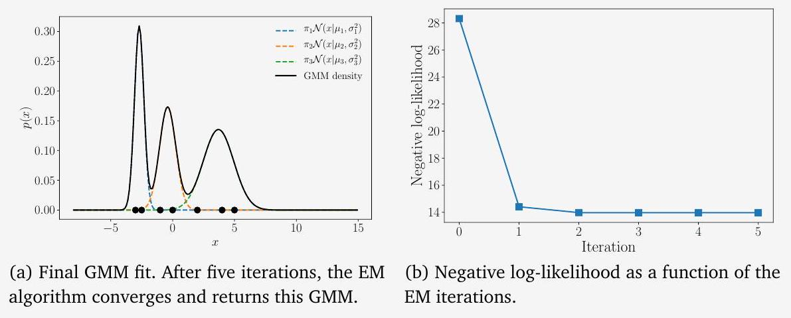

図11.1に示した二次元データセットに $K=3$ の混合成分でEMアルゴリズムを適用しました。図11.9はEMアルゴリズムのいくつかのステップを説明し、EM反復の関数としての負の対数尤度を示しています（図11.9(b)）。

図 11.9 二次元データセットに3つの成分を持つガウス混合モデルを適合させるためのEMアルゴリズムの図解。(a) データセット、(b) EM反復の関数としての負の対数尤度（低いほど良い）。赤点は、(c)から(f)に示されている対応するGMM適合の混合成分の反復を示している。黄色の円盤はガウス混合成分の平均を示している。

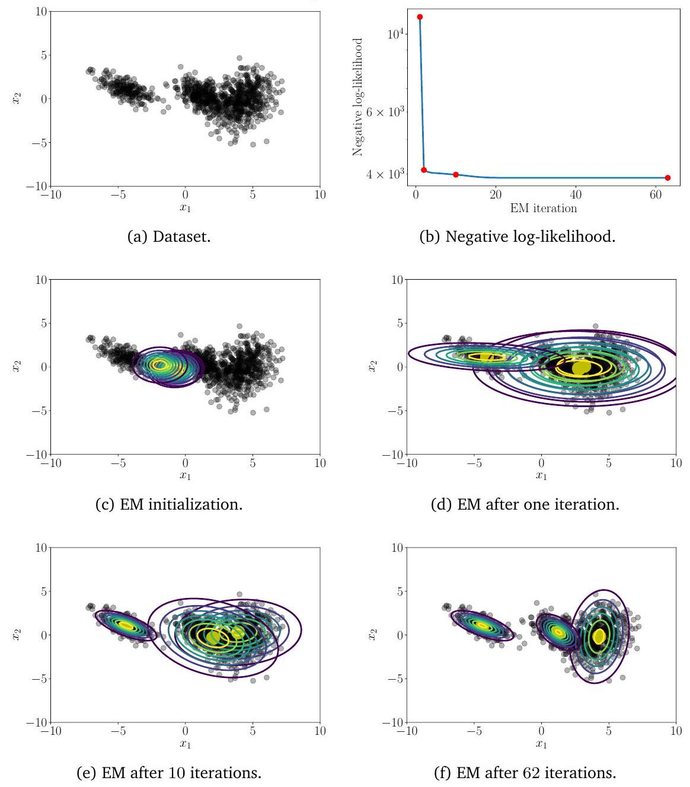

図11.10(a)は最終的なGMMの適合を示しています。図11.10(b)は、データポイントに対する混合成分の最終的な負担率を視覚化したものです。EMが収束したときの混合成分の負担率に従ってデータセットが色付けされています。左側のデータについては単一の混合成分が明らかに責任を負っていますが、右側の2つのデータクラスターの重なり部分は、2つの混合成分のいずれによっても生成された可能性があります。単一のコンポーネント（青または黄色のいずれか）に一意に割り当てることができないデータポイントが存在することが明らかになり、それらのポイントに対するこれら2つのクラスターの負担率は0.5付近になります。

図 11.10 EM収束時のGMM適合と負担率。(a) EM収束時のGMM適合、(b) 各データポイントは混合成分の負担率に従って色付けされている。

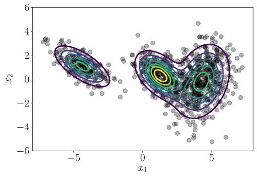
(a) GMM fit after 62 iterations.

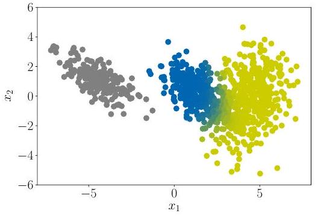
(b) 負担率に従って色付けされたデータセット。

### 11.4 潜在変数的な視点（Latent-Variable Perspective）

GMMを、離散的な**潜在変数モデル（latent-variable model）**の観点から見ることができます。すなわち、潜在変数 $\boldsymbol{z}$ が有限の集合の値のみを取ることができるモデルです。これは、潜在変数が $\mathbb{R}^{M}$ 内の連続値であったPCAとは対照的です。

確率的な視点の利点は、(i) 前のセクションで行ったいくつかのその場しのぎ（ad hoc）の決定を正当化できること、(ii) 負担率を事後確率として具体的に解釈できること、(iii) モデルパラメータを更新するための反復アルゴリズムを、潜在変数モデルにおける最大尤度パラメータ推定のためのEMアルゴリズムとして体系的な方法で導出できることです。

### 11.4.1 生成プロセスと確率モデル（Generative Process and Probabilistic Model）

GMMの確率モデルを導出するには、生成プロセス、すなわち確率モデルを用いてデータを生成することを可能にするプロセスについて考えるのが有益です。

$K$ 個のコンポーネントを持つ混合モデルを想定し、あるデータポイント $\boldsymbol{x}$ はちょうど1つの混合成分によって生成されると仮定します。そのデータポイントを $k$ 番目の混合成分が生成したかどうかを示す、2つの状態を持つバイナリのインジケータ変数 $z_{k} \in\{0,1\}$ を導入します（6.2節参照）。これにより、次のように書けます。

$$
p\left(\boldsymbol{x} \mid z_{k}=1\right)=\mathcal{N}\left(\boldsymbol{x} \mid \boldsymbol{\mu}_{k}, \boldsymbol{\Sigma}_{k}\right) .
$$

$\boldsymbol{z}:=\left[z_{1}, \ldots, z_{K}\right]^{\top} \in \mathbb{R}^{K}$ を、$K-1$ 個の 0 とちょうど1つの 1 からなる確率ベクトルとして定義します。例えば $K=3$ の場合、有効な $\boldsymbol{z}$ は $\boldsymbol{z}=\left[z_{1}, z_{2}, z_{3}\right]^{\top}=[0,1,0]^{\top}$ のようになり、これは $z_{2}=1$ であるため2番目の混合成分を選択することを意味します。

**備考：** この種の確率分布は、ベルヌーイ分布を2つ以上の値に一般化した「マルチヌーイ（multinoulli）」分布と呼ばれることもあります(Murphy, 2012)。

$\boldsymbol{z}$ の性質は $\sum_{k=1}^{K} z_{k}=1$ であることを意味します。したがって、$\boldsymbol{z}$ は**ワンホットエンコーディング（one-hot encoding）**（別名：1-of-K 表現）です。

これまでは、インジケータ変数 $z_{k}$ が既知であると仮定してきました。しかし、実際にはそうではなく、潜在変数 $\boldsymbol{z}$ に対して次のような**事前分布（prior distribution）**を置きます。

$$
p(\boldsymbol{z})=\boldsymbol{\pi}=\left[\pi_{1}, \ldots, \pi_{K}\right]^{\top}, \quad \sum_{k=1}^{K} \pi_{k}=1 .
$$

すると、この確率ベクトルの $k$ 番目の要素

$$
\pi_{k}=p\left(z_{k}=1\right)
$$

は、$k$ 番目の混合成分がデータポイント $\boldsymbol{x}$ を生成した確率を表します。

図 11.11 単一のデータポイントを持つGMMのグラフィカルモデル。

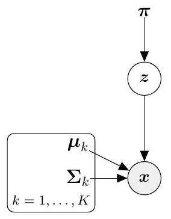

**備考（GMMからのサンプリング）：** この潜在変数モデルの構築（図11.11の対応するグラフィカルモデルを参照）は、データを生成するための非常に単純なサンプリング手順（生成プロセス）に適しています。

1. $z^{(i)} \sim p(\boldsymbol{z})$ をサンプリングする。
2. $\boldsymbol{x}^{(i)} \sim p\left(\boldsymbol{x} \mid z^{(i)}=1\right)$ をサンプリングする。

最初のステップでは、（ワンホットエンコーディング $\boldsymbol{z}$ を介して）$p(\boldsymbol{z})=\boldsymbol{\pi}$ に従って混合成分 $i$ をランダムに選択します。2番目のステップでは、対応する混合成分からサンプルを抽出します。潜在変数のサンプルを破棄して $\boldsymbol{x}^{(i)}$ だけを残すと、GMMからの有効なサンプルが得られます。確率変数のサンプルがグラフィカルモデルにおけるその変数の親のサンプルに依存するこのようなサンプリングは、**アンスエストラルサンプリング（ancestral sampling）**と呼ばれます。

一般に、確率モデルはデータと潜在変数の同時分布によって定義されます（8.4節参照）。(11.59)と(11.60)で定義された事前分布 $p(\boldsymbol{z})$ と、(11.58)の条件付き分布 $p(\boldsymbol{x} \mid \boldsymbol{z})$ を用いると、この同時分布の $K$ 個すべての成分は次のように得られます。

$$
p\left(\boldsymbol{x}, z_{k}=1\right)=p\left(\boldsymbol{x} \mid z_{k}=1\right) p\left(z_{k}=1\right)=\pi_{k} \mathcal{N}\left(\boldsymbol{x} \mid \boldsymbol{\mu}_{k}, \boldsymbol{\Sigma}_{k}\right)
$$

これを $k=1, \ldots, K$ についてまとめると、

$$
p(\boldsymbol{x}, \boldsymbol{z})=\left[\begin{array}{c}
p\left(\boldsymbol{x}, z_{1}=1\right) \\
\vdots \\
p\left(\boldsymbol{x}, z_{K}=1\right)
\end{array}\right]=\left[\begin{array}{c}
\pi_{1} \mathcal{N}\left(\boldsymbol{x} \mid \boldsymbol{\mu}_{1}, \boldsymbol{\Sigma}_{1}\right) \\
\vdots \\
\pi_{K} \mathcal{N}\left(\boldsymbol{x} \mid \boldsymbol{\mu}_{K}, \boldsymbol{\Sigma}_{K}\right)
\end{array}\right]
$$

となり、これで確率モデルが完全に指定されました。

### 11.4.2 尤度（Likelihood）

潜在変数モデルにおいて尤度 $p(\boldsymbol{x} \mid \boldsymbol{\theta})$ を得るには、潜在変数を周辺化（周辺消去）する必要があります（8.4.3節参照）。私たちのケースでは、(11.62)の同時分布 $p(\boldsymbol{x}, \boldsymbol{z})$ からすべての潜在変数を足し合わせることでこれを行うことができます。

$$
p(\boldsymbol{x} \mid \boldsymbol{\theta}) = \sum_{\boldsymbol{z}} p(\boldsymbol{x} \mid \boldsymbol{\theta}, \boldsymbol{z}) p(\boldsymbol{z} \mid \boldsymbol{\theta}), \quad \boldsymbol{\theta} := \left\{\boldsymbol{\mu}_{k}, \boldsymbol{\Sigma}_{k}, \pi_{k}: k=1, \ldots, K\right\} .
$$

ここでは、以前は省略していた確率モデルのパラメータ $\boldsymbol{\theta}$ を明示的に条件として付けています。(11.63)では、$\boldsymbol{z}$ のすべての可能なワンホットエンコーディングにわたって和を取っており、これを $\sum_{\boldsymbol{z}}$ で表しています。各 $\boldsymbol{z}$ には非ゼロの要素が1つしかないため、$\boldsymbol{z}$ の可能な構成/設定は $K$ 個しかありません。例えば $K=3$ の場合、$\boldsymbol{z}$ は次の構成を取り得ます。

$$
\left[\begin{l}
1 \\
0 \\
0
\end{l}\right], \left[\begin{l}
0 \\
1 \\
0
\end{l}\right], \left[\begin{l}
0 \\
0 \\
1
\end{l}\right] .
$$

(11.63)において $\boldsymbol{z}$ のすべての可能な構成にわたって和を取ることは、$\boldsymbol{z}$ ベクトルの非ゼロ要素に注目して次のように書くことと同等です。

$$
\begin{aligned}
p(\boldsymbol{x} \mid \boldsymbol{\theta}) & = \sum_{\boldsymbol{z}} p(\boldsymbol{x} \mid \boldsymbol{\theta}, \boldsymbol{z}) p(\boldsymbol{z} \mid \boldsymbol{\theta}) \\
& = \sum_{k=1}^{K} p\left(\boldsymbol{x} \mid \boldsymbol{\theta}, z_{k}=1\right) p\left(z_{k}=1 \mid \boldsymbol{\theta}\right)
\end{aligned}
$$

したがって、求める周辺分布は次のように与えられます。

$$
\begin{aligned}
p(\boldsymbol{x} \mid \boldsymbol{\theta}) & \stackrel{(11.65 \mathrm{~b})}{=} \sum_{k=1}^{K} p\left(\boldsymbol{x} \mid \boldsymbol{\theta}, z_{k}=1\right) p\left(z_{k}=1 \mid \boldsymbol{\theta}\right) \\
& = \sum_{k=1}^{K} \pi_{k} \mathcal{N}\left(\boldsymbol{x} \mid \boldsymbol{\mu}_{k}, \mathbf{\Sigma}_{k}\right)
\end{aligned}
$$

これは(11.3)のGMMモデルと同一であることがわかります。データセット $\mathcal{X}$ が与えられたとき、直ちに尤度が得られます。

$$
p(\mathcal{X} \mid \boldsymbol{\theta}) = \prod_{n=1}^{N} p\left(\boldsymbol{x}_{n} \mid \boldsymbol{\theta}\right) \stackrel{(11.66 \mathrm{~b})}{=} \prod_{n=1}^{N} \sum_{k=1}^{K} \pi_{k} \mathcal{N}\left(\boldsymbol{x}_{n} \mid \boldsymbol{\mu}_{k}, \boldsymbol{\Sigma}_{k}\right),
$$

これはまさに(11.9)のGMMの尤度です。したがって、潜在的なインジケータ $z_{k}$ を用いた潜在変数モデルは、ガウス混合モデルについて考えるための同等な方法です。

図 11.12 $N$ 個のデータポイントを持つGMMのグラフィカルモデル。

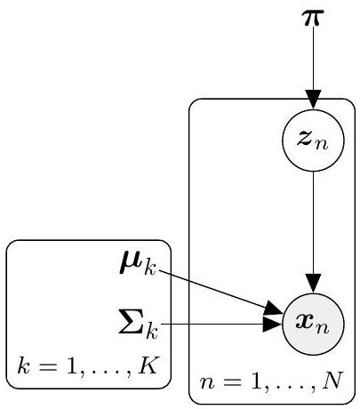

### 11.4.3 事後分布（Posterior Distribution）

潜在変数 $\boldsymbol{z}$ の事後分布について簡単に見てみましょう。ベイズの定理によれば、データポイント $\boldsymbol{x}$ を $k$ 番目のコンポーネントが生成した事後確率は次のようになります。

$$
p\left(z_{k}=1 \mid \boldsymbol{x}\right) = \frac{p\left(z_{k}=1\right) p\left(\boldsymbol{x} \mid z_{k}=1\right)}{p(\boldsymbol{x})},
$$

ここで周辺分布 $p(\boldsymbol{x})$ は(11.66b)で与えられます。これにより、$k$ 番目のインジケータ変数 $z_{k}$ の事後分布は次のように得られます。

$$
p\left(z_{k}=1 \mid \boldsymbol{x}\right) = \frac{p\left(z_{k}=1\right) p\left(\boldsymbol{x} \mid z_{k}=1\right)}{\sum_{j=1}^{K} p\left(z_{j}=1\right) p\left(\boldsymbol{x} \mid z_{j}=1\right)} = \frac{\pi_{k} \mathcal{N}\left(\boldsymbol{x} \mid \boldsymbol{\mu}_{k}, \boldsymbol{\Sigma}_{k}\right)}{\sum_{j=1}^{K} \pi_{j} \mathcal{N}\left(\boldsymbol{x} \mid \boldsymbol{\mu}_{j}, \boldsymbol{\Sigma}_{j}\right)},
$$

これは、データポイント $\boldsymbol{x}$ に対する $k$ 番目の混合成分の負担率（responsibility）として識別できます。ここでは、GMMのパラメータ $\pi_{k}, \boldsymbol{\mu}_{k}, \boldsymbol{\Sigma}_{k} (k=1, \ldots, K)$ に対する明示的な条件付けを省略していることに注意してください。

### 11.4.4 データセット全体への拡張（Extension to a Full Dataset）

これまでは、データセットが単一のデータポイント $\boldsymbol{x}$ のみからなる場合について議論してきました。しかし、事前分布と事後分布の概念は、$N$ 個のデータポイント $\mathcal{X}:=\left\{\boldsymbol{x}_{1}, \ldots, \boldsymbol{x}_{N}\right\}$ の場合に直接拡張できます。

GMMの確率的な解釈において、すべてのデータポイント $\boldsymbol{x}_{n}$ はそれぞれ独自の潜在変数を持っています。

$$
\boldsymbol{z}_{n} = \left[z_{n 1}, \ldots, z_{n K}\right]^{\top} \in \mathbb{R}^{K} .
$$

以前（単一のデータポイント $\boldsymbol{x}$ のみを考慮したとき）はインデックス $n$ を省略していましたが、ここではこれが重要になります。

すべての潜在変数 $\boldsymbol{z}_{n}$ に対して同じ事前分布 $\boldsymbol{\pi}$ を共有します。対応するグラフィカルモデルを図11.12に示します。ここではプレート表記（plate notation）を使用しています。

条件付き分布 $p\left(\boldsymbol{x}_{1}, \ldots, \boldsymbol{x}_{N} \mid \boldsymbol{z}_{1}, \ldots, \boldsymbol{z}_{N}\right)$ はデータポイントに関して因数分解され、次のように与えられます。

$$
p\left(\boldsymbol{x}_{1}, \ldots, \boldsymbol{x}_{N} \mid \boldsymbol{z}_{1}, \ldots, \boldsymbol{z}_{N}\right) = \prod_{n=1}^{N} p\left(\boldsymbol{x}_{n} \mid \boldsymbol{z}_{n}\right)
$$

事後分布 $p\left(z_{n k}=1 \mid \boldsymbol{x}_{n}\right)$ を得るには、11.4.3節と同じ論理に従ってベイズの定理を適用し、次を得ます。

$$
\begin{aligned}
p\left(z_{n k}=1 \mid \boldsymbol{x}_{n}\right) & = \frac{p\left(\boldsymbol{x}_{n} \mid z_{n k}=1\right) p\left(z_{n k}=1\right)}{\sum_{j=1}^{K} p\left(\boldsymbol{x}_{n} \mid z_{n j}=1\right) p\left(z_{n j}=1\right)} \\
& = \frac{\pi_{k} \mathcal{N}\left(\boldsymbol{x}_{n} \mid \boldsymbol{\mu}_{k}, \boldsymbol{\Sigma}_{k}\right)}{\sum_{j=1}^{K} \pi_{j} \mathcal{N}\left(\boldsymbol{x}_{n} \mid \boldsymbol{\mu}_{j}, \boldsymbol{\Sigma}_{j}\right)} = r_{n k}
\end{aligned}
$$

これは、$p\left(z_{k}=1 \mid \boldsymbol{x}_{n}\right)$ が「$k$ 番目の混合成分がデータポイント $\boldsymbol{x}_{n}$ を生成した」という（事後）確率であることを意味し、(11.17)で導入した負担率 $r_{n k}$ に対応します。これで、負担率は直感的なだけでなく、事後確率として数学的に正当化された解釈も得られたことになります。

### 11.4.5 EMアルゴリズム再訪（EM Algorithm Revisited）

最大尤度推定のための反復スキームとして導入したEMアルゴリズムは、潜在変数的な視点から体系的に導出することができます。モデルパラメータの現在の設定 $\boldsymbol{\theta}^{(t)}$ が与えられたとき、Eステップでは期待対数尤度を計算します。

$$
\begin{aligned}
Q\left(\boldsymbol{\theta} \mid \boldsymbol{\theta}^{(t)}\right) & = \mathbb{E}_{\boldsymbol{z} \mid \boldsymbol{x}, \boldsymbol{\theta}^{(t)}}[\log p(\boldsymbol{x}, \boldsymbol{z} \mid \boldsymbol{\theta})] \\
& = \int \log p(\boldsymbol{x}, \boldsymbol{z} \mid \boldsymbol{\theta}) p\left(\boldsymbol{z} \mid \boldsymbol{x}, \boldsymbol{\theta}^{(t)}\right) \mathrm{d} \boldsymbol{z}
\end{aligned}
$$

ここで、$\log p(\boldsymbol{x}, \boldsymbol{z} \mid \boldsymbol{\theta})$ の期待値は、潜在変数の事後分布 $p\left(\boldsymbol{z} \mid \boldsymbol{x}, \boldsymbol{\theta}^{(t)}\right)$ に関して取られます。Mステップでは、(11.73b)を最大化することによって更新されたモデルパラメータのセット $\boldsymbol{\theta}^{(t+1)}$ を選択します。

EMの反復は対数尤度を増加させますが、EMが最大尤度解に収束するという保証はありません。EMアルゴリズムが対数尤度の局所最大解に収束する可能性があります。不適切な局所最適解に陥るリスクを減らすために、複数のEM実行においてパラメータ $\boldsymbol{\theta}$ の異なる初期化を使用することができます。ここではこれ以上の詳細には踏み込みませんが、Rogers and Girolami (2016) や Bishop (2006) による優れた解説を参照してください。

### 11.5 さらに詳しく知るために（Further Reading）

GMMは、アンスエストラルサンプリング（Bishop, 2006）を用いて新しいデータを生成することが容易であるという意味で、**生成モデル（generative model）**と見なすことができます。与えられたGMMのパラメータ $\pi_{k}, \boldsymbol{\mu}_{k}, \boldsymbol{\Sigma}_{k} (k=1, \ldots, K)$ に対して、確率ベクトル $[\pi_{1}, \ldots, \pi_{K}]^{\top}$ からインデックス $k$ をサンプリングし、次にデータポイント $\boldsymbol{x} \sim \mathcal{N}\left(\boldsymbol{\mu}_{k}, \boldsymbol{\Sigma}_{k}\right)$ をサンプリングします。これを $N$ 回繰り返すと、GMMによって生成されたデータセットが得られます。図11.1はこの手順を使用して生成されました。

本章を通じて、コンポーネントの数 $K$ は既知であると仮定してきました。実際には、そうでない場合が多いです。しかし、8.6.1節で議論したように、ネステッド交差検証（nested cross-validation）を使用して適切なモデルを見つけることができます。

ガウス混合モデルは、$K$-means（$K$平均法）クラスタリングアルゴリズムと密接に関連しています。$K$-meansもまた、データポイントをクラスターに割り当てるためにEMアルゴリズムを使用します。GMMにおける平均をクラスターの中心として扱い、共分散を無視する（または $\boldsymbol{I}$ に設定する）と、$K$-meansに到達します。MacKay (2003) によっても詳しく説明されているように、$K$-meansはデータポイントをクラスター中心 $\boldsymbol{\mu}_{k}$ に「ハード」に割り当てるのに対し、GMMは負担率を介して「ソフト」な割り当てを行います。

本章ではGMMとEMアルゴリズムの潜在変数的な視点についてのみ触れました。EMは、一般的な潜在変数モデルのパラメータ学習に使用できることに注意してください。例えば、非線形状態空間モデル（Ghahramani and Roweis, 1999; Roweis and Ghahramani, 1999）や、Barber (2012) によって議論されている強化学習などが挙げられます。したがって、GMMの潜在変数的な視点は、対応する EMアルゴリズムを体系的に導出するのに役立ちます(Bishop, 2006; Barber, 2012; Murphy, 2012)。

GMMのパラメータを見つけるために、EMアルゴリズムを介した最大尤度（最尤）推定についてのみ議論しました。最大尤度法に対する標準的な批判は、ここでも当てはまります。

- 線形回帰と同様に、最大尤度法は深刻な**過学習（overfitting）**に陥る可能性があります。GMMの場合、これはある混合成分の平均がデータポイントと一致し、共分散が 0 に近づくときに発生します。このとき、尤度は無限大に近づきます。Bishop (2006) と Barber (2012) はこの問題を詳細に議論しています。
- パラメータ $\pi_{k}, \boldsymbol{\mu}_{k}, \boldsymbol{\Sigma}_{k} (k= 1, \ldots, K)$ の**点推定値（point estimate）**しか得られず、パラメータ値の不確実性を示すものは何も得られません。ベイズ的アプローチでは、パラメータに事前分布を置き、それを使用してパラメータの事後分布を得ます。この事後分布により、**モデル証拠（model evidence）**（周辺尤度）を計算でき、これをモデル比較に使用することで、混合成分の数を決定するための体系的な方法が得られます。残念ながら、このモデルには共役事前分布が存在しないため、この設定で解析的な推論を行うことは不可能です。しかし、**変分推論（variational inference）**などの近似手法を使用して、近似的な事後分布を得ることができます（Bishop, 2006）。

図 11.13 ヒストグラム（オレンジ色の棒）とカーネル密度推定（青色の線）。カーネル密度推定器は内在する密度の滑らかな推定値を生成するのに対し、ヒストグラムは単一のビン（bin）にいくつのデータポイント（黒点）が落ちるかを示す、平滑化されていないカウント尺度である。

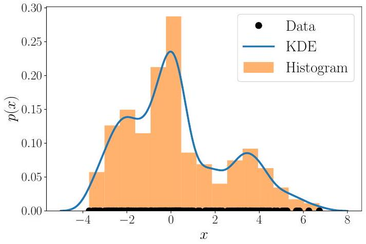

本章では、密度推定のための混合モデルについて議論しました。利用可能な密度推定技術は他にも数多く存在します。実際には、**ヒストグラム（histograms）**や**カーネル密度推定（kernel density estimation）**がしばしば使用されます。

ヒストグラムは、連続的な密度を表現するための非パラメトリックな方法を提供し、Pearson (1895) によって提案されました。ヒストグラムは、データ空間を「ビン（bin）」に分割し、各ビンにいくつのデータポイントが含まれるかをカウントすることによって構築されます。次に、各ビンの中心に棒が描かれ、棒の高さはそのビン内のデータポイントの数に比例します。ビンのサイズは重要なハイパーパラメータであり、不適切な選択は過学習や学習不足（アンダーフィッティング）につながる可能性があります。8.2.4節で議論したように、交差検証を使用して適切なビンサイズを決定できます。

Rosenblatt (1956) と Parzen (1962) によって独立に提案されたカーネル密度推定は、密度推定のための非パラメトリックな方法です。$N$ 個の i.i.d. サンプルが与えられたとき、カーネル密度推定器は内在する分布を次のように表現します。

$$
p(\boldsymbol{x}) = \frac{1}{N h} \sum_{n=1}^{N} k\left(\frac{\boldsymbol{x}-\boldsymbol{x}_{n}}{h}\right),
$$

ここで $k$ はカーネル関数（すなわち、積分すると 1 になる非負の関数）であり、$h > 0$ は平滑化パラメータ（またはバンド幅パラメータ）であり、ヒストグラムにおけるビンサイズと同様の役割を果たします。データセット内のすべてのデータポイント $\boldsymbol{x}_{n}$ にカーネルを配置することに注意してください。一般的に使用されるカーネル関数は一様分布やガウス分布です。カーネル密度推定はヒストグラムと密接に関連していますが、適切なカーネルを選択することで、密度推定値の滑らかさを保証できます。図11.13は、250個のデータポイントからなるデータセットに対する、ヒストグラムと（ガウス型カーネルを用いた）カーネル密度推定器の違いを示しています。
